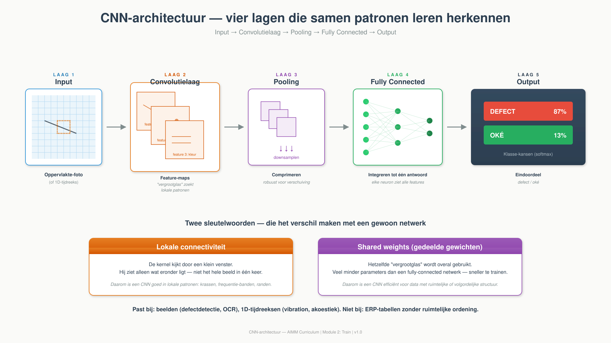

# Wat doet een CNN eigenlijk laag voor laag, en wanneer is het de juiste keuze voor een werkvloerprobleem?

Op steeds meer werkvloeren rijden vision-AI-camera's en trillingssensoren mee. Je ziet de uitkomst — rood/groen, een klassenlabel, een score — maar zonder model in je hoofd kun je het systeem niet bevragen. Wie weet wat een CNN doet, kan beter beoordelen waarom het wel iets ziet of juist niet. Dat is het verschil tussen gebruiker en sparringpartner.

## Wat leer je?

Je kunt de vier lagen van een CNN benoemen — input, convolutielaag, pooling, fully connected — en uitleggen wat elke laag doet. Daarna kun je in concrete werkvloersituaties beoordelen of een CNN passend is.

## De vier lagen, met een speurder als beeld

Stel je een speurder voor met een vergrootglas. Hij schuift het glas systematisch over een foto en zoekt streepjes, randen en krassen. Wat hij vindt, schrijft hij op een tweede vel — een kaart van patronen. Daarna zoekt iemand anders op die kaart de hoofdkenmerken bij elkaar en trekt een conclusie. Dat is precies wat een CNN doet, in vier stappen.

### 1. Input — wat krijgt het netwerk binnen?

Een foto, een trillingssignaal of een ander gestructureerd patroon. De data heeft een **lokale structuur**: pixels die naast elkaar zitten horen bij elkaar, samples die in de tijd dichtbij elkaar zitten ook.

### 2. Convolutielaag — kijken door een klein venster

Een **kernel** is dat vergrootglas. Het is een klein vakje (bijvoorbeeld 3x3 pixels) dat over de input schuift. Per stap kijkt het of er een bepaald patroon zit — een rand, een kras, een frequentiepiek. Wat het vindt, slaat het op in een **feature map**.

Twee technische termen die je vaker zult horen:

- **Lokale connectiviteit** — de kernel kijkt alleen naar wat dichtbij zit, niet naar het hele beeld tegelijk
- **Shared weights** — dezelfde kernel zoekt overal hetzelfde patroon, dus minder parameters om te trainen

Dit maakt CNN's snel én geschikt voor data met ruimtelijke of volgordelijke ordening — zoals pixels in een oppervlaktefoto of samples in een trillingssignaal.

### 3. Pooling — comprimeren wat je ziet

Pooling vat samen. Per blokje van bijvoorbeeld 2x2 wordt het sterkste signaal bewaard, de rest weggegooid. Het netwerk wordt zo robuust voor kleine verschuivingen — als de kras een paar pixels verschoven is, zie je 'm nog steeds.

### 4. Fully connected — alles samenbrengen tot één antwoord

Hier komen alle gevonden patronen bij elkaar. De fully connected laag werkt als een klassiek neuraal netwerk: input × gewichten → uitkomst. Het eindigt in een **uitkomst (output)**: bijvoorbeeld een klasse-label "kras", "deuk", of "geen defect", of een score tussen 0 en 1.

## Wanneer past een CNN — en wanneer niet?

CNN's werken goed bij data met lokale structuur. Vier voorbeelden van de werkvloer:

| Voorbeeld | Lokale structuur? | CNN passend? |
|---|---|---|
| Lasergravure-beeld voor kraskwaliteit | Ja, ruimtelijk | ✅ |
| Oppervlaktefoto van een gespoten plaat | Ja, ruimtelijk | ✅ |
| Vibratiesignaal van een lager (200 samples) | Ja, volgordelijk | ✅ |
| ERP-tabel met onderdeelnummer + leverdatum | Nee, geen ordening | ❌ |

Voor de eerste drie zoekt het netwerk lokale patronen — een rand, een trilling-piek. Voor een ERP-tabel werkt dit niet: een onderdeelnummer dat naast een leverdatum staat heeft geen "buurschap" in dezelfde zin. Voor zulke data zijn andere modellen geschikter, bijvoorbeeld een random forest.

### De vraag die je stelt

Voordat je akkoord gaat met een CNN-aanbod van een leverancier, kun je dit vragen:

> "Wat is de input — een beeld of een tijdreeks? En welk patroon wil je dat het systeem oppakt? Zit dat patroon op een specifieke plek, of overal?"

Als de leverancier daar geen helder antwoord op geeft, weet je dat de keuze voor een CNN nog niet doordacht is.

## Zelf zien gebeuren?

Twee extra hulpmiddelen om het concept tastbaar te maken — beide horen bij dit leerobject:

- **Video (~90 seconden):** zie hoe een 3×3 kernel systematisch over een lasergravure-beeld glijdt en de feature map vult. De video volgt dezelfde vier lagen die je hierboven hebt geleerd — maar dan in beweging. Bestand: `video/composition.tsx` (Remotion-project).
- **Interactief sorteerspel "Past CNN hier?":** zes datavoorbeelden van de werkvloer (beelden, tijdreeksen en tabellen). Klik per voorbeeld of CNN past, krijg directe feedback met uitleg. Bestand: `model-cnn-past-hier.jsx` (React-component).

Vraag je trainer welke variant in jouw sessie gebruikt wordt — papieren werkblad, video, of interactief sorteerspel. Ze sluiten allemaal aan op hetzelfde leerdoel.

## Na deze sessie

Kijk deze week op je eigen lijn — of bij een klant — waar een vision-AI of trillingsanalyse-systeem actief is. Vraag de leverancier of een IT-collega: gebruikt het systeem een CNN? Wat is de input, een beeld of een tijdreeks? Welk type defect herkent het, en welk juist niet? Schrijf de antwoorden op en koppel ze aan de vier lagen die je net hebt geleerd. Neem je notities mee naar de volgende bijeenkomst.

---

## Werkbladen (Kolb-cyclus)

1. [`wb-01-architectuur-invullen.md`](./werkbladen/wb-01-architectuur-invullen.md) — Architectuur invullen
2. [`wb-02-data-voorbeelden.md`](./werkbladen/wb-02-data-voorbeelden.md) — Data voorbeelden
3. [`wb-03-reflectie.md`](./werkbladen/wb-03-reflectie.md) — Reflectie
4. [`wb-04-actieplan.md`](./werkbladen/wb-04-actieplan.md) — Actieplan

## Verder

- Onderliggend kennisobject: [`ko-ai-fundamentals-cnn-001`](../../kennisbank/ai_fundamentals/neural_networks_conceptueel/ko-ai-fundamentals-cnn-001.md)
- Voor de begeleider: [`trainer.md`](./trainer.md) + [`draaiboek.md`](./draaiboek.md)
