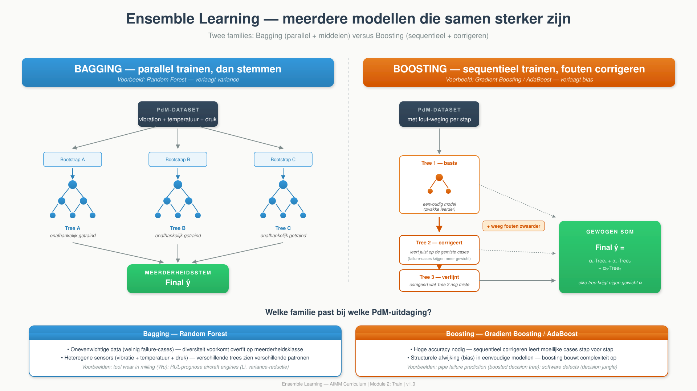

# Wanneer leveren meerdere modellen samen betere voorspellingen op dan één goed model?

PdM-data is bijna altijd onevenwichtig. Er zijn veel cycli waarin de machine prima draait en weinig waarin hij stuk gaat. Losse modellen leren dan vooral de meerderheidsklasse — "alles is goed" — en missen precies waar het om gaat: de uitval. Of het systeem nu een uitval moet classificeren of een **RUL** (Remaining Useful Life — hoeveel cycli de machine nog aankan) moet voorspellen, ensembles vangen die scheefheid beter op door meerdere modellen samen te laten beslissen.

## Wat leer je?

Je kunt uitleggen wat een ensemble is, het verschil benoemen tussen bagging en boosting, en herkennen wanneer een ensemble passend is voor een PdM-probleem.

## Wat is een ensemble?

Stel je drie ervaren onderhoudsmonteurs voor die naar dezelfde machine kijken. De een hoort iets aan het lager. De ander ziet trillingen op een sensor. De derde let op temperatuur. Apart komen ze tot verschillende conclusies. Maar samen — als ze stemmen of hun bevindingen middelen — komen ze meestal dichter bij de waarheid.

Dat is een ensemble: **meerdere modellen die samen één voorspelling vormen**. In de praktijk werkt dit verrassend goed bij PdM, omdat:

- Uitvaldata is schaars (weinig kapotte cases versus veel goede)
- Sensors zijn verschillend (vibratie, temperatuur, druk — heterogene signalen)
- Twijfelgevallen zijn precies de gevallen waarop één model vaak struikelt

In onderzoek leveren ensembles consequent betere RUL-voorspellingen dan losse algoritmen.

## Twee families: bagging en boosting

Niet elk ensemble werkt hetzelfde. Er zijn twee hoofdfamilies, elk geschikt voor een ander type probleem.

### Bagging — parallel, voor stabielere voorspellingen

Bij bagging train je meerdere modellen **onafhankelijk van elkaar**, elk op een iets andere subset van de data. Bij voorspellingen middel je hun uitkomsten of laat je ze stemmen. Het bekendste voorbeeld is **random forest** — een ensemble van decision trees.

- **Werkt vooral op:** verlagen van **variance** (instabiliteit van de voorspelling)
- **Goed bij:** heterogene sensors, klassieke classificatie of regressie
- **PdM-voorbeeld:** tool wear in milling, met een random forest die uitvalkans voorspelt

### Boosting — sequentieel, voor het wegwerken van fouten

Bij boosting train je modellen **na elkaar**, en elk volgend model probeert de fouten van de vorige te corrigeren. Het bekendste voorbeeld is **boosted decision trees** (bijvoorbeeld XGBoost, LightGBM).

- **Werkt vooral op:** verlagen van **bias** (systematische fout die het model altijd maakt)
- **Goed bij:** complexere patronen, sterk onevenwichtige data
- **PdM-voorbeeld:** pipe failure prediction met een boosted decision tree

### Het korte verschil

| | Bagging | Boosting |
|---|---|---|
| Hoe trainen? | Parallel, onafhankelijk | Sequentieel, fouten corrigeren |
| Wat lost het op? | Variance (instabiliteit) | Bias (systematische fout) |
| Voorbeeld | Random forest | Boosted decision trees |
| Goed bij | Heterogene data | Onevenwichtige data |

## Wanneer past een ensemble bij jouw PdM?

Drie vragen om te stellen voor je eigen toepassing:

1. **Heb je weinig failure-cases?** Een paar kapotte machines per jaar tegenover duizenden goede cycli? Dan is een ensemble bijna altijd beter dan een enkel model.
2. **Heb je heterogene sensors?** Trilling, temperatuur en stroom door elkaar? Bagging vangt die diversiteit goed op.
3. **Zijn jouw uitvalpatronen complex?** Verschillende oorzaken die op elkaar lijken? Boosting kan die nuances pakken.

Als je twee van de drie vragen met ja beantwoordt, is een ensemble waarschijnlijk een verstandige keuze.

> **Eén model gaat dan teleurstellen — niet omdat het algoritme zwak is, maar omdat de data te scheef is voor één leerder.**

## Zelf zien gebeuren?

Twee extra hulpmiddelen die bij dit leerobject horen — beide maken het ensemble-effect tastbaar:

- **Video (~90 seconden):** zie 5 modellen parallel stemmen (bagging) en daarna 3 modellen sequentieel elkaars fouten corrigeren (boosting). Eén foutje weggemiddeld door de groep. Bestand: `video/composition.tsx` (Remotion-project).
- **Interactief "Ensemble-stemming":** schuif het aantal modellen (1-15) en toggle tussen diverse en identieke modellen — zie hoe de ensemble-accuracy van 75% naar ~95% stijgt (mits diversiteit). Bestand: `model-ensemble-stemming.jsx`.

Vraag je trainer welke variant in jouw sessie gebruikt wordt.

## Na deze sessie

Kijk deze week of er op je eigen lijn — of bij een klant — een PdM-systeem actief is dat uitval voorspelt. Vraag IT of de leverancier: gebruikt het systeem een ensemble of een enkel model? Zo ja, is het bagging-style (random forest) of boosting-style (gradient boosting)? Hoeveel failure-cases zijn beschikbaar voor de training? Schrijf de antwoorden op. Bekijk daarnaast één keer een korte uitleg over random forest op YouTube — dan zie je letterlijk hoe meerdere decision trees samen stemmen.

---

## Werkbladen (Kolb-cyclus)

1. [`wb-01-diagnose-spel.md`](./werkbladen/wb-01-diagnose-spel.md) — Diagnose spel
2. [`wb-01-ervaren.md`](./werkbladen/wb-01-ervaren.md) — Ervaren
3. [`wb-02-reflecteren.md`](./werkbladen/wb-02-reflecteren.md) — Reflecteren
4. [`wb-02-reflectie.md`](./werkbladen/wb-02-reflectie.md) — Reflectie
5. [`wb-03-handout-bagging-boosting.md`](./werkbladen/wb-03-handout-bagging-boosting.md) — Handout bagging boosting
6. [`wb-03-theoretiseren.md`](./werkbladen/wb-03-theoretiseren.md) — Theoretiseren
7. [`wb-04-actieplan.md`](./werkbladen/wb-04-actieplan.md) — Actieplan
8. [`wb-04-experimenteren.md`](./werkbladen/wb-04-experimenteren.md) — Experimenteren

## Verder

- Onderliggend kennisobject: [`ko-ai-fundamentals-ensemble-001`](../../kennisbank/ai_fundamentals/machine_learning_basics/ko-ai-fundamentals-ensemble-001.md)
- Voor de begeleider: [`trainer.md`](./trainer.md) + [`draaiboek.md`](./draaiboek.md)
