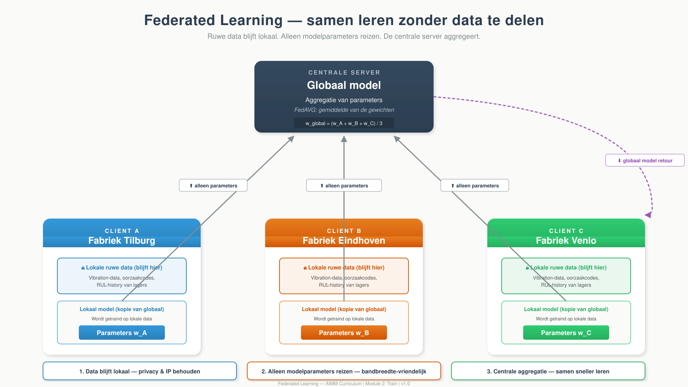

# Hoe kun je samen met andere fabrieken een AI-model verbeteren zonder dat jullie productiedata jullie muren verlaat?



Veel maakbedrijven willen samen sneller leren — zusterfabrieken, OEM-leveranciersketens, sectorgenoten met dezelfde machinetypes. Maar productiedata is gevoelig: het bevat concurrentievoordeel, persoonlijke data of fabrieks-IP. Federated learning verzoent beide werelden. Als je het concept kent, kun je in dat gesprek meedenken — en dat maakt het verschil aan tafel.


## Wat leer je?

Je kunt uitleggen wat federated learning is, hoe het verschilt van klassieke centrale ML-training, en in welke situatie het op je eigen werkvloer voordeel oplevert.

## Klassieke ML versus federated learning — het verschil

Bij klassieke machine learning gaat alle data naar één centrale plek. Daar wordt het model getraind. Daarna wordt het model uitgerold naar wie het nodig heeft.

```
Fabriek A ──┐
Fabriek B ──┼──> Centrale server ──> Getraind model ──> Iedereen
Fabriek C ──┘    (alle ruwe data)
```

Federated learning draait dat om. **De data blijft waar ze is.** Alleen het model — of liever: de modelparameters die het model heeft geleerd — reist heen en weer.

```
Fabriek A: lokaal trainen ──> alleen parameters ──┐
Fabriek B: lokaal trainen ──> alleen parameters ──┼──> Centrale server ──> Gemiddeld model
Fabriek C: lokaal trainen ──> alleen parameters ──┘    (aggregeert)        ──> Iedereen
```

## De drie kernkenmerken

Federated learning steunt op drie eigenschappen, en elk lost een ander probleem op:

### 1. Data blijft lokaal

Geen ruwe productiedata verlaat de fabriek. Geen privacy-zorgen, geen concurrentiegevoelige info naar buiten, geen IP-verlies.

### 2. Alleen modelparameters reizen

Wat verstuurd wordt, zijn de **gewichten** die het model heeft geleerd — getallen die bepalen hoe zwaar het model elk patroon meeweegt. Die gewichten bevatten de essentie van wat het model heeft geleerd, maar niet de oorspronkelijke data zelf. Veel kleiner pakketje, veel minder gevoelig.

### 3. Centrale server aggregeert

Een centrale server middelt de parameters van alle deelnemers tot één gemiddeld model. Dat model wordt teruggestuurd. Beperking om te onthouden: die server is een **single point of failure** — valt hij uit, dan ligt de samenwerking stil.

## Drie scenario's — past FL hier?

| Scenario | FL passend? | Waarom |
|---|---|---|
| Drie zusterfabrieken willen samen een PdM-model voor dezelfde lager-types | ⚠️ Soms | Hangt af van of de productiedata echt gevoelig is. Als de data niet gevoelig is, is een centrale aanpak eenvoudiger en goedkoper. |
| Edge-device op een mobiele kraan met beperkte 4G-bandbreedte | ✅ Ja | Ruwe data uploaden zou de verbinding overbelasten. Alleen parameters versturen werkt wel. |
| Lasrobot met productiedata die concurrentiegevoelig is | ✅ Ja | IP-bescherming staat centraal. Data mag de muren niet verlaten. |

Federated learning is dus geen wondermiddel voor élke samenwerking. Maar bij privacy, bandbreedte of IP-bescherming biedt het iets wat klassieke ML niet kan.

## Het gesprek dat je kunt voeren

Stel: er ligt een voorstel om met een zusterfabriek samen een AI-model te trainen, maar IT zegt nee tegen het delen van data. Tot nu toe was dat het einde van het gesprek. Nu kun je vragen:

> "Kennen we federated learning? We zouden samen een model kunnen trainen zonder dat onze ruwe data het pand verlaat. Past dat bij onze data-strategie?"

Vaak ontdek je dan dat de IT-afdeling het concept wel kent, of dat een leverancier het al kan ondersteunen.

## Zelf zien gebeuren?

Een extra hulpmiddel bij dit leerobject — maakt het federated leren visueel:

- **Video (~91 seconden):** een korte explainer die in 5 scenes laat zien hoe federated learning werkt — drie fabrieken, het probleem met centrale data-verzameling, lokaal leren (data blijft thuis), aggregatie van alleen modelparameters, en een concrete PdM-toepassing (drie fabrieken leren samen pomp-anomalieën). Bestand: `video/composition.tsx` (Remotion-project).

Vraag je trainer of dit in jouw sessie gebruikt wordt.

## Na deze sessie

Zoek deze week één concrete situatie in je eigen organisatie of bij een klant waar productiedata om privacy- of IP-redenen niet centraal verzameld kan worden. Beschrijf in vijf zinnen: welke data het betreft, met wie samenwerking zinvol zou zijn, welk modeldoel je zou nastreven, of FL hier passend is, en wie binnen de organisatie hierover gaat (IT, management, productie). Praat er deze week één keer over met een collega van IT of de data-afdeling: *"Ik leerde over federated learning — kennen jullie het concept, en zien jullie het in onze data-strategie?"* Je krijgt vaak verrassend snel zicht op hoe je organisatie er nu over denkt.

---

## Werkbladen (Kolb-cyclus)

1. [`wb-01-theoretiseren.md`](./werkbladen/wb-01-theoretiseren.md) — Theoretiseren
2. [`wb-01-vergelijkingsschema.md`](./werkbladen/wb-01-vergelijkingsschema.md) — Vergelijkingsschema
3. [`wb-02-ervaren.md`](./werkbladen/wb-02-ervaren.md) — Ervaren
4. [`wb-02-scenarios.md`](./werkbladen/wb-02-scenarios.md) — Scenarios
5. [`wb-03-reflecteren.md`](./werkbladen/wb-03-reflecteren.md) — Reflecteren
6. [`wb-03-reflectie.md`](./werkbladen/wb-03-reflectie.md) — Reflectie
7. [`wb-04-actieplan.md`](./werkbladen/wb-04-actieplan.md) — Actieplan
8. [`wb-04-experimenteren.md`](./werkbladen/wb-04-experimenteren.md) — Experimenteren

## Verder

- Onderliggend kennisobject: [`ko-ai-fundamentals-fl-001`](../../kennisbank/ai_fundamentals/machine_learning_basics/ko-ai-fundamentals-fl-001.md)
- Voor de begeleider: [`trainer.md`](./trainer.md) + [`draaiboek.md`](./draaiboek.md)
