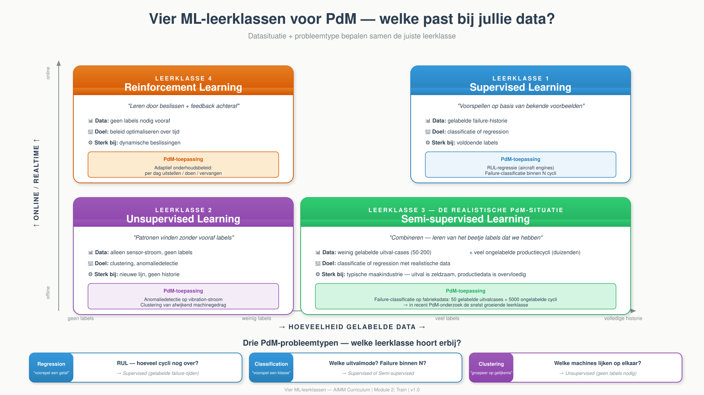

# Welke vorm van AI-leren past bij de data die jullie feitelijk in huis hebben?

Of een AI/PdM-project bij jou kan starten, hangt direct af van wat voor data je hebt. Een leverancier die zegt "wij doen supervised regression voor RUL" verwacht dat jij gelabelde uitvalhistorie levert. Heb je die niet, dan is het project dood voor het begint. Wie de vier leerklassen herkent, kan een leveranciersgesprek leiden in plaats van ondergaan.

## Wat leer je?

Je kunt de vier ML-leerklassen benoemen — supervised, unsupervised, semi-supervised, reinforcement — en uitleggen welke leerklasse past bij welke datasituatie. Daarna kun je beoordelen welke combinatie past bij je eigen PdM-toepassing.

## De vier leerklassen op een rij

Het verschil tussen leerklassen draait om één vraag: **welke data heb je beschikbaar?**

### 1. Supervised — gelabelde data

Je hebt voorbeelden waarvan je weet wat het juiste antwoord is. Bijvoorbeeld: vijf jaar uitvalhistorie waarbij elke uitval een type heeft gekregen (lager, motor, koeling).

- **Datasituatie:** veel gelabelde voorbeelden
- **PdM-toepassing:** RUL-voorspelling (regressie), uitvalmode-classificatie
- **Meest accuraat — als je de labels hebt**

### 2. Unsupervised — geen labels nodig

Je hebt veel data, maar weet niet wat de juiste antwoorden zijn. Het systeem zoekt zelf naar patronen of clusters.

- **Datasituatie:** veel data zonder labels
- **PdM-toepassing:** clustering van afwijkende gedragingen, anomaliedetectie zonder bekende failure-modes
- **Goed voor exploratie — geen kant-en-klare voorspelling**

### 3. Semi-supervised — een paar labels, veel zonder

De meest realistische situatie in de praktijk: je hebt 50 gelabelde uitvalcases en 5000 ongelabelde cycli. Het systeem leert van allebei.

- **Datasituatie:** weinig labels, veel data
- **PdM-toepassing:** classificatie waar labelen duur is
- **Recent populair in PdM-onderzoek**

### 4. Reinforcement — leren door te doen

Het systeem neemt continu beslissingen en krijgt feedback op elke keuze (goed/fout, beter/slechter). Daarmee verbetert het zichzelf.

- **Datasituatie:** continue beslissingen met meetbare gevolgen
- **PdM-toepassing:** adaptieve onderhoudsplanning (uitstellen, doen, vervangen)
- **Online leren — niet offline trainen.** Online betekent: het systeem leert terwijl het werkt, niet van een vastgelegde dataset.

## Drie PdM-probleemtypen — welke leerklasse hoort erbij?

| PdM-probleem | Wat is gevraagd? | Welke leerklasse? |
|---|---|---|
| **Classification** | Wat voor uitval is dit? | Supervised (labels nodig) |
| **Regression** | Hoeveel cycli tot uitval (RUL)? | Supervised (labels nodig) |
| **Clustering** | Welke patronen zitten er in onze data? | Unsupervised (geen labels) |

De keuze begint dus altijd bij twee vragen: **wat wil je voorspellen, en welke labels heb je?**

## Vier scenario's, vier keuzes

Voor elk scenario staat de juiste leerklasse erbij, en de denkstap waarom.

| Scenario | Leerklasse | Waarom |
|---|---|---|
| 5 jaar uitvalhistorie + duidelijke failure-labels, RUL voorspellen | Supervised | Veel gelabelde data + getal voorspellen → regressie |
| Geen uitvalhistorie, veel sensordata, afwijkende patronen vinden | Unsupervised | Geen labels → patronen vinden = clustering |
| 50 gelabelde uitvalcases + 5000 ongelabelde cycli, classificeren | Semi-supervised | Combinatie van labels en geen labels |
| Continu beslissen over onderhoud (uitstellen, doen, vervangen) | Reinforcement | Online beslissen met meetbare gevolgen |

## Wat dit betekent voor jouw project

De praktische volgorde voor elke nieuwe AI/PdM-toepassing:

1. **Inventariseer je data** — heb je gelabelde uitvalhistorie, of niet?
2. **Bepaal je probleemtype** — wat wil je voorspellen of vinden?
3. **Kies je leerklasse** — op basis van bovenstaande tabel
4. **Toets de aanbieding** — past de aanpak van de leverancier bij jouw datasituatie?

Vaak ontdek je in stap 1 dat de data niet zo systematisch is bijgehouden als gedacht. Dat is geen mislukking — dat is precies de eerste stap van elk AI-project. Dan weet je: data verzamelen of structureren komt eerst, modeltraining tweede. Soms vind je informatie in vrije tekstvelden in het ERP-systeem (het computersysteem voor bedrijfsprocessen), maar niet bruikbaar gestructureerd.

## Na deze sessie

Onderzoek deze week één concrete vraag binnen je eigen organisatie: hoeveel gelabelde uitvalhistorie hebben jullie werkelijk? Vraag bij onderhoud, IT of kwaliteit: registreren we systematisch failure-events met datum, machine en oorzaak? Hoeveel cases zijn beschikbaar over de afgelopen 1 tot 3 jaar? Is de oorzaak gecategoriseerd? Schrijf op wat je vindt en koppel het aan een passende leerklasse uit deze sessie. Praat er ook even over met een onderhoudscollega: *"Houden wij eigenlijk systematisch bij waarom een machine stuk gaat?"* Vaak zit de informatie wel ergens — in logboeken, ERP-vrije tekstvelden — maar niet bruikbaar gestructureerd. Dat is een waardevolle ontdekking voor elk AI-project.

---

## Werkbladen (Kolb-cyclus)

1. [`wb-01-ervaren.md`](./werkbladen/wb-01-ervaren.md) — Ervaren
2. [`wb-02-reflecteren.md`](./werkbladen/wb-02-reflecteren.md) — Reflecteren
3. [`wb-03-theoretiseren.md`](./werkbladen/wb-03-theoretiseren.md) — Theoretiseren
4. [`wb-04-experimenteren.md`](./werkbladen/wb-04-experimenteren.md) — Experimenteren

## Verder

- Onderliggend kennisobject: [`ko-ai-fundamentals-ml-001`](../../kennisbank/ai_fundamentals/supervised_vs_unsupervised/ko-ai-fundamentals-ml-001.md)
- Voor de begeleider: [`trainer.md`](./trainer.md) + [`draaiboek.md`](./draaiboek.md)
