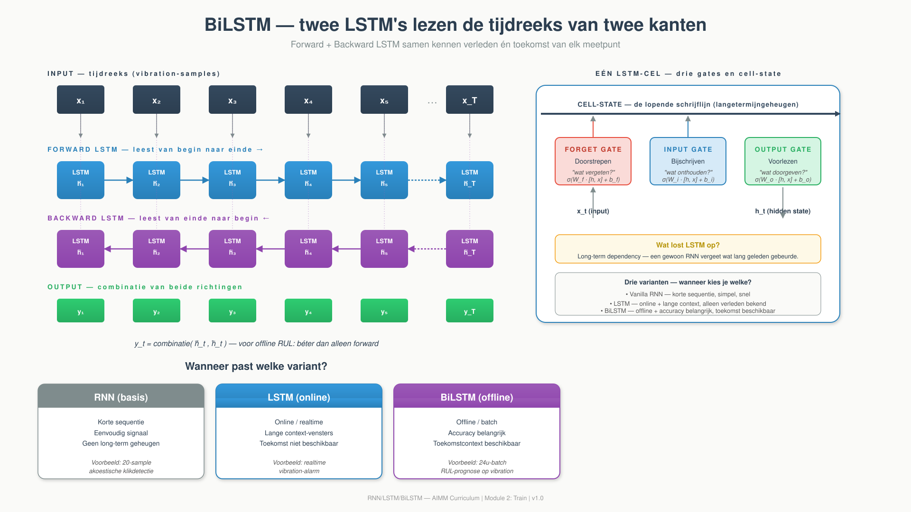

# Hoe kan een AI-model rekening houden met wat eerder gebeurde, en wanneer kies je welke variant?

Veel PdM-systemen op de werkvloer analyseren niet één meetwaarde maar een venster van tientallen tot honderden samples — een tijdreeks. Dat venster kan het systeem verwerken met een RNN, LSTM of BiLSTM. De keuze bepaalt hoe het model omgaat met lange patronen en realtime-eisen. Wie het onderscheid kent, kan beter interpreteren waarom een PdM-systeem soms te laat alarmeert.

## Wat leer je?

Je kunt uitleggen waarom een RNN-familie nodig is voor tijdreeks-data, het verschil benoemen tussen vanilla RNN, LSTM en BiLSTM, en beoordelen welke variant past bij een gegeven scenario.

## Waarom geheugen nodig is

Klassieke neurale netwerken — een feedforward netwerk (één richting, geen geheugen) of een CNN met vast venster — verwerken samples min of meer onafhankelijk. Voor een foto is dat prima. Voor trillingsdata van een lager dat langzaam slechter wordt is dat een probleem: het patroon zit in **de volgorde** van de samples, niet in een enkel meetpunt.

Een trillingsamplitude van 3,4 zegt niets als je niet weet wat de waarde was van de honderd samples ervoor. Recurrent netwerken lossen dit op door **geheugen** in te bouwen: bij elk nieuw sample neemt het netwerk informatie uit het verleden mee.

## Drie varianten — vergelijken via een schrift

Stel je een schrift voor waarin een onderhoudsmonteur per uur aantekeningen maakt over een machine. Dat schrift is je tijdreeks. Hoe ga je ermee om?

### Vanilla RNN — schrijf alleen op wat er net gebeurde

Een vanilla RNN onthoudt steeds het laatste stukje. Het probleem: bij lange tijdreeksen vergeet het systeem wat er aan het begin gebeurde. Dat heet het **probleem van lange afhankelijkheden** (long-term dependency): het netwerk vergeet wat er lang geleden in de reeks gebeurde. Een trend over duizend samples? Vergeet het.

- **Wat lost het op:** kortetermijn-patronen
- **Beperking:** kan geen lange afhankelijkheden onthouden
- **Use-case:** korte sequenties, simpele patronen
- **Online of offline:** beide

### LSTM — drie soorten markeringen in het schrift

Een LSTM is een RNN-variant met **drie gates** die per timestep beslissen wat er met de informatie gebeurt:

1. **Forget gate** — wat doorstrepen (vergeten)?
2. **Input gate** — wat erbij schrijven (toevoegen)?
3. **Output gate** — wat voorlezen (doorgeven naar de volgende stap)?

Daarmee kan het netwerk lange afhankelijkheden wél onthouden. Het is de werkpaard-variant voor de meeste PdM-tijdreeksen.

- **Wat lost het op:** long-term dependencies
- **Use-case:** middellange tot lange sequenties, online + offline
- **Standaardkeuze voor PdM**

### BiLSTM — twee mensen lezen het schrift, één van voor naar achter, één van achter naar voor

Een BiLSTM zet twee LSTM's parallel: de ene leest van begin naar eind, de andere van eind naar begin. Beide brengen informatie samen. Dit voegt **toekomstcontext** toe — handig als je een sample wilt beoordelen met kennis van wat erna kwam.

- **Wat lost het op:** beide kanten van de tijdreeks meewegen
- **Use-case:** offline batch-analyse, hoge accuracy
- **Beperking:** werkt niet voor realtime/online — je hebt geen toekomst beschikbaar

## Wanneer welke variant?

Twee vragen bepalen meestal de keuze:

1. **Online of offline?** Realtime alarm of achteraf analyseren?
2. **Hoe lang is je context-venster?** Tientallen samples of duizenden?

| Scenario | Variant | Waarom |
|---|---|---|
| Online vibration-monitoring, alarm binnen seconden | LSTM | Online + middellange context, geen toekomst beschikbaar |
| Offline batch-analyse van 24 uur vibration voor RUL | BiLSTM | Offline + lange context = toekomst meewegen mag |
| Korte signaalclassificatie op 20-sample window | RNN of LSTM | Kort + simpel — vanilla RNN kan al voldoen |

## Wat dit betekent voor jouw werkvloer

Twee voorbeelden:

- Als jouw PdM-systeem soms "te laat" alarmeert, kan het zijn dat het venster te kort is — een LSTM met groter venster zou eerder een trend zien.
- Als de offline RUL-analyse van vorige maand veel preciezer was dan het realtime-systeem, ligt dat vaak aan het verschil LSTM (online) versus BiLSTM (offline). Logisch — bij offline mag je vooruit kijken.

## Zelf zien gebeuren?

Een extra hulpmiddel bij dit leerobject — maakt het geheugen-mechanisme visueel zichtbaar:

- **Video (~91 seconden):** een korte explainer die in 5 scenes laat zien hoe RNN, LSTM en BiLSTM werken — sensorsignaal over tijd, RNN unrolled met doorgegeven geheugen, LSTM-gates als drie sluizen (forget/input/output), BiLSTM bidirectioneel, en een PdM-toepassing op pomp-vibratie met aanloop én nasleep in beeld. Bestand: `video/composition.tsx` (Remotion-project).

Vraag je trainer of dit in jouw sessie gebruikt wordt.

## Na deze sessie

Kijk deze week of er op je eigen lijn — of bij een klant — een PdM- of monitoringsysteem actief is dat tijdreeks-data analyseert. Vraag bij IT of de leverancier: hoe lang is het context-venster (aantal samples)? Is het systeem realtime/online of analyseert het achteraf in batch? Is bekend welke modelfamilie gebruikt wordt — RNN, LSTM of BiLSTM? Schrijf de antwoorden op en koppel ze aan de keuzetabel. Praat er deze week ook even over met een collega die met dezelfde tijdreeksen werkt: *"Vinden wij dat ons PdM-systeem snel genoeg alarmeert, of liever preciezer en achteraf?"* Dat gesprek toont hoe de keuze tussen LSTM en BiLSTM ook een organisatie-keuze is.

---

## Werkbladen (Kolb-cyclus)

1. [`wb-01-theoretiseren.md`](./werkbladen/wb-01-theoretiseren.md) — Theoretiseren
2. [`wb-01-vergelijkingstabel.md`](./werkbladen/wb-01-vergelijkingstabel.md) — Vergelijkingstabel
3. [`wb-02-ervaren.md`](./werkbladen/wb-02-ervaren.md) — Ervaren
4. [`wb-02-scenarios.md`](./werkbladen/wb-02-scenarios.md) — Scenarios
5. [`wb-03-reflecteren.md`](./werkbladen/wb-03-reflecteren.md) — Reflecteren
6. [`wb-03-reflectie.md`](./werkbladen/wb-03-reflectie.md) — Reflectie
7. [`wb-04-actieplan.md`](./werkbladen/wb-04-actieplan.md) — Actieplan
8. [`wb-04-experimenteren.md`](./werkbladen/wb-04-experimenteren.md) — Experimenteren

## Verder

- Onderliggend kennisobject: [`ko-ai-fundamentals-rnn-001`](../../kennisbank/ai_fundamentals/neural_networks_conceptueel/ko-ai-fundamentals-rnn-001.md)
- Voor de begeleider: [`trainer.md`](./trainer.md) + [`draaiboek.md`](./draaiboek.md)
