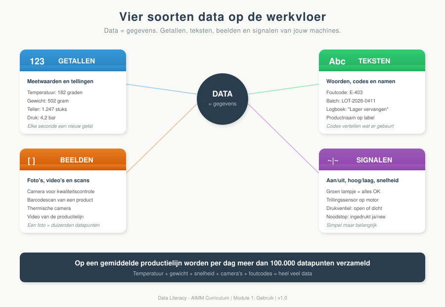

# Wat is data eigenlijk, en waar zit het op jouw werkvloer?

Je werkt elke dag met data, ook als je het niet zo noemt. Een temperatuurmeting, een teller op het scherm, een foutcode in het logboek — het zijn allemaal datapunten. Als je weet wat data is en waar het zit, kun je betere beslissingen nemen op je werkplek.

## Wat leer je?

Je kunt uitleggen wat data is en je benoemt minstens drie voorbeelden van data op je eigen werkvloer. Bij elk voorbeeld kun je de soort data benoemen.

## Wat is data?

Data is informatie in een vorm die je kunt opslaan, doorgeven of analyseren. Op de werkvloer komt data in vier soorten voor:

1. **Getallen** — temperaturen, snelheden, aantallen, drukmetingen
2. **Tekst** — foutmeldingen, ploegenoverdracht-notities, logboek-aantekeningen
3. **Beelden** — camerabeelden, foto's van defecten, scans van producten
4. **Signalen** — trillingen, geluid, stroomverbruik over de tijd

Elke meter, elk scherm, elke melding op je werkplek levert één van deze vier soorten op.

## Voorbeelden van je eigen werkvloer

Stel je een rondgang voor langs een gemiddelde productielijn. Wat zie je?

- Het **HMI-scherm** toont productieaantallen — getallen
- De **temperatuursensor** op de oven toont de huidige temperatuur — een getal
- Het **logboek** vermeldt waarom de lijn vanmorgen 20 minuten stilstond — tekst
- De **inspectiecamera** maakt foto's van elk product — beelden
- De **trillingssensor** op het lager registreert hoe het draait — een signaal

Allemaal data. Allemaal bruikbaar als je weet hoe je ernaar moet kijken.

## Waarom dit telt

Veel operators zien al die meters en schermen als "iets van IT" of "iets voor onderhoud". Maar in werkelijkheid:

- **Jij** ziet de afwijkingen het eerst
- **Jij** weet wanneer een meter rare waarden geeft
- **Jij** kunt patronen herkennen die geen ander ziet

Als je data herkent als data, wordt het bruikbaar. Dan stel je niet alleen vast dát er iets raars gebeurt — je weet ook welke meting dat verraadt.

### Een korte test

Loop in gedachten door je werkplek. Hoeveel datapunten zie je per uur? Een gemiddelde lijn levert er **honderden tot duizenden** per uur op. Schrijf eens vijf op die je vaak ziet maar nooit "data" hebt genoemd.

## Na deze sessie

Kies deze week een machine of werkplek waar je vaak komt. Zoek daar bewust naar data. Tel de datapunten per uur. Schrijf op welke soorten data je vindt — getal, tekst, beeld of signaal. Neem je notities mee naar het volgende groepsmoment, en als het kan een foto van een scherm of meter. Let de rest van de week ook bij elke storingsmelding of foutcode op: dat is óók data.

---

## Werkbladen (Kolb-cyclus)

1. [`wb-01-ervaren.md`](./werkbladen/wb-01-ervaren.md) — Ervaren
2. [`wb-02-reflecteren.md`](./werkbladen/wb-02-reflecteren.md) — Reflecteren
3. [`wb-03-theoretiseren.md`](./werkbladen/wb-03-theoretiseren.md) — Theoretiseren
4. [`wb-04-experimenteren.md`](./werkbladen/wb-04-experimenteren.md) — Experimenteren

## Verder

- Onderliggend kennisobject: [`ko-data-lit-101`](../../kennisbank/data_literacy/data_begrippen/ko-data-lit-101.md)
- Voor de begeleider: [`trainer.md`](./trainer.md) + [`draaiboek.md`](./draaiboek.md)
- Interactief: [`interactive/model.html`](./interactive/model.html)
