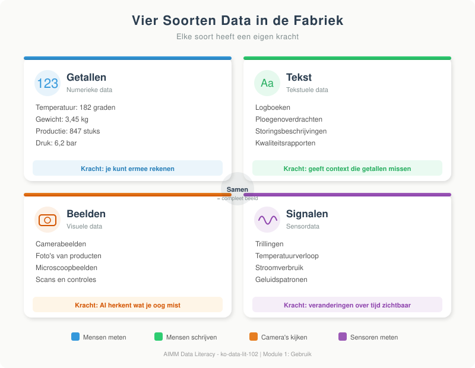

# Welke soorten data komen er voor op jouw werkplek, en wat kun je ermee?

Op elke productielijn komen meerdere soorten data samen. Als je weet welke soorten er zijn, begrijp je beter wat dashboards en rapporten je vertellen — en kun je gerichter meedenken over verbeteringen.

## Wat leer je?

Je kunt de vier soorten data in de fabriek benoemen en herkennen op je eigen werkplek. Bij je eigen machine kun je minstens twee soorten aanwijzen.

## De vier soorten

### 1. Getallen

Alles wat je in cijfers kunt uitdrukken. Op je werkplek kom je dat overal tegen:

- Productieaantal per uur
- Temperatuur van een oven
- Snelheid van een lopende band
- Drukwaarde in een hydrauliek-systeem
- Afkeurpercentage per dienst

Getallen zijn de meest gebruikte soort. Ze zijn makkelijk te vergelijken en te middelen.

### 2. Tekst

Alles wat in woorden staat — vaak ingevuld door mensen.

- Foutmeldingen op het scherm
- Ploegenoverdracht-notities
- Logboeken bij onderhoud
- Klachten van klanten

Tekstdata is rijk aan context, maar lastiger automatisch te analyseren. Vaak zit er waardevolle informatie in die niemand systematisch leest.

### 3. Beelden

Foto's en video van het productieproces.

- Inspectiecamera's die elk product fotograferen
- Scans van een serienummer
- Beelden van een robotcel
- Thermische camera-opnames

Beelden zijn handig voor visuele controle, maar nemen veel ruimte in beslag. AI-systemen kunnen ze tegenwoordig automatisch beoordelen.

### 4. Signalen

Een **signaal** is een meting die continu doorgaat in de tijd. Anders dan een los getal: het is een hele reeks getallen achter elkaar.

- Trillingen van een lager (honderden samples per seconde)
- Geluid van een machine
- Stroomverbruik over de tijd
- Drukverloop tijdens een persgang

Signalen vertellen je niet alleen wat er nu is, maar ook hoe het verloopt. Daar zitten patronen in die een los getal mist.

## Het overzicht

| Soort | Voorbeeld | Sterkste in |
|---|---|---|
| Getallen | Temperatuur, productieaantal | Vergelijken, doelwaarden |
| Tekst | Foutmelding, logboek | Context, oorzaak-zoeken |
| Beelden | Inspectiefoto, camerabeeld | Visuele kwaliteit |
| Signalen | Trillingen, geluid | Patronen over de tijd |

## Waarom dit verschil ertoe doet

De meeste dashboards laten alleen getallen zien. Maar als jouw machine vooral signalen produceert (zoals trillingen), mis je de helft van het verhaal als je alleen naar de getallen-samenvatting kijkt.

Voorbeeld: een lager heeft een trillingsamplitude van 3,2. Dat getal staat groen op het dashboard. Maar het signaal zelf laat zien dat de trilling de afgelopen 24 uur langzaam stijgt. Het getal vandaag is OK. De trend niet.

Dat verschil — getal versus signaal — bepaalt of je een probleem op tijd ziet of pas als de machine stilstaat.

## Na deze sessie

Inventariseer deze week welke soorten data er zijn bij jouw machine. Schrijf per soort een voorbeeld op:

- Welk **getal** zie je het vaakst?
- Welke **tekst** komt langs in logboeken of ploegenoverdracht?
- Welke **beelden** worden gemaakt — door wie en hoe vaak?
- Welk **signaal** wordt continu gemeten?

Bespreek je inventarisatie in de volgende sessie met je leergroep. Let de komende dagen extra op ploegenoverdrachten: welke soorten data komen daarin voor, en welke ontbreken?

---

## Werkbladen (Kolb-cyclus)

1. [`wb-01-ervaren.md`](./werkbladen/wb-01-ervaren.md) — Ervaren
2. [`wb-02-reflecteren.md`](./werkbladen/wb-02-reflecteren.md) — Reflecteren
3. [`wb-03-theoretiseren.md`](./werkbladen/wb-03-theoretiseren.md) — Theoretiseren
4. [`wb-04-experimenteren.md`](./werkbladen/wb-04-experimenteren.md) — Experimenteren

## Verder

- Onderliggend kennisobject: [`ko-data-lit-102`](../../kennisbank/data_literacy/data_begrippen/ko-data-lit-102.md)
- Voor de begeleider: [`trainer.md`](./trainer.md) + [`draaiboek.md`](./draaiboek.md)
- Interactief: [`interactive/model.html`](./interactive/model.html)
