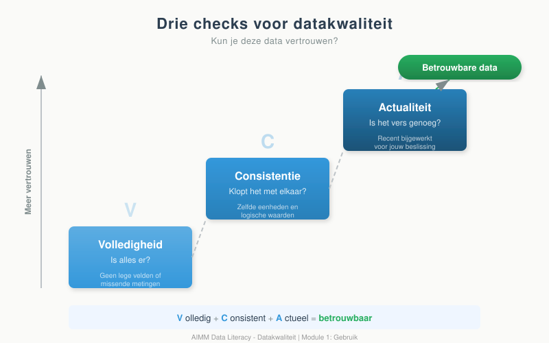

# Hoe weet je of je data kunt vertrouwen?

Op je werkvloer staan dashboards en productieschermen waar je beslissingen op baseert. Wat zou er gebeuren als die data niet klopt? Dan klopt je beslissing ook niet. Met drie simpele checks voorkom je dat.

## Wat leer je?

Je kunt de drie checks toepassen — volledigheid, consistentie en actualiteit — om te beoordelen of een dataset betrouwbaar is.

## De VCA-check

Onthoud het kort: **VCA**. Drie letters, drie controles. Voor je een beslissing neemt op basis van data, loop je deze drie kort langs.

### V — Volledigheid: zijn alle velden ingevuld?

Een productietabel met lege rijen is een waarschuwing. Als de operator van de nachtploeg vergat het logboek bij te werken, mis je drie ploegen aan informatie. Beslis je op basis van het lege veld, dan beslis je op basis van iets wat er niet is.

**Vraag:** *Zitten er lege cellen of ontbrekende dagen in deze data?*

Voorbeeld: een afkeurtabel toont maandag 2%, dinsdag leeg, woensdag 4%. Conclusie zonder check: het loopt op. Conclusie mét check: dinsdag mist — misschien stond de lijn stil, misschien werd het vergeten. Eerst uitzoeken.

### C — Consistentie: kloppen de waarden met elkaar?

Soms zijn alle velden ingevuld, maar de getallen zijn onlogisch. Een temperatuur van -5 °C in een oven die op 200 °C hoort te staan. Een productieaantal dat op de teller hoger is dan de capaciteit van de lijn. Dat zijn signalen dat er iets mis is met de meting of de invoer.

**Vraag:** *Zijn er waarden die niet kunnen kloppen, of die elkaar tegenspreken?*

Voorbeeld: het MES toont 1200 stuks geproduceerd, maar de teller op de machine staat op 800. Eén van de twee klopt niet. Voor je gaat rapporteren: uitzoeken waar het verschil zit.

### A — Actualiteit: hoe oud is deze data?

Een dashboard dat ververst werd om 06:00 vanmorgen geeft je geen beeld van wat er nu gebeurt. Bij een lijn die elke vijf minuten verandert, is data van vier uur oud waardeloos voor realtime-beslissingen.

**Vraag:** *Wanneer is deze data voor het laatst bijgewerkt?*

Voorbeeld: je ziet een storing-status "actief" op het scherm. Het tijdstip in de hoek van het scherm staat op 04:32. Het is nu 11:00. Die status is mogelijk al uren voorbij. Niet betrouwbaar voor een acute beslissing.

## De drie samen

| Check | Vraag | Wat je zoekt |
|---|---|---|
| **V**olledigheid | Zijn alle velden ingevuld? | Lege cellen, ontbrekende dagen |
| **C**onsistentie | Kloppen de waarden met elkaar? | Onlogische getallen, tegenspraken |
| **A**ctualiteit | Hoe oud is de data? | Verouderde dashboards, oude meldingen |

Slaag je voor alle drie? Dan kun je beslissen.
Faal je op één? Dan check je eerst voor je beslist.

## Wat dit voorkomt

Beslissen op foute data kost tijd, geld en kwaliteit. Drie typische voorbeelden van wat fout gaat:

- **Volledigheid:** een rapport zegt dat ploeg 2 het slechtst presteert — maar ploeg 2 heeft een onvolledig logboek bijgehouden, dus zijn afkeuringen lijken laag, niet zijn productie.
- **Consistentie:** een afkeurpercentage van 0,2% lijkt prachtig — totdat je ziet dat het systeem geen onderscheid maakt tussen "geen meting" en "geen afkeur".
- **Actualiteit:** een dashboard met groene lampjes maakt iedereen gerust — terwijl het dashboard al sinds vanmorgen 04:00 niet meer is bijgewerkt.

Vijf seconden VCA-check voorkomt dagen onderzoek achteraf.

## Na deze sessie

Doe komende week de VCA-check op een databron die je dagelijks gebruikt. Schrijf op wat je vindt: was alles volledig, klopte alles met elkaar, en was het actueel? Bespreek je bevindingen met je leidinggevende of een buddy. Let bij het volgende teamoverleg ook op of iemand data gebruikt zonder eerst de kwaliteit te checken — dat kan een mooie bespreking opleveren.

---

## Werkbladen (Kolb-cyclus)

1. [`wb-01-ervaren.md`](./werkbladen/wb-01-ervaren.md) — Ervaren
2. [`wb-02-reflecteren.md`](./werkbladen/wb-02-reflecteren.md) — Reflecteren
3. [`wb-03-theoretiseren.md`](./werkbladen/wb-03-theoretiseren.md) — Theoretiseren
4. [`wb-04-experimenteren.md`](./werkbladen/wb-04-experimenteren.md) — Experimenteren

## Verder

- Onderliggend kennisobject: [`ko-data-lit-103`](../../kennisbank/data_literacy/data_kwaliteit/ko-data-lit-103.md)
- Voor de begeleider: [`trainer.md`](./trainer.md) + [`draaiboek.md`](./draaiboek.md)
- Interactief: [`interactive/model.html`](./interactive/model.html)
