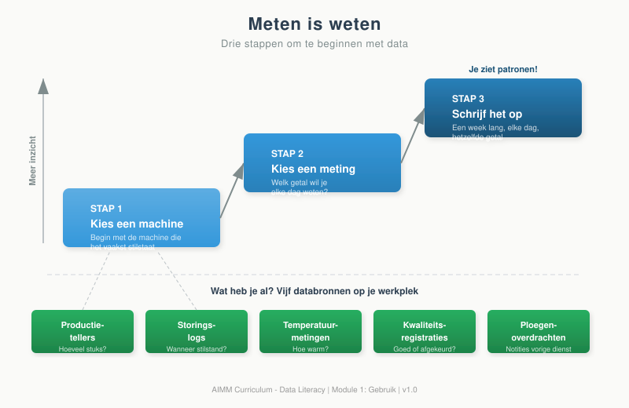

# Welke data heb je al op je werkplek, en hoe kun je die gebruiken?

Op bijna elke machine staan tellers, sensoren en logs. Veel operators weten niet dat dit waardevolle data is. Als je het herkent en begint te gebruiken, kun je problemen zien voor ze groot worden. Dat bespaart werk en voorkomt stilstand.

## Wat leer je?

Je kunt drie databronnen op je eigen werkplek benoemen en uitleggen hoe je daar patronen in herkent.

## De vijf soorten databronnen op de werkvloer

### 1. Tellers

Mechanische of digitale tellers houden bij hoeveel iets is gebeurd:

- Productie-aantal per dienst
- Aantal cycli sinds laatste onderhoud
- Aantal storingen deze week

Tellers zijn simpel maar krachtig. Ze laten zien hoe vaak iets gebeurt en geven de basis voor trends.

### 2. Sensoren

Sensoren meten iets continu:

- Temperatuur in een oven
- Druk in een hydraulieksysteem
- Trillingen op een lager
- Stroomverbruik van een motor

Hoe sneller een sensor meet, hoe meer detail je krijgt. Een trillingssensor die 1000 keer per seconde meet ziet patronen die een meting per minuut nooit oppakt.

### 3. Logs

Een log is een lijst van wat er is gebeurd, met tijdstip en oorzaak:

- Storingslogboek
- Onderhoudslogboek
- Foutcodes van de besturing

Logs zijn vaak ondergebruikt. Ze bevatten meestal precies de informatie die je nodig hebt om patronen te zien — als je ze leest.

### 4. Schermen en dashboards

HMI-schermen, productie-dashboards, kwaliteitsschermen. Ze tonen samenvattingen van de andere drie soorten — getallen, sensoren, logs samengevoegd.

Belangrijk: een dashboard toont meestal niet alle data, alleen wat de bouwer interessant vond. Vaak zit er meer onder.

### 5. Mensen

Vergeten databron, maar misschien wel de rijkste:

- Wat de ploeg op de werkvloer ziet en zegt
- Wat in ploegenoverdrachten wordt gedeeld
- Wat een onderhoudsmonteur zich herinnert

Mensen zien dingen die geen sensor oppakt. Vraag het je collega's: dat is ook data verzamelen.

## Hoe herken je patronen?

Een patroon is iets dat zich herhaalt. Drie manieren om er één te vinden:

1. **Schrijf het op** — elke dag hetzelfde getal noteren laat na een week patronen zien die je in losse waarnemingen mist
2. **Vergelijk** — gisteren versus vandaag, ploeg 1 versus ploeg 2, deze week versus vorige week
3. **Vraag rond** — collega's die langer op de lijn werken zien vaak patronen die je zelf nog niet kent

Je hoeft hier geen ingewikkelde analyse voor. Een schrift en een potlood zijn vaak genoeg om de eerste keer iets opvallends te ontdekken.

## Een korte oefening

Stel je voor dat je morgen begint met één eenvoudige meting:

> Iedere ochtend om 07:00 schrijf je de waarde op van één meter — bijvoorbeeld de temperatuur van de oven of het productieaantal van de nachtdienst.

Na vijf werkdagen heb je vijf waarden. Wat zie je? Stijgt het? Daalt het? Springt het op specifieke dagen? Daar zit je eerste patroon. Dat heb je zelf gevonden, met data die er al was.

## Na deze sessie

Schrijf de komende week elke dag hetzelfde getal op van jouw machine. Een teller, een temperatuur, een afkeuraantal — wat past. Bespreek na een week met je buddy wat je ziet: welk patroon ontstaat er? Kijk ook of er een dashboard bestaat waar jouw machine al op staat — soms is de data er al, je hebt 'm alleen nog niet gezien.

---

## Werkbladen (Kolb-cyclus)

1. [`wb-01-ervaren.md`](./werkbladen/wb-01-ervaren.md) — Ervaren
2. [`wb-02-reflecteren.md`](./werkbladen/wb-02-reflecteren.md) — Reflecteren
3. [`wb-03-theoretiseren.md`](./werkbladen/wb-03-theoretiseren.md) — Theoretiseren
4. [`wb-04-experimenteren.md`](./werkbladen/wb-04-experimenteren.md) — Experimenteren

## Verder

- Onderliggend kennisobject: [`ko-data-lit-107`](../../kennisbank/data_literacy/data_begrippen/ko-data-lit-107.md)
- Voor de begeleider: [`trainer.md`](./trainer.md) + [`draaiboek.md`](./draaiboek.md)
- Interactief: [`interactive/model.html`](./interactive/model.html)
