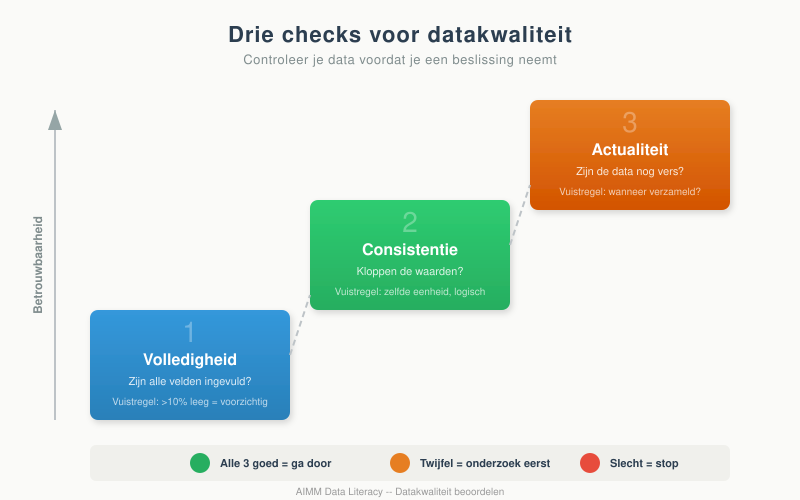

# Hoe weet je of je data goed genoeg is om te gebruiken?

Op de werkvloer neem je elke dag beslissingen op basis van data. Cijfers uit logboeken, dashboards en metingen. Maar wat als die data niet kloppen? Dan neem je een slechte beslissing met goede bedoelingen. Drie korte checks van vijf minuten halen de meeste fouten eruit.

## Wat leer je?

Je leert drie checks uitvoeren op een dataset. Je kunt na deze sessie zelf een onderbouwd oordeel geven of je data goed genoeg is om te gebruiken.

## De drie checks in vijf minuten

Stel je voor: je krijgt een Excel met productiecijfers van vorige week. Je moet er een beslissing op baseren. Voordat je verder gaat, doe je deze drie checks.

### Check 1: Volledigheid

Tel de lege cellen. Zijn er rijen waar belangrijke kolommen leeg zijn?

- Een paar lege cellen op 200 rijen: meestal geen probleem.
- Hele kolommen leeg op cruciale velden: stop, dit gaat fout.
- Een patroon in de gaten (alleen nachtdienst leeg): vraag waarom.

### Check 2: Consistentie

Klopt de eenheid? En vallen de waarden binnen wat logisch is?

- Staat er "kg" in de kolomtitel, maar zie je waarden zoals 0,8 en 1500? Dan is iets in gram, iets in kilo.
- Een temperatuur van 950 graden bij een proces dat normaal 65 graden doet: typfout of echte storing?
- Vergelijk een paar rijen met je gevoel. Past het bij wat je op de werkvloer ziet?

### Check 3: Actualiteit

Hoe oud zijn de data? Komen ze uit de juiste periode?

- Data van vorige maand voor een beslissing over deze week: meestal te oud.
- Een dataset met laatste update "3 jaar geleden": niet gebruiken voor vandaag.
- Een logboek dat eindigt op een vrijdag terwijl je over de hele week wilt beslissen: vraag waarom.

## Het stoplichtsysteem

Na de drie checks geef je elke dataset een kleur.

| Kleur | Wat zie je | Wat doe je |
|---|---|---|
| Groen | Alle drie checks oke | Gebruiken |
| Oranje | Eén check twijfelt | Gebruiken met voorzichtigheid; meld twijfel |
| Rood | Twee of drie checks falen | Niet gebruiken; eerst opschonen |

Dit is geen wetenschap, het is een gevoel met houvast. De drempel mag je zelf bijstellen op basis van wat de beslissing waard is.

## Waarom dit ertoe doet

Een slechte beslissing op goede data is pech. Een slechte beslissing op slechte data is vermijdbaar. Met deze drie checks van vijf minuten haal je de meeste vermijdbare fouten eruit.

- Je voorkomt dat je een proces aanpast op een typfout.
- Je merkt sneller op als een sensor uitviel zonder dat iemand het zag.
- Je geeft betere onderbouwing als je teamleider vraagt: "Weet je dat zeker?"

## Na deze sessie

Kies deze week één dataset die je op je werk gebruikt. Bijvoorbeeld een productieoverzicht, een stilstandlog of een kwaliteitsrapport.

Doe op die dataset de drie checks. Schrijf per check op: groen, oranje of rood. Noteer kort waarom.

Bespreek je oordeel met je teamleider in het volgende overleg. Vraag een collega om dezelfde checks te doen op dezelfde data. Vergelijk jullie kleuren.

Eén concrete stap deze week: pak die ene dataset waar je het minste vertrouwen in hebt. Begin daar.

---

## Werkbladen (Kolb-cyclus)

1. [`wb-01-ervaren.md`](./werkbladen/wb-01-ervaren.md) — Ervaren
2. [`wb-02-reflecteren.md`](./werkbladen/wb-02-reflecteren.md) — Reflecteren
3. [`wb-03-theoretiseren.md`](./werkbladen/wb-03-theoretiseren.md) — Theoretiseren
4. [`wb-04-experimenteren.md`](./werkbladen/wb-04-experimenteren.md) — Experimenteren

## Verder

- Onderliggend kennisobject: [`ko-data-lit-202`](../../kennisbank/data_literacy/data_kwaliteit/ko-data-lit-202.md)
- Voor de begeleider: [`trainer.md`](./trainer.md) + [`draaiboek.md`](./draaiboek.md)
- Interactief: [`interactive/model.html`](./interactive/model.html)
