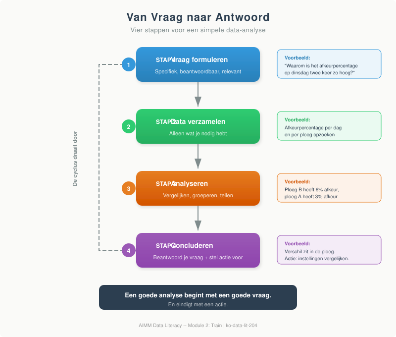

# Hoe voer je zelf een simpele data-analyse uit, van vraag tot conclusie?

In Module 1 leerde je wanneer data helpt. Nu leer je hoe je zelf een analyse doet. Met vier stappen kun je elk productieprobleem onderzoeken — niet wachten tot iemand anders het uitzoekt, maar zelf van vraag naar antwoord komen. Dat maakt je onmisbaar op de werkvloer.

## Wat leer je?

Je kunt zelf een data-analyse uitvoeren in vier stappen: een vraag formuleren, data verzamelen, analyseren en concluderen. Bij minstens twee van de drie casussen kom je tot een onderbouwde conclusie.

## De vier stappen

### Stap 1: Vraag formuleren

Een goede vraag is **specifiek, beantwoordbaar en relevant**.

- Niet: *"Waarom gaat het fout?"* — te vaag
- Wel: *"Waarom is het afkeurpercentage op dinsdag twee keer zo hoog als op maandag?"* — specifiek

Een specifieke vraag stelt je in staat om gericht naar data te zoeken. Een vage vraag eindigt in een vage analyse.

### Stap 2: Data verzamelen

Verzamel alleen data die je nodig hebt voor je vraag. Niet alles. Denk aan:

- Welke **periode** is relevant? (gisteren, deze week, deze maand?)
- Welke **machine** of welke lijn?
- Welke **ploeg** of welk product?
- Welke **gebeurtenissen** speelden er (onderhoud, ploegenwissel)?

Te veel data verzamelen verlamt. Te weinig data laat je vraag onbeantwoord. Begin gericht.

### Stap 3: Analyseren

Drie eenvoudige manieren — geen statistiek nodig:

1. **Vergelijken** — dinsdag versus maandag, deze week versus vorige week
2. **Groeperen** — per ploeg, per machine, per product
3. **Tellen** — hoeveel storingen per dag, hoeveel afkeuringen per uur

Begin altijd met **vergelijken**. Het is de snelste manier om afwijkingen te zien.

### Stap 4: Concluderen

Een goede conclusie:

- **Beantwoordt je vraag** — niet meer, niet minder
- **Is onderbouwd met de data** — niet met aannames
- **Is eerlijk over onzekerheden** — als de data geen duidelijk antwoord geeft, zeg dat

Dat laatste is belangrijk. Een eerlijke "ik weet het niet zeker, maar..." is beter dan een verzonnen exact antwoord.

## Een voorbeeld

Stel: het afkeurpercentage op lijn 4 is op dinsdag 6%, de andere dagen rond de 3%. Twee keer zo hoog. Wat doe je?

| Stap | Actie | Resultaat |
|---|---|---|
| 1. Vraag | "Waarom is afkeur op dinsdag 6% versus 3% andere dagen?" | Specifiek, meetbaar, relevant |
| 2. Data | Productiedata van lijn 4 van deze week, met ploeg + product per uur | Tabel met 24 uur dinsdag en 24 uur maandag |
| 3. Analyseren | Vergelijk maandag-dinsdag op ploeg, op product, op uurpiek | Verschil zit in ochtenddienst dinsdag, niet in product |
| 4. Conclusie | "Hogere afkeur op dinsdag komt door ochtenddienst (12%), niet door het product" | Onderbouwd. Vervolgvraag: wat gebeurde in die dienst? |

In vier stappen heb je niet alleen het probleem geïdentificeerd, je hebt ook al een vervolgactie.

## De valkuilen

| Stap | Wat vaak misgaat | Wat helpt |
|---|---|---|
| 1. Vraag | Te vage vraag | Maak hem specifiek met getallen of tijden |
| 2. Data | Te veel of verkeerde data verzamelen | Volg je vraag, niet je nieuwsgierigheid |
| 3. Analyseren | Direct conclusies trekken zonder te vergelijken | Begin met "wat valt op?" |
| 4. Concluderen | Meer beweren dan de data ondersteunt | Beperk je tot je vraag |

## Na deze sessie

Kies deze week een productieprobleem op je eigen werkvloer. Het mag iets zijn dat je al kent, of iets dat je altijd al wilde uitzoeken. Doorloop de vier stappen: formuleer een vraag, verzamel data, analyseer, en trek een conclusie. Schrijf je analyse op één A4. Bespreek hem daarna met je teamleider — vraag: *"Klopt mijn conclusie? Wat zou jij anders doen?"* Neem het werkblad mee naar de volgende bijeenkomst om met je duo te bespreken.

---

## Werkbladen (Kolb-cyclus)

1. [`wb-01-ervaren.md`](./werkbladen/wb-01-ervaren.md) — Ervaren
2. [`wb-02-reflecteren.md`](./werkbladen/wb-02-reflecteren.md) — Reflecteren
3. [`wb-03-theoretiseren.md`](./werkbladen/wb-03-theoretiseren.md) — Theoretiseren
4. [`wb-04-experimenteren.md`](./werkbladen/wb-04-experimenteren.md) — Experimenteren

## Verder

- Onderliggend kennisobject: [`ko-data-lit-204`](../../kennisbank/data_literacy/data_driven_besluitvorming/ko-data-lit-204.md)
- Voor de begeleider: [`trainer.md`](./trainer.md) + [`draaiboek.md`](./draaiboek.md)
- Interactief: [`interactive/model.html`](./interactive/model.html)
