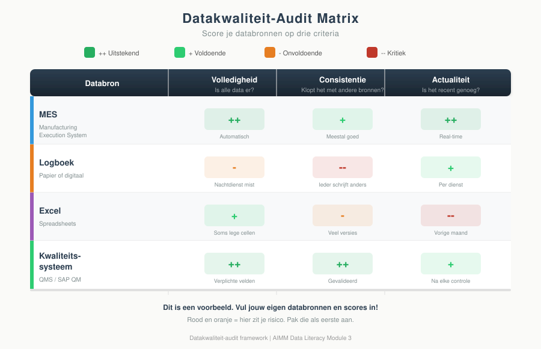

# Hoe goed is de data op jouw eigen afdeling?

Module 3 gaat over jouw werkvloer. Geen voorbeelddata meer, geen oefendataset. Dit keer pak je de databronnen die je écht gebruikt: MES (Manufacturing Execution System — het productiesysteem), het logboek, Excel-bestanden en het kwaliteitssysteem. Je doet een audit (een korte kwaliteitscontrole) en weet aan het eind welke bronnen je kunt vertrouwen.

## Wat leer je?

Je leert hoe je je eigen databronnen scoort op volledigheid, consistentie en actualiteit. Je kunt na deze sessie de twee grootste risico's benoemen en een verbeterplan opstellen.

## Een audit in vier stappen

Een audit klinkt formeel. In de praktijk is het een gestructureerde rondgang langs je databronnen, met een vast scoreschema. Een uur werk, een week winst.

### Stap 1: Maak een lijst van je databronnen

Loop op je afdeling alle plekken langs waar data ontstaat. Denk aan:

- Het MES-systeem (productieaantallen, cyclustijden).
- Het logboek (handgeschreven of digitaal).
- Excel-bestanden van het team.
- Het kwaliteitssysteem (afkeur, klachten).
- Sensordata uit machines.

Mik op minimaal vier bronnen. Schrijf ze allemaal op.

### Stap 2: Scoor elke bron op drie criteria

Geef per bron drie scores. Gebruik dit schema:

| Score | Wat het betekent |
|---|---|
| ++ | Helemaal in orde |
| + | Klopt meestal, kleine smetjes |
| - | Twijfelachtig, soms gaten of fouten |
| -- | Niet te vertrouwen |

De drie criteria zijn:

1. **Volledigheid** — staan alle velden ingevuld? Worden alle relevante gebeurtenissen vastgelegd?
2. **Consistentie** — kloppen eenheden? Wordt het op dezelfde manier ingevoerd door iedereen?
3. **Actualiteit** — hoe vers zijn de data? Worden ze op tijd bijgewerkt?

### Stap 3: Bespreek met een collega waar het risico zit

Welke databron vertrouw je het minst? Wat kan er misgaan als je daarop een beslissing baseert? Een tweede paar ogen ziet wat jij over het hoofd ziet.

### Stap 4: Kies de twee grootste risico's en maak een verbeterplan

Niet alles tegelijk oplossen. Kies de twee bronnen met de slechtste scores op de belangrijkste criteria. Schrijf per bron op:

- Wat is het probleem precies?
- Wie kan dit oplossen — jij, je teamleider, IT, de leverancier?
- Wat is de eerste stap deze week?

## Een werkvloer-voorbeeld

Stel: je werkt op een spuitgietlijn. Je vier databronnen zijn MES, logboek, Excel-cyclustellingen en het kwaliteitssysteem.

- MES: scoort ++ / ++ / ++ (alles automatisch, dagelijks bijgewerkt).
- Logboek: scoort - / -- / + (handgeschreven, ieder doet het anders, wél dezelfde dag).
- Excel: scoort + / - / -- (alleen door de dagdienst bijgewerkt, formules verschillen per maand).
- Kwaliteitssysteem: scoort ++ / + / ++ (klopt meestal, sommige codes worden door iedereen anders begrepen).

De grootste risico's: het logboek (inconsistent) en Excel (te oud). Eerste actie deze week: vraag in het werkoverleg of het logboek-format gestandaardiseerd kan worden.

## Waarom dit ertoe doet

Als jij weet welke data je kunt vertrouwen, neem je betere beslissingen. Je voorkomt dat het team een proces aanpast op een fout in Excel. Je kunt onderbouwen waarom een conclusie waterdicht is — of waarom je nog twijfelt.

## Na deze sessie

Voer deze week de audit uit op je eigen afdeling. Pak minimaal vier databronnen. Vul de scoringsmatrix in.

Kies daarna de twee grootste risico's. Schrijf per risico één concrete actie op die deze week haalbaar is.

Deel je matrix en plan met je teamleider in het eerstvolgende teamoverleg. Vraag een collega om dezelfde audit te doen op dezelfde bronnen. Vergelijk jullie scores en bespreek de verschillen.

Eén kleine stap deze week: kies de databron waar je het minste vertrouwen in hebt en doe daar de audit. De rest komt vanzelf.

---

## Werkbladen (Kolb-cyclus)

1. [`wb-01-ervaren.md`](./werkbladen/wb-01-ervaren.md) — Ervaren
2. [`wb-02-reflecteren.md`](./werkbladen/wb-02-reflecteren.md) — Reflecteren
3. [`wb-03-theoretiseren.md`](./werkbladen/wb-03-theoretiseren.md) — Theoretiseren
4. [`wb-04-experimenteren.md`](./werkbladen/wb-04-experimenteren.md) — Experimenteren

## Verder

- Onderliggend kennisobject: [`ko-data-lit-302`](../../kennisbank/data_literacy/data_kwaliteit/ko-data-lit-302.md)
- Voor de begeleider: [`trainer.md`](./trainer.md) + [`draaiboek.md`](./draaiboek.md)
- Interactief: [`interactive/model.html`](./interactive/model.html)
