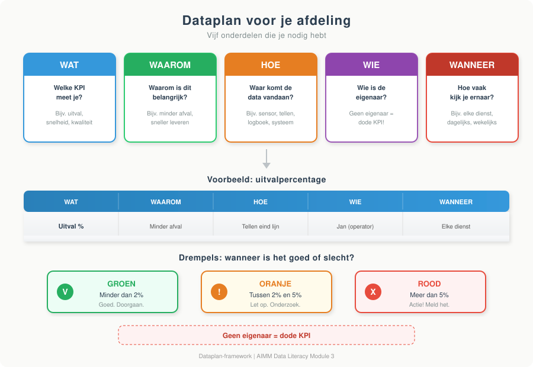

# Wat ga je op jouw afdeling meten — en waarom?

In Module 1 en 2 leerde je data te herkennen, te beoordelen en te analyseren. Nu maak je het echt: jouw eigen dataplan voor jouw afdeling. Drie tot vijf KPI's, met doel, eigenaar en frequentie. Geen "van alles" meer meten zonder doel — gericht meten dat je morgen kunt starten.

## Wat leer je?

Je kunt een dataplan opstellen voor je eigen afdeling met 3 tot 5 KPI's, inclusief doel, databron, eigenaar en frequentie per KPI. Je kunt het plan in eigen woorden uitleggen aan je teamleider.

## Wat is een dataplan?

Een dataplan is een korte lijst — geen dik rapport — die antwoord geeft op vijf vragen per KPI:

1. **Wat** meet je? (de KPI)
2. **Waarom** meet je dat? (het doel)
3. **Hoe** meet je het? (de databron)
4. **Wie** is verantwoordelijk? (de eigenaar)
5. **Wanneer** meet je? (de frequentie)

Vijf simpele vragen. Maar als je ze voor elke KPI kunt beantwoorden, weet je precies wat je doet en waarom.

## Hoe kies je 3 tot 5 KPI's?

Niet meer, niet minder. Drie redenen:

- Onder de drie: je mist te veel
- Boven de vijf: niemand houdt het bij
- Drie tot vijf: precies hanteerbaar

Een KPI hoort bij een **doel**. Begin daar. Stel jezelf voor elke kandidaat-KPI deze vraag:

> *"Als deze KPI rood wordt, wat doen we dan?"*

Als je geen antwoord hebt, is het geen goede KPI. Een meting waar je niets mee doet, kun je beter niet doen.

## Een werkend voorbeeld

Stel: je werkt op een productielijn. Drie KPI's die kunnen werken:

### KPI 1: OEE per dienst

| Onderdeel | Invulling |
|---|---|
| Wat | OEE — meet hoe goed de machine wordt benut |
| Waarom | Inzicht in wanneer en waar productiviteit verloren gaat |
| Hoe | Automatisch berekend uit MES-data |
| Wie | Ploegleider per dienst |
| Wanneer | Einde van elke dienst |

### KPI 2: Aantal storingen langer dan 10 minuten

| Onderdeel | Invulling |
|---|---|
| Wat | Aantal stilstanden langer dan 10 minuten per dag |
| Waarom | Oplopende storingen wijzen op onderhoudsproblemen |
| Hoe | Storingslogboek + tijdregistratie |
| Wie | Operator + onderhoud |
| Wanneer | Dagelijks, evaluatie wekelijks |

### KPI 3: Afkeurpercentage per product-batch

| Onderdeel | Invulling |
|---|---|
| Wat | Percentage afkeur per geproduceerde batch |
| Waarom | Vroege signalering van kwaliteitsproblemen |
| Hoe | Inspectie aan einde lijn |
| Wie | Kwaliteitscontroleur |
| Wanneer | Per batch, samenvatting per dienst |

Drie KPI's, alle vijf onderdelen ingevuld, één A4. Dit is het hele plan.

## Drempelwaardes — de groen-rood-grens

Een KPI zonder drempelwaarde is een getal zonder betekenis. Voor elke KPI bepaal je:

- **Groen** — alles goed, doe niets
- **Oranje** — let op, kijk eens of er iets verandert
- **Rood** — actie nodig, nu

Voorbeeld OEE: groen >75%, oranje 65-75%, rood <65%. Concreet, meetbaar, eenduidig.

Zonder drempel werkt een KPI niet. Iedereen interpreteert "het is laag" anders. Met een drempel weet iedereen het meteen.

## Het gesprek met je teamleider

Een dataplan is pas een plan als de teamleider akkoord is. Daar zijn twee redenen voor:

1. **Eigenaarschap** — als hij meet, moet hij weten waarom
2. **Tijd** — meten kost tijd, dat moet ergens vandaan komen

Bereid je gesprek voor met deze drie zinnen:

- *"Ik wil deze drie KPI's meten omdat..."*
- *"Het kost ongeveer X minuten per dag, gedaan door Y..."*
- *"Wat ik ermee wil bereiken is..."*

Als de teamleider die drie kan herhalen na jouw uitleg, is je plan helder. Zo niet, scherp aan.

## Na deze sessie

Bespreek je dataplan deze week met je teamleider. Vraag akkoord op de KPI-keuze en op het eigenaarschap per KPI. Start de eerste meetcyclus binnen twee weken en plan een evaluatiemoment over een maand. Vraag daarnaast een collega van een naburige afdeling om hetzelfde plan te maken voor hun werkplek. Vergelijk de verschillen — wat valt je op? Soms zit daar de meest waardevolle les: jouw blinde vlekken zie je het beste in de keuzes van een ander.

---

## Werkbladen (Kolb-cyclus)

1. [`wb-01-ervaren.md`](./werkbladen/wb-01-ervaren.md) — Ervaren
2. [`wb-02-reflecteren.md`](./werkbladen/wb-02-reflecteren.md) — Reflecteren
3. [`wb-03-theoretiseren.md`](./werkbladen/wb-03-theoretiseren.md) — Theoretiseren
4. [`wb-04-experimenteren.md`](./werkbladen/wb-04-experimenteren.md) — Experimenteren

## Verder

- Onderliggend kennisobject: [`ko-data-lit-304`](../../kennisbank/data_literacy/data_driven_besluitvorming/ko-data-lit-304.md)
- Voor de begeleider: [`trainer.md`](./trainer.md) + [`draaiboek.md`](./draaiboek.md)
- Interactief: [`interactive/model.html`](./interactive/model.html)
