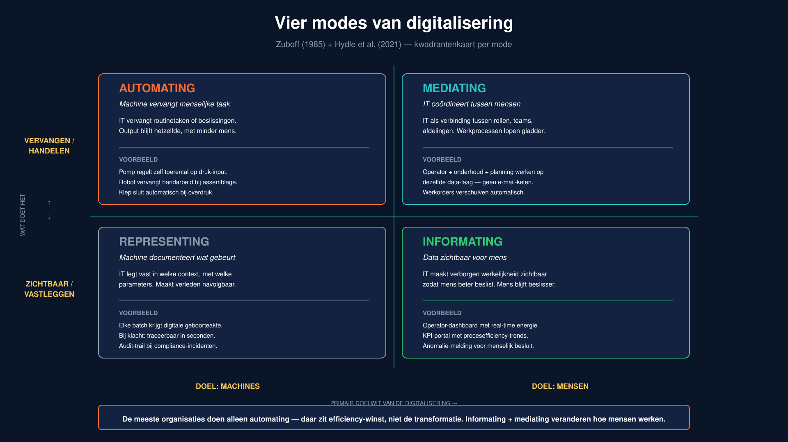

# Welke vorm van digitalisering doen jullie eigenlijk — en welke laten jullie liggen?

Als teamleider geef je vaak goedkeuring aan digitaliseringsinvesteringen zonder taal om te onderscheiden waar precies waarde ontstaat. Sommige projecten worden enthousiast ontvangen, andere stranden zonder duidelijke reden. De vier modes van digitalisering geven je die taal — en helpen je sturen.

## Wat leer je?

Je kunt de vier modes van digitalisering onderscheiden — automating, informating, representing en mediating — en bij minstens drie eigen initiatieven aangeven welke modes dominant zijn en welke ontbreken.

## Vier modes, één digitalisering

Digitalisering is geen één ding. Het kent vier vormen, elk met een ander effect op het werk:

### 1. Automating — taken automatiseren

Een algoritme of systeem voert iets uit dat eerder een mens deed. De pomp stopt vanzelf bij een afwijking. De voorraadbestelling gaat automatisch weg. Het werk verdwijnt of verschuift.

- **Wat verandert:** wie de taak doet
- **Klassiek voorbeeld:** robotarm op de productielijn
- **Risico:** als alleen automating gebeurt, blijft de samenwerking onveranderd

### 2. Informating — data zichtbaar maken

Het systeem toont informatie die er eerder niet was. Een dashboard met realtime energieverbruik. Een logboek met geconsolideerde foutmeldingen. De mens beslist nog steeds, maar nu op basis van betere data.

- **Wat verandert:** wat de mens weet
- **Klassiek voorbeeld:** OEE-dashboard
- **Risico:** zonder gebruikers verandert er niets — een dashboard waar niemand naar kijkt

### 3. Representing — content tonen op de werkvloer

Informatie wordt zichtbaar gemaakt voor wie het werk doet, in een vorm die uitnodigt tot actie. Een groot scherm in de kantine met productiestatus. Een digitaal rapport dat een ploegleider kan delen op zijn telefoon.

- **Wat verandert:** wie het ziet
- **Klassiek voorbeeld:** energieverbruik per ploeg op het kantinescherm
- **Vaak onderbenut:** technologisch makkelijk, organisatorisch krachtig

### 4. Mediating — digitaal samenwerken

Mensen werken samen via het systeem. De operator en de data-analist beslissen samen op basis van een gedeeld dashboard. Onderhoud en productie zien dezelfde alerts en verdelen taken via een gezamenlijke werkbak.

- **Wat verandert:** hoe mensen samenwerken
- **Klassiek voorbeeld:** gezamenlijk onderhouds-werkpatroon
- **Vaak onderbenut:** vereist meer dan techniek — ook proces- en cultuurverandering

## Het verschil zien — een voorbeeld

Stel je een pomp-installatie voor die door de jaren heen geëvolueerd is:

| Fase | Wat gebeurde er | Modes |
|---|---|---|
| Begin | Algoritme zegt "pomp gaat falen, vervang nu". Operator voert uit. | Alleen **automating** |
| Tussenstap | Operator ziet realtime pompstatus op een scherm. | + **informating** |
| Volwassen | Operator + data-analist beslissen samen op basis van een gedeeld dashboard, ondersteund door een digitale werkbak. | + **representing** + **mediating** |

In de eerste fase werkte het systeem technisch perfect. Maar het werkproces veranderde nauwelijks. Pas in fase drie veranderde het werk écht — niet alleen de taak, maar ook de samenwerking.

## Waar wordt vaak op overinvesteerd?

In de praktijk krijgen automating en informating meestal het budget. Mediating en representing blijven liggen — terwijl daar vaak de échte werkprocesverandering zit.

| Mode | Krijgt aandacht? | Werkproces-effect |
|---|---|---|
| Automating | Hoog | Beperkt (taken verschuiven) |
| Informating | Hoog | Matig (alleen als data gebruikt wordt) |
| Representing | Laag | Hoog (zichtbaarheid op de werkvloer) |
| Mediating | Laag | Hoog (verandert samenwerking) |

Wie deze lens hanteert, kan in een stuurgroep onderbouwd zeggen: *"Dit project mist een mediating-component. Daarom blijft het op de plank liggen."* En dat verandert de investeringsdiscussie.

## Wat dit betekent voor jouw afdeling

Pak drie lopende of geplande digitaliseringsprojecten op je afdeling. Stel per project drie vragen:

1. Welke mode is **dominant** — wat doet dit project vooral?
2. Welke mode **ontbreekt** — waarom landt het niet helemaal?
3. Wat zou er veranderen als je de ontbrekende mode zou toevoegen?

Het antwoord op vraag 3 is meestal verrassend concreet. Een dashboard dat niemand bekeek, krijgt waarde zodra je het op een scherm in de kantine zet (representing). Een AI-alert die alleen naar de operator gaat, gaat werken zodra ook onderhoud meekijkt (mediating).

## Na deze sessie

Werk de drie initiatieven uit de sessie verder uit. Vraag voor elk initiatief aan minstens één betrokkene — een operator, planner, IT-collega — hoe zij de uitkomst ervaren. Vergelijk hun antwoord met je eigen mode-classificatie. Stel daarna voor je eerstvolgende stuurgroepoverleg één concreet voorstel op om een onderbenutte mode toe te voegen aan een lopend initiatief — met argumenten waarom dat het werkproces-effect vergroot. Lees deze maand ook één projectvoorstel of business case op je afdeling met de vier-modes-lens. Markeer welke modes erin zitten en welke ontbreken — vaak verandert alleen het noemen van een ontbrekende mode al het ontwerp.

---

## Werkbladen (Kolb-cyclus)

1. [`wb-01-theoretiseren.md`](./werkbladen/wb-01-theoretiseren.md) — Theoretiseren
2. [`wb-02-ervaren.md`](./werkbladen/wb-02-ervaren.md) — Ervaren
3. [`wb-03-experimenteren.md`](./werkbladen/wb-03-experimenteren.md) — Experimenteren
4. [`wb-04-reflecteren.md`](./werkbladen/wb-04-reflecteren.md) — Reflecteren

## Verder

- Onderliggend kennisobject: [`ko-industry-4-0-digi-001`](../../kennisbank/industry_4_0/smart_factory_concepten/ko-industry-4-0-digi-001.md)
- Voor de begeleider: [`trainer.md`](./trainer.md) + [`draaiboek.md`](./draaiboek.md)
