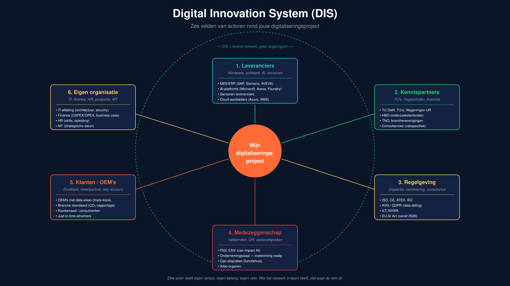

# Welke actoren, regels en technologieën om je heen bepalen mee of je digitaliseringsproject lukt?

Als teamleider verklaar je vertraging in een digitaliseringsproject vaak technisch of intern. *"Het systeem is nog niet af."* Of: *"We hebben geen capaciteit."* Maar de echte rem zit vaak buiten je organisatie: een leverancier met een trage roadmap, een installatieprotocol uit 2008, een vakbond met andere prioriteiten, een certificeringseis die nog niet bestaat voor AI-systemen. Wie het ecosysteem in kaart brengt, ziet die rem — en kan er gericht op sturen.

## Wat leer je?

Je kunt de actoren, technologieën en regels van het Digital Innovation System (DIS) rond je eigen afdeling in kaart brengen, en kunt minstens één misalignment benoemen die de digitale adoptie in jouw organisatie vertraagt.

## Wat is een Digital Innovation System (DIS)?

Een DIS is het netwerk van actoren, technologieën en regels dat samen bepaalt of digitalisering in jouw bedrijf lukt. Anders dan een traditioneel innovatiesysteem heeft een DIS:

- **Breder bereik** — naast techniek ook regelgeving, vakbond, klanten en kennispartners
- **Gemengde doelen** — productiviteit, duurzaamheid, veiligheid en arbeidsmarkt door elkaar
- **Snellere evolutie** — wat vandaag bestaat is morgen alweer anders

Voor jou als teamleider is het belangrijk om te weten: jouw project staat zelden of nooit los van dit netwerk.

## Het DIS-canvas — zes velden

Het canvas heeft zes velden waarin je de actoren rond je project plaatst.

### 1. Leveranciers

De bedrijven die de techniek leveren. Niet alleen de hoofdvendor — denk ook aan:

- AI-platform leveranciers
- MES- en ERP-leveranciers
- Cloud-providers
- Sensorfabrikanten

### 2. Kennispartners

Wie helpt met expertise die intern ontbreekt:

- Universiteiten en hogescholen (TU/e, Fontys, Avans)
- Brancheorganisaties (FME, Koninklijke Metaalunie)
- Onderzoeksinstituten (TNO)
- Adviesbureaus en consultancies

### 3. Regelgeving en certificering

Wie bepaalt wat mag en wat moet:

- Inspectie SZW
- Brandweer en veiligheidsdiensten
- ISO-certificeerders
- Sectorspecifieke autoriteiten (NVWA voor voeding, IGJ voor zorg)

### 4. Vakbonden en medezeggenschap

- Vakbonden zoals FNV en CNV — zij vertegenwoordigen medewerkers in arbeidsonderhandelingen
- Ondernemingsraad (OR)
- Personeelsvertegenwoordiging (PVT)

Vaak vergeten, vaak doorslaggevend bij projecten die werk veranderen.

### 5. Klanten

- Eindafnemers
- Distributiepartners
- Inkoop bij klantorganisaties

Een klant die transparantie eist, kan een digitaliseringsproject versnellen — of vertragen.

### 6. Interne actoren

- Operators en ploegleiders
- Onderhoud
- IT
- Inkoop
- Directie

Niet alleen wie het project trekt — ook wie het ondersteunt of tegenwerkt.

## Een misalignment vinden

Een **misalignment** is een mismatch tussen actoren die jouw project vertraagt. Het patroon klinkt zo:

> *"Doordat actor A [iets doet of niet doet], terwijl actor B [iets anders verwacht], gebeurt er [vertraging, conflict, stilstand]."*

Drie typische voorbeelden uit de maakindustrie:

| Misalignment | Waar het over gaat |
|---|---|
| Vendor traag versus interne urgentie | Jouw MES-leverancier rolt updates uit per kwartaal, terwijl jouw lijn elke maand iets nieuws nodig heeft |
| Certificeringseis ontbreekt | Je wilt AI invoeren voor kwaliteitscontrole, maar er bestaat geen ISO-norm die dit valideert |
| Vakbond versus directie | Directie wil automating doorvoeren, vakbond eist eerst plan voor herinzet medewerkers |

Vaak zijn de bottlenecks niet technisch — ze zijn regulatoir of cultureel. Dat verklaart waarom techniek-gedreven adoptie vaak vastloopt.

## Hoe je het canvas gebruikt

Voor één digitaliseringsproject op je afdeling:

1. **Vul alle zes velden** met minstens twee concrete actoren (bij naam of functie)
2. **Markeer wie wacht** op wie — daar ontstaan misalignments
3. **Beschrijf één misalignment** met oorzaak én gevolg
4. **Formuleer één eerste actie** die deze maand uitvoerbaar is

Een eerste actie hoeft niet groots te zijn. Een gesprek van 30 minuten met je MES-product-manager kan meer beweging brengen dan drie maanden interne discussie.

## Na deze sessie

Plan binnen twee weken minstens twee gesprekken met actoren uit je eigen DIS-canvas die je tot nu toe nauwelijks of niet sprak. Bijvoorbeeld een product-manager bij je MES-vendor, een inspecteur, of de interne medezeggenschap. Stel concreet de vraag: *"Wat heeft jullie kant nodig om dit digitaliseringsproject van mij te laten slagen?"* Vul je canvas aan op basis van die gesprekken en kijk of de misalignment groter, kleiner of anders bleek dan je dacht. Voeg deze maand ook één regulatoire of certificerende actor toe aan een bestaand projectoverleg — al is het maar voor 15 minuten. Vaak ontstaat daar de eerste verbinding die later tijd bespaart.

---

## Werkbladen (Kolb-cyclus)

1. [`wb-01-theoretiseren.md`](./werkbladen/wb-01-theoretiseren.md) — Theoretiseren
2. [`wb-02-ervaren.md`](./werkbladen/wb-02-ervaren.md) — Ervaren
3. [`wb-03-experimenteren.md`](./werkbladen/wb-03-experimenteren.md) — Experimenteren
4. [`wb-04-reflecteren.md`](./werkbladen/wb-04-reflecteren.md) — Reflecteren

## Verder

- Onderliggend kennisobject: [`ko-industry-4-0-dis-001`](../../kennisbank/industry_4_0/smart_factory_concepten/ko-industry-4-0-dis-001.md)
- Voor de begeleider: [`trainer.md`](./trainer.md) + [`draaiboek.md`](./draaiboek.md)
