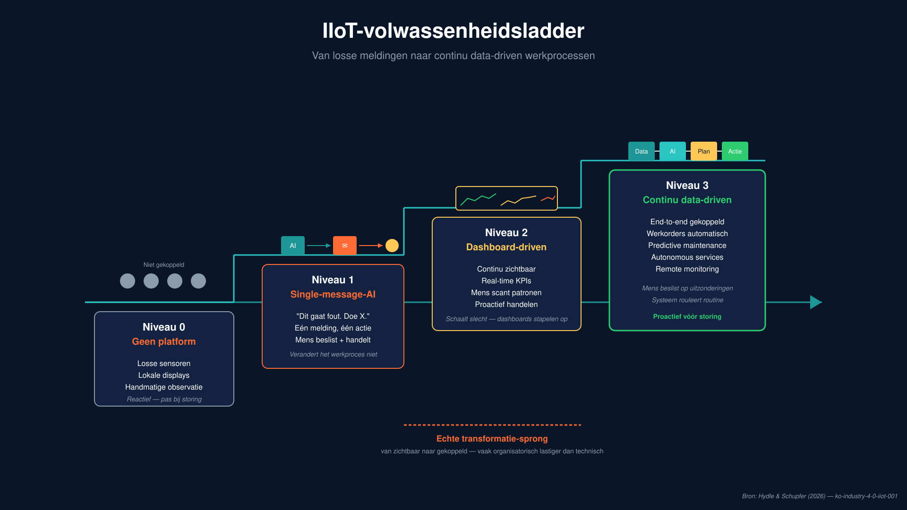

# Op welk niveau staat jullie IIoT-platform nu, en wat is de eerstvolgende stap die echt iets verandert?

In directieoverleggen vallen termen als "predictive maintenance", "autonomous operations" en "data-driven besluitvorming" — vaak zonder duidelijk beeld waar jouw organisatie nu staat en wat haalbaar is. De IIoT-volwassenheidsladder geeft je dat beeld. En het verschil tussen "we hebben een dashboard" en "ons werkproces is veranderd".

## Wat leer je?

Je kunt de evolutie van losstaande AI-meldingen naar continue data-driven werkprocessen uitleggen, en kunt voor je eigen afdeling beoordelen op welk volwassenheidsniveau het IIoT-platform nu staat — én wat de eerstvolgende stap zou zijn.

## De volwassenheidsladder — vier niveaus

Niet elk IIoT-platform (IIoT = Industrial Internet of Things, het koppelen van machines aan internet) is even ver. Er zijn vier niveaus, en de meeste fabrieken zitten op niveau 2.

### Niveau 0 — Geen platform

Geen centrale dataverzameling. Wat er aan data is, zit in losse Excel-bestanden of papieren logboeken. Beslissingen op gevoel en ervaring.

### Niveau 1 — Single-message AI

Het systeem stuurt losse waarschuwingen: *"Pomp gaat falen, vervang nu."* De operator voert uit. Technisch werkt het, maar het werkproces is niet veranderd — alleen de bron van de waarschuwing.

- **Typisch:** alarmpaneel, foutcodes, simpele alerts
- **Werkpatroon:** reageren op meldingen
- **Beperking:** geen context, geen trend, geen dialoog

### Niveau 2 — Dashboard-driven

Er is een centraal dashboard met samengevatte data. Iemand kijkt er één keer per dag of per week naar voor rapportage. Maandrapportages worden uit dit dashboard gehaald.

- **Typisch:** Power BI, Grafana, vendor-portaal
- **Werkpatroon:** rapporteren over het verleden
- **Beperking:** data is correct maar bestuurt het werk niet realtime

### Niveau 3 — Continue data-driven

De data stuurt het werkpatroon. De operator ziet realtime emissie- en verbruiksdata. De data-analist kijkt mee. Beslissingen worden samen genomen, op basis van trend, niet op basis van losse alarmen.

- **Typisch:** gedeelde dashboards, multi-disciplinaire teams, conditie-gestuurd onderhoud
- **Werkpatroon:** sturen op trends, samen beslissen
- **Vereist:** technologie + werkpatroon-verandering

## Het verschil zien — twee tijdlijnen voor dezelfde pompstoring

| Moment | Niveau 1 (single-message) | Niveau 3 (data-driven) |
|---|---|---|
| 0 min | Geen waarschuwing | Trillingstrend stijgt licht — zichtbaar op gedeeld dashboard |
| 30 min | Geen waarschuwing | Operator ziet trend, vraagt data-analist mee te kijken |
| 90 min | "Pomp gaat falen, vervang nu" | Samen besloten: nog 8 uur draaien, dan onderhoud bij geplande wissel |
| Resultaat | Gedwongen stop, geïmproviseerd onderhoud | Geplande stop, voorbereid onderhoud, geen verloren productie |

Niveau 1 werkt technisch perfect. Maar werkprocesmatig levert niveau 3 een ander resultaat.

## Vier IIoT-services die jou kunnen helpen

Een mature IIoT-platform biedt meestal vier services. Niet allemaal nodig, maar goed om te weten waar je staat:

1. **Geïntegreerd werkbeheer** (integrated work management) — taken, meldingen en logs in één werkbak
2. **Predictive maintenance** — voorspellen wanneer onderhoud nodig is
3. **Autonome diensten** (autonomous services) — het systeem neemt bepaalde beslissingen zelf, binnen vaste kaders
4. **Remote monitoring** — op afstand zicht op de installatie

Vraag aan jezelf: welke van deze vier hebben wij wel, welke deels, welke niet?

## De eerstvolgende stap

Opschuiven op de ladder is geen IT-keuze. Het is een werkprocesveranderings-keuze. Drie typische "eerstvolgende stappen":

| Van | Naar | Eerste actie |
|---|---|---|
| Niveau 0 | Niveau 1 | Eén meting digitaal verzamelen — bijvoorbeeld energieverbruik per uur |
| Niveau 1 | Niveau 2 | Een dashboard bouwen waar minstens één persoon dagelijks naar kijkt |
| Niveau 2 | Niveau 3 | Eén operator + één data-analist samen laten werken aan één productiebeslissing |

Belangrijk: een stap heeft alleen zin als hij **werk verandert**. Een dashboard waar niemand naar kijkt is geen niveau 2. Een data-analist die niet wordt uitgenodigd is geen niveau 3.

## Wat dit betekent voor jouw stuurgroep

Als directie vraagt "wanneer worden we data-driven?", kun je nu antwoorden:

> *"Wij staan nu op niveau 2 — we hebben dashboards, maar gebruiken ze voor maandrapportage. De eerstvolgende stap is om één operator en één data-analist samen aan één productiebeslissing te laten werken. Daarvoor heb ik [actor X] nodig en moet [randvoorwaarde Y] geregeld zijn."*

Concreet, onderbouwd, niet abstract.

## Na deze sessie

Voer binnen drie weken twee korte gesprekken. Eén met een operator: *"Welke beslissing neem je nu zonder dat het systeem je helpt — en zou je daar realtime data bij willen?"* Eén met je IT-collega of platform-leverancier: *"Wat is technisch nodig om die data binnen drie maanden bij die operator te krijgen?"* Vul op basis van die gesprekken je actiekaart aan en check of je eerstvolgende stap nog steeds de juiste is. Bekijk ook één keer een dashboard van een collega-afdeling of bezoek een bedrijf in jullie branche. Vraag concreet: *"Wat doen jullie operators met deze data dat ze daarvoor niet deden?"* Het antwoord is bijna nooit het dashboard zelf — het is het veranderde werkpatroon.

---

## Werkbladen (Kolb-cyclus)

1. [`wb-01-ervaren.md`](./werkbladen/wb-01-ervaren.md) — Ervaren
2. [`wb-02-reflecteren.md`](./werkbladen/wb-02-reflecteren.md) — Reflecteren
3. [`wb-03-theoretiseren.md`](./werkbladen/wb-03-theoretiseren.md) — Theoretiseren
4. [`wb-04-experimenteren.md`](./werkbladen/wb-04-experimenteren.md) — Experimenteren

## Verder

- Onderliggend kennisobject: [`ko-industry-4-0-iiot-001`](../../kennisbank/industry_4_0/iot_in_productie/ko-industry-4-0-iiot-001.md)
- Voor de begeleider: [`trainer.md`](./trainer.md) + [`draaiboek.md`](./draaiboek.md)
