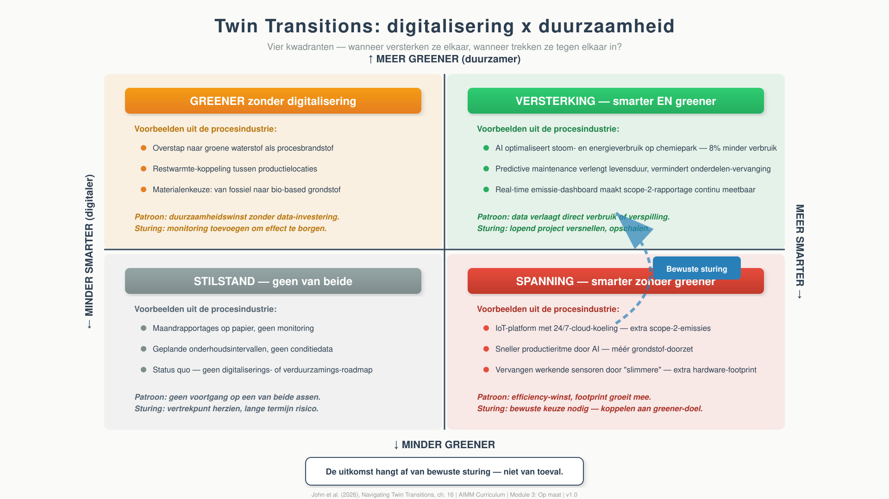

# Wanneer versterkt digitalisering jullie duurzaamheidsdoelen, en wanneer staat het ze in de weg?

Als teamleider krijg je vaak twee opdrachten naast elkaar: digitaliseer én verduurzaam. Meestal als losse projecten met losse budgetten. Wie ze los aanstuurt, mist de momenten waarop ze elkaar versterken — en loopt vast op de momenten waarop ze elkaar tegenwerken. Het twin-transition perspectief geeft je een lens om beleidsdruk en bedrijfskansen samen te brengen.

## Wat leer je?

Je kunt het twin-transition perspectief uitleggen en kunt voor een digitaliseringsinitiatief op je eigen afdeling beoordelen of het alleen "smarter" is of ook bijdraagt aan "greener" — onderbouwd met minstens twee argumenten per kant.

## Twin transitions — wat is het?

Twin transitions betekent: digitalisering en duurzaamheid als **gekoppelde transformaties**, niet als twee losse sporen. Beide veranderen je productie. De vraag is of ze elkaar versterken of tegenwerken — en hoe je daar bewust op stuurt.

Drie patronen om te herkennen:

### 1. Versterking — digitalisering verlaagt verbruik

Een AI-systeem dat het energieverbruik van persen optimaliseert verlaagt zowel kosten als CO2. Een voorraadalgoritme vermindert overproductie en daarmee uitval. **Smarter en greener tegelijk.**

### 2. Spanning — digitalisering verhoogt energievraag

Een AI-model trainen kost rekenkracht en dus energie. Een serverpark voor IIoT-data verbruikt stroom. Sommige digitaliseringsprojecten hebben een grotere voetafdruk dan ze besparen. **Smarter, maar minder green.**

### 3. Bewuste sturing — de uitkomst hangt af van keuzes

Hetzelfde project kan smarter-én-greener zijn óf alleen smarter — afhankelijk van wat je expliciet kiest. Een dashboard dat energieverbruik toont kan alleen rapportage worden, of een actief sturingsinstrument. **Het verschil zit in de keuze, niet in de techniek.**

## Een voorbeeld uit de procesindustrie

Een Nederlands procesindustriebedrijf installeert AI voor energie-optimalisatie. Wat is het — alleen smarter, of ook greener?

| Argument | Smarter | Greener |
|---|---|---|
| Optimalisatie verlaagt productieverbruik 8% | ✅ | ✅ |
| AI-model draait op cloud-server | ✅ | ❌ (extra serverstroom) |
| Optimaliseren creëert ruimte voor groene waterstof | ✅ | ✅ (potentieel) |
| Project levert geen change-budget voor groen-overstap | ✅ | ❌ (kans gemist) |

Conclusie: **smarter, deels greener.** Maar met één expliciete keuze — een deel van de besparing inzetten voor groene-waterstof-overstap — wordt het ook echt greener.

Zonder die keuze is het *gemist greener*. Een mooie rapportage, geen werkelijke transitie.

## Vier kwadranten om in te ordenen

Voor elk digitaliseringsproject op je afdeling kun je het in één van vier kwadranten plaatsen:

| | **Verbetert duurzaamheid** | **Verslechtert duurzaamheid** |
|---|---|---|
| **Verbetert efficiency** | Twin win — versterking | Spanning — kies bewust |
| **Verslechtert efficiency** | Onwaarschijnlijk — heroverweeg | Vermijden |

De meeste projecten zitten in het twin-win kwadrant of het spanningskwadrant. Beide vragen aandacht — alleen op verschillende manieren.

## De vier vragen voor jouw project

Pak één digitaliseringsproject van je afdeling. Beantwoord:

1. **Wat maakt het smarter?** Welke efficiency-winst, welke betere beslissingen, welke automatisering?
2. **Wat maakt het greener?** Of, als het dat niet is — waarom niet?
3. **Welke spanning zit erin?** Waar werken de twee sporen tegen elkaar?
4. **Welke sturingskeuze heb je nodig?** Wat moet er expliciet besloten worden om beide te bereiken?

De vierde vraag is de belangrijkste. Een twin-transition is geen automatisch resultaat — het is een keuze.

## Waarom dit belangrijk is voor jouw rol

In de meeste bedrijven worden digitaliseringsprojecten en duurzaamheidsdoelen apart beoordeeld. De CFO kijkt naar de business case (kosten/opbrengsten). De duurzaamheidscoördinator kijkt naar de footprint. Beide oordelen passeren elkaar zonder elkaar te zien.

Wie de twin-transition lens hanteert, kan in een stuurgroep de twee perspectieven samenbrengen. Niet als beleidstaal, maar als concrete keuze:

> *"Dit project kost €X en levert €Y op (smarter). Met sturingskeuze Z verlagen we ook onze CO2-voetafdruk (footprint) met N ton (greener). Zonder die keuze blijven we alleen smarter."*

Wie de twee sporen samenbrengt, bouwt een integrale roadmap in plaats van losse projecten.

## Na deze sessie

Kies deze maand één digitaliseringsproject van je afdeling dat op de agenda staat. Werk de roadmap-schets verder uit: voeg minstens drie smarter-argumenten en drie greener-argumenten toe, identificeer twee spanningen, en formuleer drie concrete sturingskeuzes die je in het eerstvolgende stuurgroepoverleg kunt inbrengen. Leg de schets ook voor aan een collega-teamleider en vraag waar zij blinde vlekken ziet. Plan binnen twee weken één gesprek met de duurzaamheidscoördinator (of de persoon die CO2-rapportage doet) over je project. Vraag concreet: *"Verlaagt of verhoogt dit project onze footprint, en hoe meten we dat?"* Je krijgt vaak data terug die je nog niet had.

---

## Werkbladen (Kolb-cyclus)

1. [`wb-01-reflecteren.md`](./werkbladen/wb-01-reflecteren.md) — Reflecteren
2. [`wb-02-theoretiseren.md`](./werkbladen/wb-02-theoretiseren.md) — Theoretiseren
3. [`wb-03-ervaren.md`](./werkbladen/wb-03-ervaren.md) — Ervaren
4. [`wb-04-experimenteren.md`](./werkbladen/wb-04-experimenteren.md) — Experimenteren

## Verder

- Onderliggend kennisobject: [`ko-industry-4-0-twin-001`](../../kennisbank/industry_4_0/smart_factory_concepten/ko-industry-4-0-twin-001.md)
- Voor de begeleider: [`trainer.md`](./trainer.md) + [`draaiboek.md`](./draaiboek.md)
