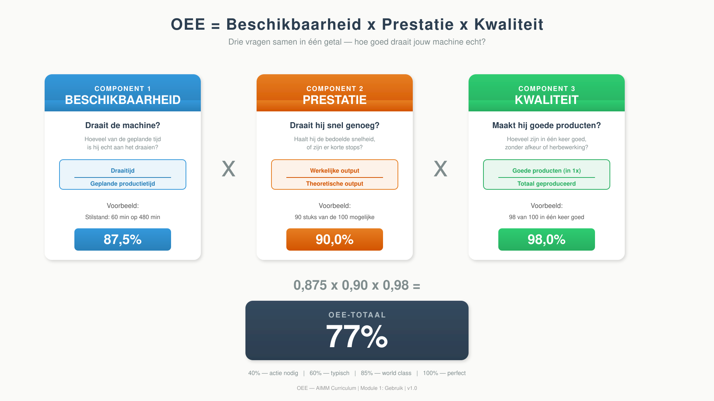

# Wat zegt het OEE-getal eigenlijk over hoe goed jouw machine draait?

Op het bord, op het dashboard, in werkoverleg — overal hoor je over OEE-cijfers. Voor veel operators blijft het een abstract managementgetal. Maar in dat ene getal zitten drie hele eenvoudige vragen verstopt over jouw eigen lijn. Als je weet welke, wordt OEE een spiegel van je werk in plaats van een rapportcijfer.

## Wat leer je?

Je kunt uitleggen wat OEE is en welke drie vragen het beantwoordt. Bij een dienstvoorbeeld kun je per vraag aanwijzen welk getal erbij hoort.

## OEE in drie vragen

OEE staat voor **Overall Equipment Effectiveness** — hoe effectief draait je machine echt. Achter dat getal zitten drie vragen:

1. **Draait de machine wel?** — hoeveel van de geplande tijd staat hij niet stil
2. **Draait hij snel genoeg?** — haalt hij de bedoelde cyclustijd
3. **Maakt hij goede producten?** — hoeveel is in één keer goed

Drie heldere vragen. Drie percentages. En vermenigvuldigd met elkaar krijg je de OEE.

> **OEE = Beschikbaarheid × Prestatie × Kwaliteit**

## Wat het getal betekent

| OEE | Wat dat betekent |
|---|---|
| 100% | Theoretisch maximum — bestaat alleen in spreadsheets |
| 85% | Wereldklasse — uitzonderlijk goed |
| 60% | Gemiddeld in de maakindustrie |
| 40% | Veel ruimte voor verbetering |

De meeste fabrieken zitten ergens rond de 60%. Dat klinkt laag, maar het is normaal. Belangrijk: OEE is een **hulpmiddel om verliezen zichtbaar te maken**, niet een afrekentool. Het laat zien waar je tijd verliest, niet hoe goed jij je werk doet.

## De rekenkracht van vermenigvuldigen

Drie keer 90% lijkt mooi — maar wat is OEE dan?

> 90% × 90% × 90% = **73%**

Drie keer een 90 is geen 90. Het is 73. Dat is het rare aan vermenigvuldigen: kleine verliezen op drie plekken stapelen zich snel op.

Het omgekeerde geldt ook: als je elk percentage iets verbetert, schiet de OEE harder omhoog dan je verwacht.

## Hoe je je eigen lijn schat

Pak je eigen machine in gedachten. Stel jezelf de drie vragen:

- **Draait hij?** Schat: hoeveel procent van de geplande tijd draait je lijn echt? Bijvoorbeeld 90%.
- **Draait hij snel genoeg?** Haalt hij de bedoelde snelheid? Bijvoorbeeld 85%.
- **Maakt hij goede producten?** Hoeveel is in één keer goed? Bijvoorbeeld 95%.

Reken uit: 90% × 85% × 95% = **73%**.

Klinkt dat hoog of laag? Veel operators denken dat hun lijn op 85% zit. Bijna nooit klopt dat. De drie componenten samen dempen het naar beneden — bijna altijd. Dat is het eerste aha-moment van OEE.

## Waarom dit ertoe doet

Als operator zie je de stilstand, de korte stops en de afkeur het beste. Wie OEE snapt, kan:

- **Meepraten** als het management met cijfers komt
- **Aanwijzen** waar de grootste tijdwinst zit op de eigen lijn
- **Eerlijk** vertellen of de getallen op het bord kloppen

Dat is iets anders dan accepteren wat het scherm laat zien.

## Na deze sessie

Loop deze week één keer langs het OEE-bord of dashboard van jouw lijn — als dat er is. Schrijf op: wat is de OEE, en wat zijn de drie onderliggende getallen? Vergelijk dat met je eigen schatting van vandaag. Klopt het? Heb je geen bord? Vraag aan je teamleider of er ergens OEE-cijfers van jouw machine bekend zijn. Praat ook even met een collega-operator: *"Welk van de drie onderdelen denk jij dat onze grootste verliespost is?"* Je ontdekt dat collega's vaak verschillende intuïties hebben — en dat is een mooi gespreksthema.

---

## Werkbladen (Kolb-cyclus)

1. [`wb-01-ervaren.md`](./werkbladen/wb-01-ervaren.md) — Ervaren
2. [`wb-02-reflecteren.md`](./werkbladen/wb-02-reflecteren.md) — Reflecteren
3. [`wb-03-theoretiseren.md`](./werkbladen/wb-03-theoretiseren.md) — Theoretiseren
4. [`wb-04-experimenteren.md`](./werkbladen/wb-04-experimenteren.md) — Experimenteren

## Verder

- Onderliggend kennisobject: [`ko-oee-001`](../../kennisbank/oee/oee_berekening/ko-oee-001.md)
- Voor de begeleider: [`trainer.md`](./trainer.md) + [`draaiboek.md`](./draaiboek.md)
