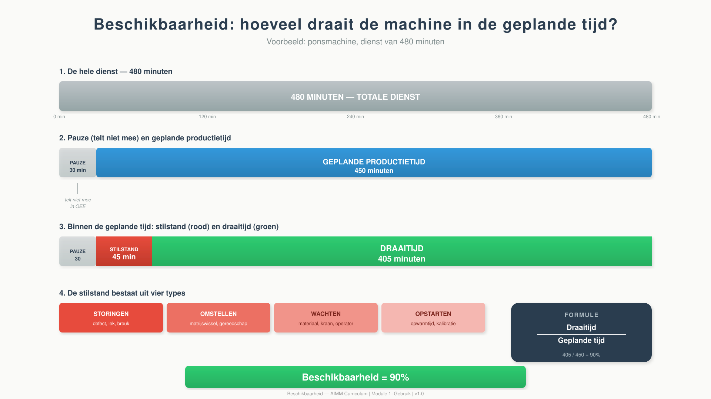

# Welke tijd telt mee als stilstand, en welke niet?

Op elke productielijn gaat tijd verloren. Storingen, omstellen, wachten op materiaal, opstarten. Maar niet alle "niet draaien" telt mee als stilstand voor OEE — pauzes en weekenden zitten niet eens in de geplande productietijd. Wie het verschil snapt, ziet beter waar de echte verbeterpunten zitten.

## Wat leer je?

Je kunt onderscheid maken tussen tijd die wel en niet meetelt als stilstand. Voor een eenvoudige dienstsituatie kun je de beschikbaarheid berekenen.

## Drie soorten tijd op je werkdag

Niet alle tijd is gelijk. Bij OEE rekenen we met drie tijden:

1. **Totale tijd** — alle uren in de dag (24/7)
2. **Geplande productietijd** — totale tijd minus geplande pauzes, weekend, gepland onderhoud, vakantie
3. **Draaitijd** — geplande productietijd minus ongeplande stilstand

De **beschikbaarheid** is de verhouding tussen draaitijd en geplande productietijd. Lunchpauzes en gepland onderhoud zitten niet in die berekening — ze zijn van tevoren ingepland en horen erbij.

> **Beschikbaarheid = Draaitijd ÷ Geplande productietijd**

## Vier stilstandstypen die wel meetellen

Binnen de geplande productietijd zijn er vier soorten ongeplande stilstand:

### 1. Storing

De machine stopt onverwacht door een technisch defect. Een hydrauliekstoring, een sensor die uitvalt, een kapot lager. Niet ingepland, kost productietijd.

### 2. Omstellen

De machine moet worden ingericht voor een ander product. Matrijswissel, gereedschapwissel, programma laden. Soms wel ingepland, maar de tijd zelf telt mee — tijdens omstellen wordt niet geproduceerd.

### 3. Wachten

De machine zou kunnen draaien, maar er is iets anders niet beschikbaar. Wachten op materiaal, op een operator, op een kraan, op kwaliteitscontrole.

### 4. Opstarten

De machine wordt opgestart, maar produceert nog niet op normale snelheid. Opwarmtijd, eerste stuks die nog niet kloppen, kalibreren.

## Telt het wel of niet mee?

Een korte test:

| Situatie | Telt mee als stilstand? |
|---|---|
| Lunchpauze van 30 minuten | Nee — gepland, niet in de productietijd |
| Hydrauliekstoring van 25 minuten | Ja — storing |
| Matrijswissel van 20 minuten | Ja — omstellen |
| Gepland weekend-onderhoud | Nee — buiten productietijd |
| Wachten op een kraan voor materiaal | Ja — wachten |
| Opstarttijd van 10 minuten 's morgens | Ja — opstarten |

De regel achter de regel: **stilstand is alle ongeplande tijd dat de machine niet draait binnen de geplande productietijd.**

## Een voorbeeld doorrekenen

Een ploeg van 8 uur — dus 480 minuten totaal.

- 30 minuten lunchpauze → niet meetellen, geplande productietijd = 450 minuten
- 25 minuten hydrauliekstoring → meetellen
- 20 minuten matrijswissel → meetellen
- Resterende draaitijd = 450 - 25 - 20 = **405 minuten**

Beschikbaarheid = 405 ÷ 450 = **90%**

In jip-en-janneketaal: van de tijd waarin de machine had moeten draaien, draaide hij 90% echt.

## Waarom dit telt

Beschikbaarheid is meestal de eerste plek waar een lijn verbeterd kan worden — en jij als operator ziet de stilstand het beste. Wie de vier types kent:

- **Kan eerlijk meedenken** in verbeterprojecten
- **Wijst gericht aan** waar de grootste tijdwinst zit
- **Voorkomt verkeerde acties** zoals "we moeten harder werken" als de echte verlies in een storingstype zit

Het is geen abstract getal. Het zijn minuten op jouw eigen klok.

## Na deze sessie

Houd komende week één dienst lang een eenvoudige stilstandregistratie bij op je eigen machine. Noteer per stilstand: starttijd, eindtijd, type — storing, omstellen, wachten, of opstarten. Reken aan het eind je beschikbaarheid uit. Neem het briefje mee naar de volgende sessie. Vraag ook aan je teamleider of er een stilstandregistratie op de lijn bestaat. Vergelijk wat erin staat met wat jij hebt gemeten — vaak ontbreken de korte stops in de officiële registratie.

---

## Werkbladen (Kolb-cyclus)

1. [`wb-01-ervaren.md`](./werkbladen/wb-01-ervaren.md) — Ervaren
2. [`wb-02-reflecteren.md`](./werkbladen/wb-02-reflecteren.md) — Reflecteren
3. [`wb-03-theoretiseren.md`](./werkbladen/wb-03-theoretiseren.md) — Theoretiseren
4. [`wb-04-experimenteren.md`](./werkbladen/wb-04-experimenteren.md) — Experimenteren

## Verder

- Onderliggend kennisobject: [`ko-oee-002`](../../kennisbank/oee/beschikbaarheid/ko-oee-002.md)
- Voor de begeleider: [`trainer.md`](./trainer.md) + [`draaiboek.md`](./draaiboek.md)
