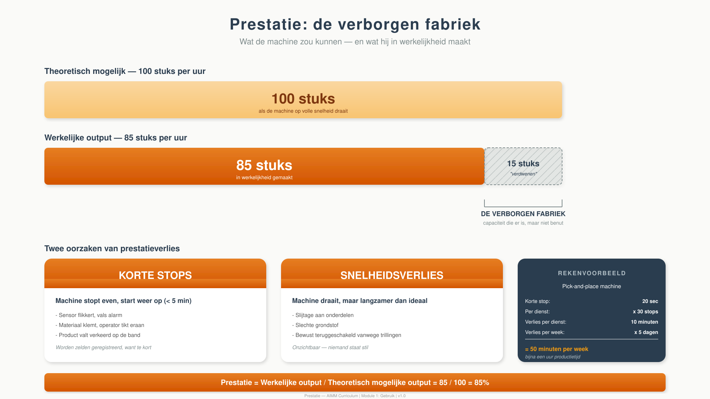

# Hoeveel productietijd verlies je eigenlijk aan stops die je nauwelijks opmerkt?

De machine draait. Niemand staat stil. En toch gaat er structureel tijd verloren. Korte stops en snelheidsverlies zijn de stille killers van productiviteit. Wie ze leert zien, ontdekt vaak een hele "verborgen fabriek" aan capaciteit die er al is.

## Wat leer je?

Je kunt korte stops en snelheidsverlies herkennen op je eigen lijn. Je kunt uitleggen waarom prestatieverlies vaak onzichtbaar blijft.

## Twee soorten prestatieverlies

Beschikbaarheid kijkt of de machine draait. **Prestatie** kijkt of hij snel genoeg draait. Verlies hier komt in twee vormen:

### 1. Korte stops

De machine stopt heel even — een paar seconden, soms een halve minuut — en gaat dan weer. Een sensor die flikkert, een feeder die kort vastloopt, een product dat scheef valt. Niemand registreert dit als storing. Het is "te kort om iets van te zeggen."

### 2. Snelheidsverlies

De machine draait wél, maar langzamer dan zou kunnen. Dat is bijna onzichtbaar — er staat niemand stil, het scherm toont groen. Maar de cyclus duurt 2,2 seconden in plaats van 2,0. Een verschil van 10%, het hele uur door.

## De verborgen fabriek

Reken eens mee. Stel je een pick-and-place lijn voor met **30 korte stops per uur**, elk **20 seconden**:

- 30 × 20 sec = **10 minuten verloren tijd per uur**
- 10 min × 8 uur dienst = **80 minuten per dienst**
- 80 min × 5 dagen = **400 minuten per week**

Bijna **7 uur per week** aan productietijd verdwijnt. Niemand merkt het. Geen storing, geen alarm, geen logboek. Maar de capaciteit die je had, krijg je niet meer.

Dit heet de **verborgen fabriek**: alle productie die je had kunnen maken, zonder extra investering, als je deze stops zou wegnemen.

## Waarom je het niet ziet

Korte stops en snelheidsverlies blijven onzichtbaar omdat:

- **Te kort** — een storing wordt vaak pas geregistreerd na een minuut. Korte stops vallen onder die drempel.
- **Geen duidelijk slachtoffer** — niemand staat te wachten, dus geen klacht
- **"Hoort erbij"** — de operator went eraan dat de feeder af en toe vastloopt
- **Snelheidsverlies is sluipend** — als de cyclus 5 jaar geleden 2,0 sec was en nu 2,2 sec, is dat geleidelijk gegaan. Iedereen denkt dat 2,2 normaal is.

Het is de stille meerderheid van het verlies in moderne fabrieken.

## Hoe je het zichtbaar maakt

Vier eenvoudige technieken die op elke lijn werken:

| Techniek | Wat je doet |
|---|---|
| Turflijst | Een uur lang elke korte stop strepen op een briefje |
| Cyclustelling | Tien cycli timen met de stopwatch en vergelijken met de "ideale" tijd |
| Audit door collega | Iemand anders kijkt 30 minuten naar jouw lijn — die ziet wat jij niet meer ziet |
| Video-opname | Een kwartier filmen en terugkijken — confronterend maar leerzaam |

De makkelijkste is de turflijst. Je hoeft niets te installeren. Je hoeft niets te kunnen. Een pen, een briefje, en aandacht.

### Wat een typische telling oplevert

Operators die voor het eerst turven, schrikken vaak van het aantal:

- 8 stops per uur — je dacht 2
- 35 stops per uur — je dacht 10

Het verschil komt omdat je **gewend** bent aan de meeste stops. Ze gaan zo snel dat ze niet als gebeurtenis registreren. Tot je ze gaat tellen.

## Waarom dit telt

Voor jou als operator:

- **Minder ergernis** aan kleine storingen — als je ze telt, kun je ze gericht aanpakken
- **Meer doorstroom** — wegnemen van de top-3 korte stops geeft vaak 10-15% extra productie zonder extra werk
- **Zichtbaar resultaat** — als je collega's overtuigt om mee te turven, krijg je zicht op het werkelijke patroon

Het is geen managementproject. Het is werk minder hebben aan dezelfde dingen die elke dag terugkomen.

## Na deze sessie

Kies een tijdslot van twee uur in je volgende dienst — bijvoorbeeld 9 tot 11 uur. Turf elke korte stop op een briefje. Zet er ook één streepje bij als de machine duidelijk langzamer draait dan normaal. Reken aan het eind uit: wat zou dit op een hele dienst betekenen? Praat ook even met een monteur of TD'er over één korte stop die structureel optreedt. Vraag: *"Is hier iets aan te doen?"* Vaak blijken de oplossingen kleiner dan gedacht.

---

## Werkbladen (Kolb-cyclus)

1. [`wb-01-ervaren.md`](./werkbladen/wb-01-ervaren.md) — Ervaren
2. [`wb-02-reflecteren.md`](./werkbladen/wb-02-reflecteren.md) — Reflecteren
3. [`wb-03-theoretiseren.md`](./werkbladen/wb-03-theoretiseren.md) — Theoretiseren
4. [`wb-04-experimenteren.md`](./werkbladen/wb-04-experimenteren.md) — Experimenteren

## Verder

- Onderliggend kennisobject: [`ko-oee-003`](../../kennisbank/oee/prestatie/ko-oee-003.md)
- Voor de begeleider: [`trainer.md`](./trainer.md) + [`draaiboek.md`](./draaiboek.md)
