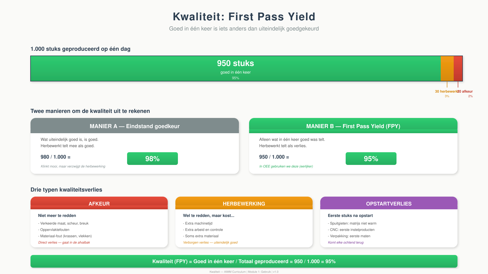

# Waarom is een herbewerkt product ook een verlies, en hoe goed scoor je echt op kwaliteit-in-één-keer?

Veel operators denken: "we keuren toch alles uiteindelijk goed?" Maar elk product dat opnieuw onder de machine moet, kost machinetijd die niet meer aan nieuwe productie besteed wordt. Wie First Pass Yield snapt, voert eerlijke gesprekken over kwaliteit — en ziet waar de echte verbeterruimte zit.

## Wat leer je?

Je kunt First Pass Yield (FPY) berekenen, je herkent waarom herbewerking als verlies telt, en je onderscheidt afkeur, herbewerking en opstartverlies.

## Twee manieren om naar kwaliteit te kijken

Stel: je maakt 1000 stuks per dag. 20 worden afgekeurd, 30 worden herbewerkt en daarna goedgekeurd.

### Manier A — eindstand goedkeur

Wat is uiteindelijk goed? 1000 - 20 = **980 goed**. Dat is 98%.

### Manier B — goed in één keer (FPY)

Wat was direct goed, zonder bijwerken? 1000 - 20 - 30 = **950 goed**. Dat is 95%.

Dat verschil van 3 procentpunten lijkt klein. Maar het vertelt twee heel verschillende verhalen over je productieproces.

> **First Pass Yield = Goed-in-één-keer ÷ Totaal aantal stuks**

## Waarom herbewerking ook verlies is

"Maar het is toch goedgekeurd?" Klopt — uiteindelijk wel. Maar herbewerken kost:

- **Machinetijd** — die je niet kunt gebruiken voor nieuwe productie
- **Arbeid** — een operator of inspecteur moet het opnieuw bekijken
- **Materiaal** — soms moet je delen verwijderen of toevoegen
- **Controle** — het herbewerkte product moet weer langs de keuring

Voor één product is dat te overzien. Voor 30 producten per dag is het structureel verlies dat je nergens terugziet als je alleen naar "goedkeur" kijkt.

## Drie typen kwaliteitsverlies

OEE onderscheidt drie verliezen aan de kwaliteitskant:

### 1. Afkeur

Het product is slecht en gaat naar de afvalbak (of recycling). Eindigend verlies — geen redding mogelijk.

- **Voorbeeld:** spuitgietproduct met luchtbel binnenin

### 2. Herbewerking

Het product is niet goed maar te redden. Iemand werkt het bij, en daarna gaat het door als goed.

- **Voorbeeld:** een naad bijwerken, een bramen verwijderen

### 3. Opstartverlies

Tijdens opstart maakt de machine producten die nog niet kloppen. Vaak elke ochtend dezelfde 10 tot 20 stuks.

- **Voorbeeld:** spuitgieten — eerste 15 producten na opstart hebben matige glans

## Het opstartverlies dat je niet ziet

Opstartverlies lijkt klein per dienst. Maar reken eens uit:

- 15 stuks opstartverlies per dienst
- × 5 diensten per week
- × 52 weken per jaar
- = **3.900 stuks per jaar**

Dat is bij € 5 per stuk **€19.500 per jaar** — alleen aan opstart. Op één lijn. En niemand stuurt actief op deze post, want iedereen zegt: *"dat hoort erbij."*

## Hoe je je eigen FPY schat

Pak de getallen van vorige week (of schat ze):

- Totaal aantal stuks gemaakt: ___
- Daarvan afgekeurd: ___
- Daarvan herbewerkt (en daarna goed): ___
- Opstartverliezen: ___

FPY = (Totaal - Afgekeurd - Herbewerkt - Opstartverlies) ÷ Totaal

Een paar typische uitkomsten:

| Lijn | FPY | Wat dat betekent |
|---|---|---|
| Goed gerunde lijn | 95-98% | Stevig proces, weinig instabiliteit |
| Gemiddelde lijn | 88-93% | Verbeterruimte, vooral op opstart |
| Lijn met problemen | 80-87% | Structureel iets mis, eerste prioriteit |

## Wat je morgen al kunt veranderen

Drie typische acties die zonder investering iets opleveren:

1. **Opstartverlies bijhouden** — eerst meten, dan ontdekken dat het structureel is
2. **Herbewerking apart registreren** — maakt zichtbaar wat nu in "goedkeur" wegvalt
3. **Met collega-operators delen** — vaak zijn er trucs voor opstart die op andere lijnen al werken

## Na deze sessie

Houd één dienst lang bij hoeveel stuks je maakt, hoeveel afgekeurd, hoeveel herbewerkt, en hoeveel opstartverlies. Reken aan het eind je FPY uit. Vergelijk met wat op het kwaliteitsbord staat — als dat er is. Staat herbewerking daar bij, of niet? Vraag ook even aan een collega-operator op een andere lijn hoe zij omgaan met opstartverlies. Vaak zijn er kleine trucs (voorverwarmen, eerste stuks apart) die je niet van je eigen lijn kent.

---

## Werkbladen (Kolb-cyclus)

1. [`wb-01-ervaren.md`](./werkbladen/wb-01-ervaren.md) — Ervaren
2. [`wb-02-reflecteren.md`](./werkbladen/wb-02-reflecteren.md) — Reflecteren
3. [`wb-03-theoretiseren.md`](./werkbladen/wb-03-theoretiseren.md) — Theoretiseren
4. [`wb-04-experimenteren.md`](./werkbladen/wb-04-experimenteren.md) — Experimenteren

## Verder

- Onderliggend kennisobject: [`ko-oee-004`](../../kennisbank/oee/kwaliteit/ko-oee-004.md)
- Voor de begeleider: [`trainer.md`](./trainer.md) + [`draaiboek.md`](./draaiboek.md)
