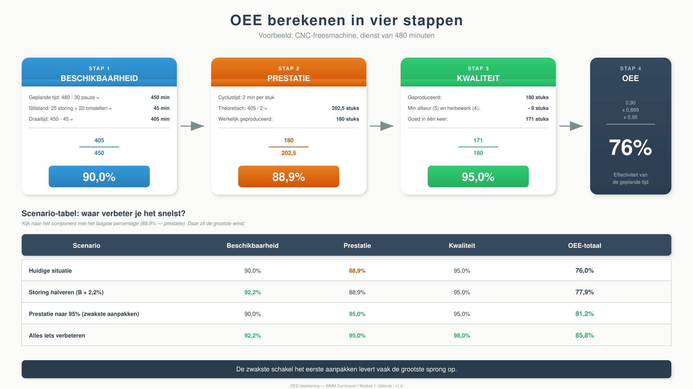

# Hoe reken je de OEE van jouw eigen lijn uit, en welk onderdeel pak je het beste eerst aan?

OEE uitrekenen is geen wiskunde voor specialisten. Het is gereedschap om te zien waar jouw lijn de meeste tijd verliest. Wie de hele berekening kan maken, ziet zelf welk onderdeel — beschikbaarheid, prestatie of kwaliteit — de zwakste schakel is. Dat helpt om gerichter te verbeteren.

## Wat leer je?

Je kunt OEE in vier stappen uitrekenen — beschikbaarheid, prestatie, kwaliteit en totaal — en aanwijzen welke component de grootste verbeterkans biedt.

## Een uitgewerkt voorbeeld — CNC-frees

Stel: je werkt op een CNC-frees. Je dienst is 8 uur (480 minuten). Wat is de OEE?

**Inputgetallen:**
- Geplande pauzes: 30 min
- Storingen: 25 min
- Omstellen: 20 min
- Output: 180 stuks
- Ideale cyclustijd: 2,25 minuten per stuk
- Afgekeurd: 5 stuks
- Herbewerkt: 4 stuks

### Stap 1: Geplande productietijd

Totale tijd minus geplande pauzes:

> 480 - 30 = **450 minuten**

### Stap 2: Beschikbaarheid

Draaitijd ÷ Geplande productietijd:

> Draaitijd = 450 - 25 - 20 = 405 minuten
> Beschikbaarheid = 405 ÷ 450 = **90%**

### Stap 3: Prestatie

(Output × ideale cyclustijd) ÷ Draaitijd:

> Theoretische output bij ideale snelheid = 405 ÷ 2,25 = 180 stuks
> Werkelijke output / theoretische output = 180 / 180 = **100%**

(In dit voorbeeld is prestatie perfect — wat zelden voorkomt. In je eigen lijn zal prestatie meestal lager liggen.)

### Stap 4: Kwaliteit

Goed-in-één-keer ÷ totaal:

> Goed = 180 - 5 - 4 = 171 stuks
> Kwaliteit = 171 ÷ 180 = **95%**

### Stap 5: OEE

> OEE = 0,90 × 1,00 × 0,95 = **85,5%**

Voor deze lijn is de zwakste component de **kwaliteit (95%)** — daar zit de eerste verbeterkans.

## Waar zit het verbeterpotentieel?

Het multiplicatie-effect is sterk. Kijk wat er gebeurt als je elk onderdeel een paar procent verbetert:

| Scenario | B | P | K | OEE |
|---|---|---|---|---|
| Huidige situatie | 90% | 100% | 95% | 85,5% |
| Storing halveren | 95% | 100% | 95% | 90,2% |
| Kwaliteit naar 99% | 90% | 100% | 99% | 89,1% |
| Beide verbeteringen | 95% | 100% | 99% | 94,1% |

Drie procentpunten op kwaliteit geeft 3,6 procentpunten op OEE. Dat is geen toeval — door vermenigvuldigen tikt elk individueel verlies dubbel aan.

## Hoe je je eigen lijn doorrekent

Pak je laatste dienst. Vul deze zes getallen in:

| Vraag | Jouw getal |
|---|---|
| Hoe lang duurde de dienst (in minuten)? | ___ |
| Hoeveel minuten geplande pauzes? | ___ |
| Hoeveel minuten ongeplande stilstand totaal? | ___ |
| Hoeveel stuks heb je gemaakt? | ___ |
| Wat is de ideale cyclustijd in minuten per stuk? | ___ |
| Hoeveel stuks waren niet-in-één-keer goed (afkeur + herbewerking)? | ___ |

Dan reken je in vier stappen:

1. Geplande productietijd = totale tijd - pauzes
2. Beschikbaarheid = (geplande productietijd - stilstand) ÷ geplande productietijd
3. Prestatie = (output × ideale cyclustijd) ÷ draaitijd
4. Kwaliteit = (output - niet-goed) ÷ output

OEE = B × P × K.

## De eerste vraag die telt

Wanneer je je OEE hebt: kijk naar het laagste percentage. **Daar zit meestal de grootste winst.** Een component op 85% verbeteren naar 90% geeft meer impact dan een component op 95% verbeteren naar 98% — door het multiplicatie-effect.

## Wat dit oplevert

Wie de berekening zelf maakt:

- **Spreekt mee** als de teamleider met cijfers komt
- **Wijst aan** welke verbetering prioriteit heeft
- **Vermijdt verkeerde acties** zoals "iedereen moet harder werken" terwijl het verlies in één type stilstand zit

Het is geen managementspel. Het is jouw lijn, in vier rekensommen.

## Na deze sessie

Reken voor je volgende dienst de OEE uit op basis van werkelijk geregistreerde getallen — geen schatting. Noteer per stap (B, P, K) het percentage en het totaal. Markeer welke component de zwakste is en bedenk één concrete actie voor de week erna. Vergelijk je OEE ook eens met die van een collega-operator op een vergelijkbare lijn. Vaak blijken de zwakste componenten te verschillen — en dat geeft gespreksstof om elkaar te helpen.

---

## Werkbladen (Kolb-cyclus)

1. [`wb-01-ervaren.md`](./werkbladen/wb-01-ervaren.md) — Ervaren
2. [`wb-02-reflecteren.md`](./werkbladen/wb-02-reflecteren.md) — Reflecteren
3. [`wb-03-theoretiseren.md`](./werkbladen/wb-03-theoretiseren.md) — Theoretiseren
4. [`wb-04-experimenteren.md`](./werkbladen/wb-04-experimenteren.md) — Experimenteren

## Verder

- Onderliggend kennisobject: [`ko-oee-005`](../../kennisbank/oee/oee_berekening/ko-oee-005.md)
- Voor de begeleider: [`trainer.md`](./trainer.md) + [`draaiboek.md`](./draaiboek.md)
