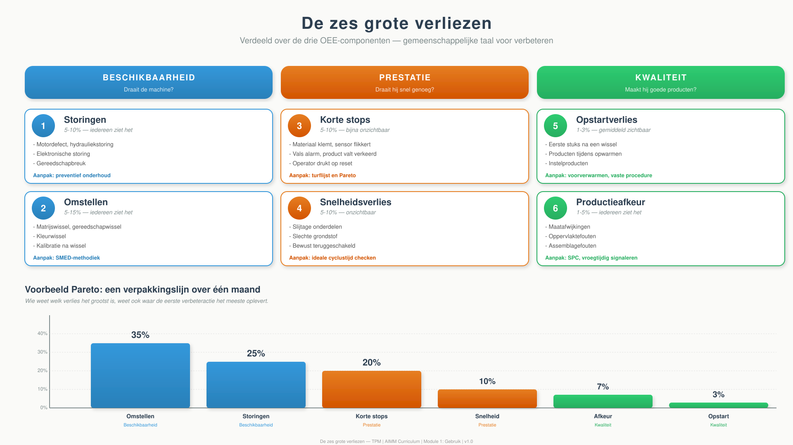

# Welke zes typen verlies zijn er, en welke is bij jou het grootst?

Op een productielijn lijkt elk probleem uniek — een storing hier, een wissel daar, een kapot product. Het zes-verliezen framework geeft je structuur: alle problemen passen in zes hokjes. Wie dat ziet, kan gerichter verbeteren en een eerlijk gesprek voeren over waar de grootste tijdwinst zit.

## Wat leer je?

Je kunt een gebeurtenis op je eigen lijn classificeren als één van de zes grote verliezen, en aangeven bij welke OEE-component die hoort.

## De zes grote verliezen

Het framework komt uit TPM (Total Productive Maintenance) en wordt wereldwijd gebruikt. Elk verlies hoort bij één van de drie OEE-componenten.

### Beschikbaarheidsverliezen

#### 1. Storingen

De machine stopt onverwacht door een technisch defect. Hydraulieklek, kapot lager, sensor uitgevallen.

- **Typisch aandeel:** 5-15% van de productietijd
- **OEE-component:** Beschikbaarheid

#### 2. Omstellen

De machine moet ingericht worden voor een ander product. Matrijswissel, gereedschapwissel, programma laden.

- **Typisch aandeel:** 5-20% van de productietijd
- **OEE-component:** Beschikbaarheid
- **Bekende aanpak:** SMED (Single Minute Exchange of Die) — wisseltijd verkorten

### Prestatieverliezen

#### 3. Korte stops

Kort (seconden tot een minuut) stopt en weer start. Sensor die kort flikkert, feeder die vastloopt, product dat scheef valt.

- **Typisch aandeel:** 5-10% van de productietijd
- **OEE-component:** Prestatie
- **Lastig:** wordt zelden geregistreerd

#### 4. Snelheidsverlies

De machine draait, maar langzamer dan ideaal. Cyclus duurt 2,2 sec in plaats van 2,0.

- **Typisch aandeel:** 5-15% van de productietijd
- **OEE-component:** Prestatie
- **Lastig:** sluipend, niemand merkt het

### Kwaliteitsverliezen

#### 5. Opstartverlies

Eerste stuks na opstart die niet goed zijn. Vaak elke ochtend dezelfde 10 tot 20 stuks.

- **Typisch aandeel:** 1-5% van de productie
- **OEE-component:** Kwaliteit
- **Vaak vergeten:** wordt geaccepteerd als "hoort erbij"

#### 6. Productieafkeur

Producten die tijdens normale productie afgekeurd worden — of moeten worden herbewerkt.

- **Typisch aandeel:** 1-10% van de productie
- **OEE-component:** Kwaliteit

## Het overzicht

| # | Verlies | OEE-component | Typische aanpak |
|---|---|---|---|
| 1 | Storingen | Beschikbaarheid | Preventief onderhoud |
| 2 | Omstellen | Beschikbaarheid | SMED (Single Minute Exchange of Die — methode om omsteltijd te verkorten) |
| 3 | Korte stops | Prestatie | Registratie + analyse |
| 4 | Snelheidsverlies | Prestatie | Cyclustijd-meting |
| 5 | Opstartverlies | Kwaliteit | Voorverwarmen, eerste-stuks-controle |
| 6 | Productieafkeur | Kwaliteit | SPC (Statistical Process Control — statistische procesbeheersing), oorzaakanalyse |

Een storing is geen omstelactie. Een korte stop is iets anders dan snelheidsverlies. Door ze apart te benoemen wordt zichtbaar waar de grootste tijdwinst zit — en welk gereedschap je nodig hebt.

## Een korte test

Welk verlies hoort bij welke gebeurtenis?

| Gebeurtenis | Verlies |
|---|---|
| Matrijswissel | Omstellen (#2) |
| Hydrauliekstoring | Storing (#1) |
| Sensor reset om de drie minuten | Korte stops (#3) |
| Eerste 15 producten 's ochtends afgekeurd | Opstartverlies (#5) |
| Cyclustijd van 2,2 ipv 2,0 sec | Snelheidsverlies (#4) |
| Lasnaad bijwerken voor 5% van de producten | Productieafkeur (#6) — herbewerking telt mee |

## Waarom dit gebruikt wordt

Een gemeenschappelijke taal voor verbeteren. Wanneer operators, teamleiders, monteurs en management dezelfde zes hokjes gebruiken:

- **Storingen** worden besproken in onderhoudsoverleg
- **Omstelacties** krijgen een SMED-project
- **Korte stops** worden eindelijk geteld in plaats van genegeerd
- **Snelheidsverlies** wordt zichtbaar via cyclustijd-meting
- **Opstartverlies** wordt geadresseerd als systeemprobleem, niet als pech
- **Afkeur** krijgt SPC en oorzaakanalyse

Vaker hergebruiken van dezelfde aanpak. Minder ad-hoc brandblussen.

## Een Pareto van je eigen lijn

Pak je eigen lijn in gedachten. Schat:

- **Welk verlies is het grootst?**
- **Welke staat op nummer 2?**
- **En op nummer 3?**

Niet exact — schatten is genoeg. Vaak heb je gelijk. Wat je ziet is je eigen Pareto: waar de meeste tijd verloren gaat. Daar zou je het eerst willen aanpakken.

## Na deze sessie

Houd één week lang een logboekje bij van de drie meest voorkomende verliezen op jouw lijn. Schrijf per voorval op: welk type verlies (van de zes), hoe lang het duurde, en wat je vermoedt als oorzaak. Aan het eind van de week: welke verlies stond het vaakst in je logboekje? Praat ook even met een monteur of een collega-operator over je top-1 verlies: *"Wat zou jij hieraan doen?"* Vaak komen er ideeën uit die je zelf niet had bedacht.

---

## Werkbladen (Kolb-cyclus)

1. [`wb-01-ervaren.md`](./werkbladen/wb-01-ervaren.md) — Ervaren
2. [`wb-02-reflecteren.md`](./werkbladen/wb-02-reflecteren.md) — Reflecteren
3. [`wb-03-theoretiseren.md`](./werkbladen/wb-03-theoretiseren.md) — Theoretiseren
4. [`wb-04-experimenteren.md`](./werkbladen/wb-04-experimenteren.md) — Experimenteren

## Verder

- Onderliggend kennisobject: [`ko-oee-006`](../../kennisbank/oee/verliesanalyse/ko-oee-006.md)
- Voor de begeleider: [`trainer.md`](./trainer.md) + [`draaiboek.md`](./draaiboek.md)
