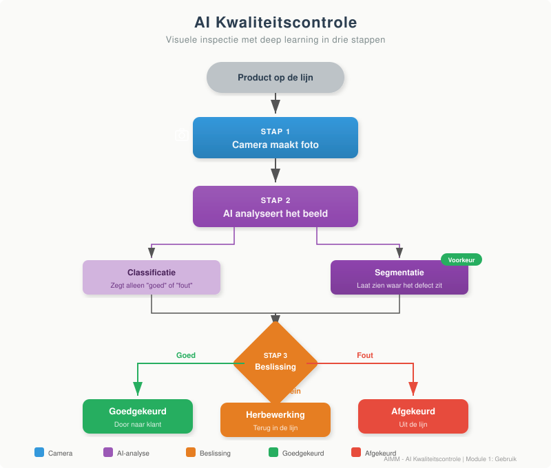

# Hoe kan een camera met AI defecten herkennen op de productielijn?

Op de werkvloer keur je dagelijks producten. Soms zie je een defect direct, soms mis je er een. En het kost tijd. Een camera met AI doet dit werk in een fractie van een seconde. In deze sessie leer je hoe dat werkt en waar het in jouw fabriek kan helpen.

## Wat leer je?

Je leert hoe AI-kwaliteitscontrole werkt. Je kunt na deze sessie in eigen woorden de drie stappen benoemen — camera, AI-analyse, beslissing — en een voorbeeld geven uit je eigen werk.

## AI-kwaliteitscontrole in drie stappen

Het systeem werkt simpel, ook al zit er veel techniek achter. Het bestaat uit drie duidelijke stappen.

### Stap 1: De camera maakt een foto

Een camera bij de productielijn maakt een foto van elk product. Soms duizenden foto's per uur. De foto's zijn scherp en altijd onder dezelfde belichting.

### Stap 2: AI bekijkt de foto

De AI (kunstmatige intelligentie — een computerprogramma dat patronen herkent) heeft duizenden voorbeelden gezien. Goede producten en afgekeurde. Het systeem kijkt naar de nieuwe foto en vergelijkt die met wat het heeft geleerd.

Er zijn twee manieren waarop het systeem kijkt:

- **Classificatie** — het systeem geeft één oordeel: goed of afgekeurd.
- **Segmentatie** — het systeem geeft een oordeel én laat zien waar het defect zit (bijvoorbeeld een rode markering op de plek van de kras).

### Stap 3: Het systeem neemt een beslissing

Goed product gaat door. Afgekeurd product gaat opzij of er komt een melding. Bij twijfel kan een operator nog meekijken.

## Een werkvloer-voorbeeld

Stel: je werkt op een lijn die plastic deksels maakt. De camera maakt van elke deksel een foto. De AI is getraind op 5.000 foto's: 4.000 goede deksels en 1.000 met defecten zoals krassen, bramen en vlekken.

Een nieuwe deksel komt langs. Camera, foto, AI-analyse — binnen 0,1 seconde een oordeel. Het systeem vindt een kras die jij met het blote oog had kunnen missen. Klep gaat opzij. Geen reclamatie van de klant.

## Hoe leert het systeem zoveel patronen?

AI heeft veel voorbeelden nodig. Soms zijn er weinig foto's van bepaalde defecten. Dan gebruikt het systeem een truc: **data-augmentatie** (de bestaande foto's worden gedraaid, lichter gemaakt, donkerder gemaakt). Zo leert het systeem ook defecten herkennen die het maar zelden ziet.

## Wat kan AI wel en niet?

Een AI-camera is niet onfeilbaar. Het werkt goed op defecten die het kent. Maar bij een nieuw soort defect — dat het systeem nooit eerder zag — herkent het systeem het niet. Daarom blijft jouw rol belangrijk:

- Jij signaleert nieuwe soorten fouten.
- Jij twijfelt waar de AI nooit twijfelt.
- Jij begrijpt waarom een defect ontstaat — de AI niet.

De AI haalt het routine-werk weg. Jij doet het werk dat denken vereist.

## Waarom dit ertoe doet

Kwaliteitscontrole kost tijd en mist soms defecten. AI doet dit sneller en nauwkeuriger. Dat maakt jouw werk makkelijker en het product beter. Een fabriek waar jij begrijpt hoe het systeem werkt, kan AI verstandig inzetten.

## Na deze sessie

Kijk de komende week bij een kwaliteitscontrole op je werk. Schrijf drie dingen op:

1. Welke defecten zoek je het meest? Krassen, vlekken, vorm, maat?
2. Hoeveel tijd kost zo'n controle per product?
3. Zou een camera dit ook kunnen zien — of zit het defect te diep voor een foto?

Bespreek je notities in de volgende sessie. Vraag je teamleider of er al plannen zijn voor AI bij kwaliteitscontrole.

Eén kleine stap deze week: kies één product op je lijn en kijk er bewust naar tijdens drie kwaliteitscontroles. Wat zou een camera daarvan zien?

---

## Werkbladen (Kolb-cyclus)

1. [`wb-01-ervaren.md`](./werkbladen/wb-01-ervaren.md) — Ervaren
2. [`wb-02-reflecteren.md`](./werkbladen/wb-02-reflecteren.md) — Reflecteren
3. [`wb-03-theoretiseren.md`](./werkbladen/wb-03-theoretiseren.md) — Theoretiseren
4. [`wb-04-experimenteren.md`](./werkbladen/wb-04-experimenteren.md) — Experimenteren

## Verder

- Onderliggend kennisobject: [`ko-smart-mfg-006`](../../kennisbank/smart_manufacturing/computer_vision_kwaliteit/ko-smart-mfg-006.md)
- Voor de begeleider: [`trainer.md`](./trainer.md) + [`draaiboek.md`](./draaiboek.md)
- Interactief: [`interactive/model.html`](./interactive/model.html)
