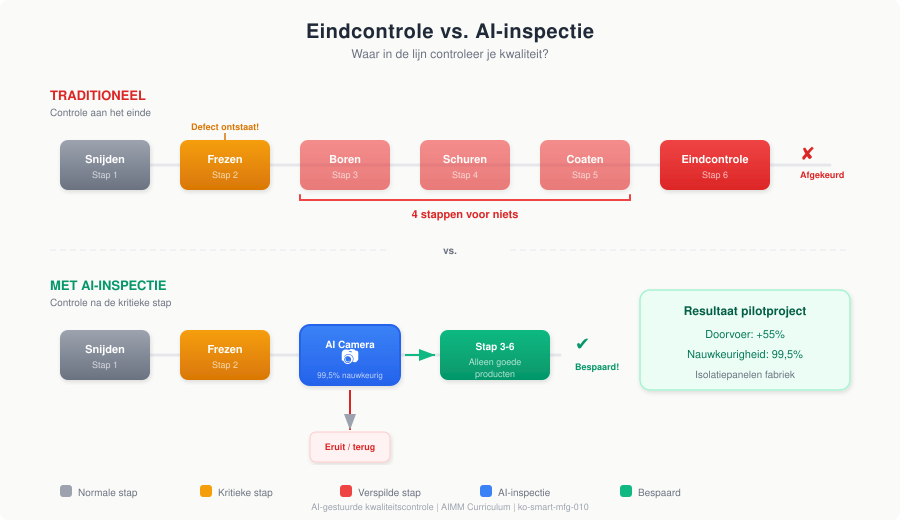

# Hoe kan AI-kwaliteitscontrole defecten eerder opsporen en productietijd besparen?

In veel fabrieken wordt een product pas aan het eind gecontroleerd. Als het dan afgekeurd wordt, heeft het al alle bewerkingen doorlopen. Tijd, energie en materiaal weg. AI-inspectie tijdens het proces kan dat voorkomen. In deze sessie zie je hoe.

## Wat leer je?

Je leert het verschil tussen eindcontrole en tussentijdse AI-inspectie. Je kunt na deze sessie minimaal twee voordelen van vroege detectie noemen aan de hand van een voorbeeld van een productielijn.

## Eindcontrole versus tussentijdse inspectie

Een productielijn heeft meestal vier of vijf bewerkingsstappen. Bij eindcontrole keur je alleen aan het eind. Bij tussentijdse AI-inspectie keurt een camera tussen elke stap door.

### Eindcontrole — wat gebeurt er?

- Een product gaat door alle stappen heen.
- Pas helemaal aan het eind komt het bij de kwaliteitscontrole.
- Een defect dat in stap 1 ontstond, krijgt nog vier bewerkingen.
- Dat kost extra grondstof, extra machinetijd, extra energie.
- Vaak ontdek je het pas als er al 50 of 100 defecte producten zijn.

### Tussentijdse AI-inspectie — wat gebeurt er?

- Tussen elke stap maakt een camera een foto.
- De AI (kunstmatige intelligentie — een computerprogramma dat patronen herkent) beoordeelt de foto direct.
- Een defect product gaat meteen opzij. Geen vervolgbewerkingen meer.
- De lijn kan stoppen of bijsturen voordat er een serie defecten ontstaat.

## Een werkvloer-voorbeeld

Stel: je werkt op een metaallijn met vijf stappen. Stap 1 is stansen, stap 5 is lakken. Bij eindcontrole na het lakken zie je een stansfout. Het product heeft dan stansen, ontvetten, primer, lakken en drogen doorlopen. Vijf bewerkingen aan een defect product.

Met tussentijdse AI-inspectie zou de camera na stap 1 al de stansfout zien. Product opzij, vier bewerkingen bespaard. En als drie producten op een rij dezelfde fout hebben, slaat het systeem alarm. Jij stelt de stansmachine bij voordat er een hele bak afkeur ontstaat.

## Twee voordelen die je direct ziet

| Voordeel | Wat het oplevert |
|---|---|
| **Minder verspilling** | Defecte producten doorlopen niet alle stappen. Minder grondstof, minder energie, minder uren. |
| **Sneller bijsturen** | Een patroon van fouten wordt direct zichtbaar. Je past de machine aan voordat er een serie afkeur is. |

Een derde, zachter voordeel: minder stress aan het eind van de dienst. Niet meer pas om vier uur ontdekken dat een hele batch fout is.

## Wat verandert er voor jou?

De AI doet routinematig kijkwerk. Jij houdt het belangrijke werk:

- Bijstellen van de machine bij een patroon.
- Beoordelen van twijfelgevallen die de AI niet kent.
- Signaleren van nieuwe soorten defecten.
- Begrijpen waarom een fout ontstaat — daar denkt de AI niet over na.

## Waarom dit ertoe doet

Een product dat al vier bewerkingen heeft gehad voor het wordt afgekeurd, is duur. Vroege detectie haalt die kosten weg. Op een drukke lijn met dunne marges maakt dit het verschil tussen winst en verlies.

## Na deze sessie

Kijk deze week bewust naar het kwaliteitsproces op jouw lijn. Schrijf op:

- Waar in de lijn worden producten gekeurd? Aan het eind, of ook tussendoor?
- Welke fouten worden pas laat ontdekt?
- Hoeveel bewerkingen had zo'n defect product al doorlopen?

Bespreek je bevindingen met je teamleider in het volgende werkoverleg. Vraag een collega van een andere lijn hoe zij kwaliteit controleren.

Eén kleine stap deze week: kies één moment per dienst om actief naar de plek te kijken waar defecten meestal pas laat opduiken. Wat zou daar een camera kunnen toevoegen?

---

## Werkbladen (Kolb-cyclus)

1. [`wb-01-ervaren.md`](./werkbladen/wb-01-ervaren.md) — Ervaren
2. [`wb-02-reflecteren.md`](./werkbladen/wb-02-reflecteren.md) — Reflecteren
3. [`wb-03-theoretiseren.md`](./werkbladen/wb-03-theoretiseren.md) — Theoretiseren
4. [`wb-04-experimenteren.md`](./werkbladen/wb-04-experimenteren.md) — Experimenteren

## Verder

- Onderliggend kennisobject: [`ko-smart-mfg-010`](../../kennisbank/smart_manufacturing/computer_vision_kwaliteit/ko-smart-mfg-010.md)
- Voor de begeleider: [`trainer.md`](./trainer.md) + [`draaiboek.md`](./draaiboek.md)
- Interactief: [`interactive/model.html`](./interactive/model.html)
