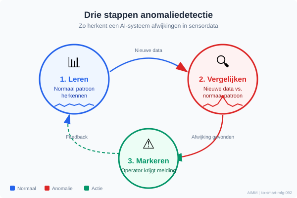

# Hoe herken je afwijkingen in sensordata van een machine, en wanneer moet je ingrijpen?

Een machine die steeds vaker afwijkende waarden laat zien, gaat binnenkort kapot. Als operator merk je dat soms pas als het te laat is. Anomaliedetectie helpt je om problemen te zien VOORDAT ze schade veroorzaken — minder stilstand, minder uitval, minder stress.

## Wat leer je?

kan drie soorten anomalieen in sensordata herkennen en benoemen wanneer een waarde afwijkt van normaal

## Hoe werkt anomaliedetectie?

Anomaliedetectie is een AI-techniek die automatisch afwijkingen in je productieproces opspoort. Het systeem leert eerst wat "normaal" is door honderden normale cycli te analyseren. Daarna vergelijkt het elke nieuwe cyclus met dat normale patroon.

### Drie soorten afwijkingen

1. **Puntanomalie** -- een enkele meting die ver buiten het normale bereik valt (bijv. temperatuur plotseling 95 graden C in plaats van 65)
2. **Contextuele anomalie** -- een waarde die normaal is in de ene situatie maar afwijkend in een andere (bijv. hoge trillingen na opstarten vs. tijdens productie)
3. **Collectieve anomalie** -- een reeks metingen die individueel normaal zijn maar samen een patroon vormen (bijv. temperatuur die elke dag 0,5 graden stijgt)

### Wat doet het systeem?

- **Leren**: het systeem analyseert honderden normale cycli
- **Vergelijken**: elke nieuwe cyclus wordt vergeleken met het geleerde patroon
- **Markeren**: als een cyclus te veel afwijkt, slaat het alarm

## Na deze sessie

Kijk deze week naar de sensordata of dashboards op je werkvloer. Schrijf drie waarden op die je opvallen. Bepaal per waarde: is dit normaal of afwijkend? Welk type anomalie zou het zijn? Neem dit mee naar de volgende bijeenkomst.

---

## Werkbladen (Kolb-cyclus)

1. [`wb-handout-theorie.md`](./werkbladen/wb-handout-theorie.md) — Theorie
2. [`wb-meekijk-worked-example.md`](./werkbladen/wb-meekijk-worked-example.md) — Worked example
3. [`wb-oefening-sensordata.md`](./werkbladen/wb-oefening-sensordata.md) — Sensordata
4. [`wb-reflectie-groepsoefening.md`](./werkbladen/wb-reflectie-groepsoefening.md) — Groepsoefening

## Verder

- Onderliggend kennisobject: [`ko-smart-mfg-092`](../../kennisbank/smart_manufacturing/predictive_maintenance/ko-smart-mfg-092.md)
- Voor de begeleider: [`trainer.md`](./trainer.md) + [`draaiboek.md`](./draaiboek.md)
- Interactief: [`interactive/model.html`](./interactive/model.html)
