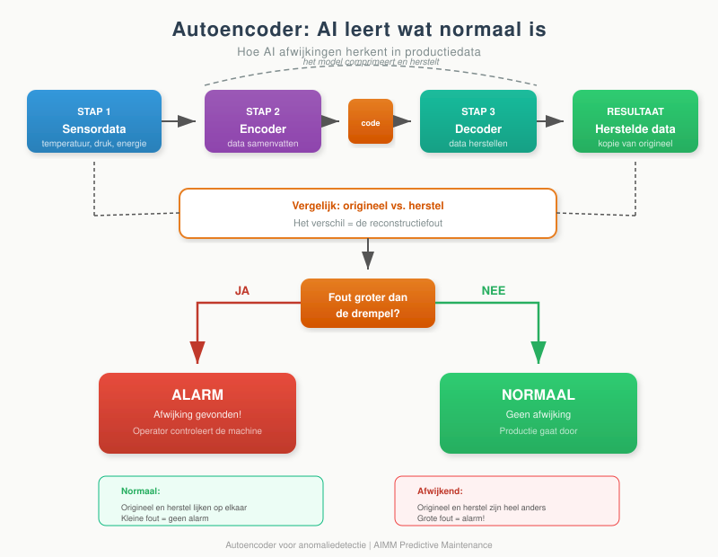

# Hoe kan AI leren wat normaal is, zodat het alarm slaat als iets afwijkt?

Op jouw productielijn draaien machines de hele dag. Soms gaat er iets mis. Je merkt het vaak pas als het te laat is — stilstand, afkeur, een snelle reparatie. Een autoencoder (een AI-techniek die patronen leert) kan eerder alarm slaan. In deze sessie zie je hoe.

## Wat leer je?

Je leert hoe een autoencoder afwijkingen in productiedata herkent. Je kunt na deze sessie in eigen woorden minimaal drie stappen van het proces uitleggen: invoer, samenvatting, herstel en reconstructiefout.

## Hoe een autoencoder werkt

Een autoencoder is een AI-techniek die alleen leert wat normaal is. Het ziet duizenden gewone cycli van een machine. Daar bouwt het een soort "geheugen" van wat het hoort te zijn.

Dat geheugen werkt in vier stappen.

### Stap 1: Invoer

De autoencoder krijgt sensordata van een productiecyclus binnen. Bijvoorbeeld trillingen, temperatuur en stroomverbruik per seconde.

### Stap 2: Samenvatting

Het systeem perst die data samen tot een korte samenvatting. Net zoals jij na een hele werkdag in één zin kunt zeggen hoe de dag ging. Onbelangrijke details verdwijnen, het wezenlijke blijft.

### Stap 3: Herstel

Vanuit die samenvatting probeert het systeem de hele cyclus weer op te bouwen. Voor normale cycli lukt dat heel goed — het systeem heeft dit patroon vaak gezien.

### Stap 4: Reconstructiefout

Het systeem vergelijkt de herstelde cyclus met de originele. Klein verschil = normaal. Groot verschil = reconstructiefout, en dus mogelijk een afwijking. Bij een te grote fout slaat het systeem alarm.

## Een werkvloer-voorbeeld

Stel: je werkt aan een spuitgietmachine. Sensors meten elke seconde druk, temperatuur en cyclustijd. De autoencoder is getraind op 10.000 normale cycli.

Vandaag draait de machine een nieuwe cyclus. Druk lijkt normaal, temperatuur ook. Maar de cyclustijd is 0,3 seconden langer dan gewoonlijk en de drukcurve heeft een klein hobbeltje halverwege. De autoencoder probeert deze cyclus na te bootsen. De druk lukt prima, de cyclustijd niet helemaal. Reconstructiefout iets te hoog: alarm.

Jij krijgt een melding op je dashboard: "Cyclus 14:32 — afwijkend patroon, controleer aanvoer." Een uur later voorkom je een lagere kwaliteit doordat je tijdig hebt bijgesteld.

## Wat doet de autoencoder hetzelfde als jij?

Eigenlijk doet de autoencoder wat jij ook doet — alleen sneller en op data:

- Jij ziet duizend keer een machine draaien. Je weet hoe een goede cyclus voelt.
- De autoencoder "ziet" duizend keer dezelfde data. Het weet hoe normaal eruitziet.
- Jij merkt dat iets "vreemd klinkt". De autoencoder meet dat als reconstructiefout.

Verschil: jij hoort het misschien één op de tien keer. De autoencoder meet het elke cyclus, dag en nacht.

## Wat moet jij doen met een alarm?

Het systeem zegt niet wat er mis is. Alleen dát er iets afwijkt. Jij blijft nodig om:

- Te bepalen of de afwijking ernstig is of een eenmalige bijzonderheid.
- De oorzaak te zoeken — versleten lager, andere grondstof, temperatuur in de hal.
- Te beslissen of je doorgaat, bijstelt of stopt.

## Waarom dit ertoe doet

Stilstand kost tijd en geld. Een autoencoder ziet patronen die jij niet altijd opvangt. Minder onverwachte storingen, minder brandjes blussen, meer grip op je dienst.

## Na deze sessie

Let de komende week op patronen in je productiedata. Schrijf op:

- Eén moment waarop je zelf dacht: "Dit is niet normaal."
- Wat viel je op — geluid, trilling, een waarde op het dashboard?
- Hoe lang voordat de storing kwam, voelde je het al?

Bespreek je notitie in de volgende sessie met je team. Vraag je teamleider of er al sensordata wordt verzameld op jouw machine. Zo ja, hoeveel cycli?

Eén kleine stap deze week: kies één machine en sta er drie keer per dienst even bij stil. Wat voelt normaal? Wat voelt anders?

---

## Werkbladen (Kolb-cyclus)

1. [`wb-01-ervaren.md`](./werkbladen/wb-01-ervaren.md) — Ervaren
2. [`wb-02-reflecteren.md`](./werkbladen/wb-02-reflecteren.md) — Reflecteren
3. [`wb-03-theoretiseren.md`](./werkbladen/wb-03-theoretiseren.md) — Theoretiseren
4. [`wb-04-experimenteren.md`](./werkbladen/wb-04-experimenteren.md) — Experimenteren

## Verder

- Onderliggend kennisobject: [`ko-smart-mfg-093`](../../kennisbank/smart_manufacturing/predictive_maintenance/ko-smart-mfg-093.md)
- Voor de begeleider: [`trainer.md`](./trainer.md) + [`draaiboek.md`](./draaiboek.md)
- Interactief: [`interactive/model.html`](./interactive/model.html)
