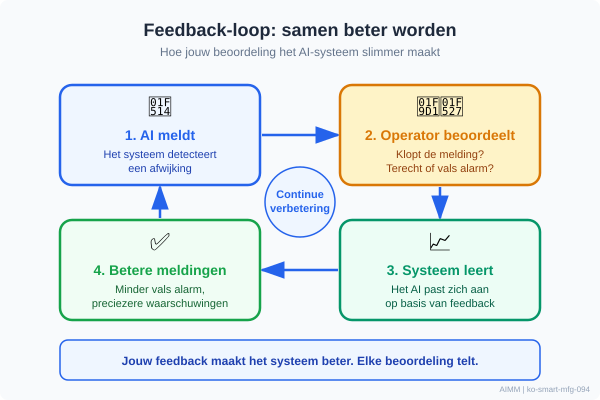

# Human-in-the-loop bij anomaliedetectie



## Waar gaat dit over?

AI-systemen op de werkvloer geven meldingen als er iets afwijkt. Soms klopt dat. Soms niet. Jij als operator kent de machine het best. In deze sessie leer je hoe je AI-meldingen beoordeelt: is het een echt probleem of vals alarm?

En het mooie is: elke keer dat jij feedback geeft, wordt het systeem slimmer.

---

## Wat leer je?

Na deze sessie kun je:
- Een AI-melding beoordelen als **terecht alarm** of **vals alarm**
- Je beoordeling onderbouwen: waarom denk je dat?
- Het beoordelingsprotocol (4 stappen) gebruiken bij een nieuwe melding
- Uitleggen waarom jouw feedback het AI-systeem beter maakt

---

## Hoe werkt deze sessie? (45 minuten)

Deze sessie werkt met **scaffolding**: eerst doet de trainer het voor, dan doen we het samen, en dan doe jij het zelf.

```
IK DOE             WIJ DOEN           JIJ DOET
Melding 1-2        Melding 3-4        Melding 5-8
Trainer doet       Groep bespreekt    Jij beoordeelt
het hardop voor    samen              zelfstandig
```

Na **elke** melding krijg je het antwoord met uitleg. Niet pas aan het einde.

---

### Deel 1: Kijken hoe het moet (10 min)

De trainer laat zien hoe je een AI-melding beoordeelt. Je kijkt mee en let op de stappen.

**Melding 1 - de trainer doet voor:**

> *"Het AI-systeem geeft een melding: temperatuurpiek van 85 graden C na het opstarten van de machine."*

De trainer denkt hardop:
- "Ik kijk eerst naar de **context**: wanneer kwam deze melding? Direct na het opstarten - 7 minuten geleden."
- "Ik weet uit ervaring: na het opstarten is een temperatuurpiek **normaal**. De machine warmt op."
- "Mijn conclusie: dit is **vals alarm**."
- "Ik klik 'vals alarm' en typ erbij: *normaal opstartgedrag*."

> **Antwoord: VALS ALARM.** Na het opstarten is een hogere temperatuur normaal. Het AI-systeem kent dit patroon nog niet. Door jouw feedback leert het dat een piek bij opstart geen probleem is.

**Melding 2 - de trainer doet nog een keer voor:**

> *"Het AI-systeem geeft een melding: trillingsniveau is 3x de normaalwaarde en neemt continu toe. Huidige waarde: 4,2 mm/s. Drempel: 3,5 mm/s. Normaal: 1,4 mm/s."*

De trainer denkt hardop:
- "Ik kijk naar het **verloop**: de trillingen zijn 3x normaal en het neemt continu toe. Dat is geen piek maar een trend."
- "Ik check de **waarde**: 4,2 is boven de drempel van 3,5."
- "Ik weet: geleidelijk toenemende trillingen wijzen vaak op **slijtage** van een lager of aandrijving."
- "Mijn conclusie: dit is **terecht alarm**. Ik plan een controle in."

> **Antwoord: TERECHT ALARM.** Trillingspiek 3x normaal en continu toenemend is een klassiek teken van lagerslijtage. Hoe langer je wacht, hoe groter de schade. Goed dat het systeem dit oppikt.

**Melding 3-4 - nu de groep:**

De trainer laat melding 3 en 4 zien. De groep bespreekt samen per tafel: wat denken jullie? De trainer geeft daarna bij elke melding het antwoordmodel.

---

### Deel 2: Patronen herkennen (10 min)

We hebben nu vier meldingen gezien. Wat valt op?

Samen maken we twee lijsten op de flip-over:
- **Vals alarm** (groen) - welke kenmerken had dat? (Bijvoorbeeld: na opstarten, na productwissel)
- **Echt alarm** (rood) - welke kenmerken had dat? (Bijvoorbeeld: geleidelijke toename, onverklaarbare afwijking)

We maken samen vuistregels. Die helpen je straks bij de volgende meldingen.

---

### Deel 3: Het beoordelingsprotocol (10 min)

Er zijn vier stappen om een AI-melding te beoordelen:

| Stap | Wat doe je? | Voorbeeld |
|------|------------|-----------|
| **1. Context** | Wanneer kwam de melding? Na opstarten? Na productwissel? Tijdens normale productie? | "Deze melding kwam 5 minuten na opstarten" |
| **2. Waarde** | Hoe ver wijkt de meting af? Is het net boven de drempel of ver erboven? | "4,2 mm/s bij een drempel van 3,5 - dat is 20% erboven" |
| **3. Patroon** | Is het een eenmalige piek of een trend? Heb je dit eerder gezien? | "Dit is de derde keer deze week" |
| **4. Actie** | Terecht of vals alarm? Welke actie neem je? Welke feedback geef je? | "Terecht alarm - ik plan een controle in en markeer als terecht" |

Je herkent deze stappen van wat we net samen deden. De trainer deed stap 1-4 bij elke melding.

---

### Deel 4: Zelf aan de slag (15 min)

Nu beoordeel je zelf vier nieuwe meldingen (5 tot en met 8). Gebruik het beoordelingsprotocol.

**Zo werkt het:**
1. Lees de melding op je casuskaart
2. Doorloop de vier stappen
3. Schrijf op: terecht of vals alarm, en waarom
4. **Direct daarna** krijg je het antwoord met uitleg

Na alle vier de meldingen tel je je score op.

**Jouw eindscore:** ___ van 6 correct (melding 3-8; melding 1-2 waren voorbeelden)

**Feed-forward van de trainer:**
De trainer vertelt je welk type melding je het vaakst miste. Bijvoorbeeld: "De meldingen die je miste waren allemaal contextuele anomalieen - situaties die normaal zijn in de ene omstandigheid maar afwijkend in een andere. Let daar volgende keer extra op."

---

## Reflectie

Denk even na:
- Bij welk type melding twijfelde je het meest? Waarom?
- Welke vuistregel die de groep bedacht helpt jou het meest?
- Hoe zou je feedback geven aan het AI-systeem op jouw werkvloer?

---

## Transferopdracht: deze week op de werkvloer

Let de komende week op AI-meldingen op jouw werkvloer (of vraag een collega die ermee werkt).

Noteer bij minimaal drie meldingen:
- Wat was de melding?
- Was het terecht of vals alarm?
- Waarom denk je dat?

Neem je notities mee naar de volgende bijeenkomst.

**Doe ook:** Vraag je leidinggevende: hoe geeft ons team nu feedback aan het AI-systeem? Gebeurt dat eigenlijk?

---

## Waarom doet dit ertoe?

Elke keer dat jij een AI-melding beoordeelt en feedback geeft, gebeuren er twee dingen:
1. **Het systeem leert.** Minder vals alarm, betere detectie van echte problemen.
2. **Jij leert.** Je wordt beter in het inschatten van meldingen. Je gaat patronen herkennen.

Jouw machinekennis en het AI-systeem versterken elkaar. Dat is human-in-the-loop.

---

## Werkbladen (Kolb-cyclus)

1. [`wb-actieplan-meldingen-werkvloer.md`](./werkbladen/wb-actieplan-meldingen-werkvloer.md) — Meldingen werkvloer
2. [`wb-casuskaarten-8-meldingen.md`](./werkbladen/wb-casuskaarten-8-meldingen.md) — 8 meldingen
3. [`wb-handout-beoordelingsprotocol.md`](./werkbladen/wb-handout-beoordelingsprotocol.md) — Beoordelingsprotocol
4. [`wb-reflectie-patronen.md`](./werkbladen/wb-reflectie-patronen.md) — Patronen
5. [`wb-scoringsformulier.md`](./werkbladen/wb-scoringsformulier.md) — wb-scoringsformulier

## Verder

- Onderliggend kennisobject: [`ko-smart-mfg-094`](../../kennisbank/smart_manufacturing/predictive_maintenance/ko-smart-mfg-094.md)
- Voor de begeleider: [`trainer.md`](./trainer.md) + [`draaiboek.md`](./draaiboek.md)
- Interactief: [`interactive/model.html`](./interactive/model.html)
