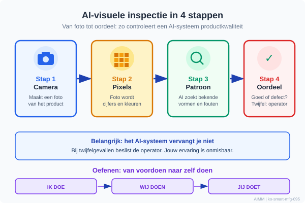

# Visuele kwaliteitscontrole met AI

> **Leervraag:** Hoe kan een AI-camera producten controleren op zichtbare gebreken, en wat is jouw rol daarbij?

---

## Waarom is dit belangrijk?

Je controleert elke dag producten met je ogen. Na een paar uur word je moe en mis je dingen. Dat kost geld en frustratie. AI-camera's kunnen je helpen door de makkelijke controles over te nemen. Jij houdt je dan bezig met de moeilijke gevallen — waar jouw vakkennis echt nodig is.

---

## Deel 1: Foto-inspectie (15 min)

### De trainer doet voor (foto 1-2)

Bekijk samen met de trainer twee productfoto's. Let op hoe hij systematisch kijkt en zijn oordeel uitlegt.

**Foto 1 — Metalen behuizing met kras:**
De trainer kijkt van links naar rechts, van boven naar beneden. Linksboven zit een kras van ongeveer 3 cm. Dat is een oppervlaktedefect. De AI scoort deze foto **0.92** — dat betekent 92% kans op defect. De AI is het eens met de trainer.

**Foto 2 — Goede metalen behuizing:**
De trainer kijkt op dezelfde manier. Het oppervlak is glad en egaal. Geen krassen, deuken of kleurafwijkingen. De AI scoort **0.12** — slechts 12% kans op defect. Goed product.

> **Tip:** Kijk altijd systematisch. Van links naar rechts, van boven naar beneden. Let extra op randen en hoeken — daar zitten de meeste defecten.

### De groep bespreekt samen (foto 3-5)

Bekijk foto 3, 4 en 5 samen met je groep. Bespreek bij elke foto:
- Wat zie je?
- Is het product goed of defect?
- Welk type defect is het?

De trainer helpt bij foto 3, maar bij foto 4 en 5 probeer je het steeds meer zelf.

### Jij beoordeelt zelfstandig (foto 6-10)

Nu ben jij aan de beurt. Beoordeel foto 6 tot en met 10 zelfstandig. Schrijf op je werkblad:
- Goed of defect?
- Welk defect zie je?
- Hoe zeker ben je? (1 = helemaal niet zeker, 5 = heel zeker)

---

## Deel 2: Hoe deed je het? (10 min)

### Antwoordmodel

Na de oefening loop je samen met de trainer alle foto's door. Bij elke foto zie je:
- Het juiste antwoord (goed of defect)
- Welk defect het was
- De AI-score

### Vergelijking mens vs. AI

De trainer noteert op het whiteboard:
- **De AI** vond 9 van de 10 foto's correct
- **De groep** vond ... van de 10 foto's correct

De defecten die de meeste mensen misten, waren kleine krassen op de rand. Dat is precies waar het menselijk oog moeite mee heeft — vooral na een lange dienst.

### Bespreek samen

- Bij welke foto's had je het fout? Waarom denk je dat je het miste?
- Wanneer mis jij weleens iets bij het controleren op je eigen werk?

---

## Deel 3: Hoe werkt AI-visuele inspectie? (10 min)

AI-visuele inspectie werkt in vier stappen:

1. **Camera maakt foto** — Van elk product op de lijn
2. **AI analyseert** — Een slim model bekijkt de foto
3. **Classificatie** — Goed of defect?
4. **Twijfelgevallen naar jou** — Bij twijfel beslist de operator

> **Belangrijk:** De AI vervangt je niet. De AI helpt je. Jij blijft nodig voor de moeilijke gevallen.

### Praktijkvoorbeeld: Philips Drachten

*(Bron: Rožanec et al. 2024 — academisch gedocumenteerd praktijkvoorbeeld, Artificial Intelligence in Manufacturing.)*

Bij Philips in Drachten controleert een AI-systeem drie producten:
- **Logo's op scheerapparaten** — Zijn ze compleet en scherp?
- **Decoratieve kapjes** — Zitten er vloeisporen in het plastic?
- **Tandenborstelschachten** — Zitten er deuken of strepen op?

Voor elk product is een apart model getraind met honderden voorbeeldfoto's. De operator hoeft alleen nog de twijfelgevallen te bekijken. **Resultaat: de inspectietijd is met 60% verminderd** *(cijfer uit de oorspronkelijke publicatie; varieert per productielijn en inspectie-situatie).*

### Denk na

Welk type defect op jouw werkvloer zou een AI goed kunnen herkennen? Welk type juist niet?

---

## Deel 4: Waar zou AI helpen op jouw werkvloer? (10 min)

Bedenk samen met je buurman:

1. **Welk product** controleren jullie het vaakst?
2. **Welk defect** zoeken jullie het meest?
3. **Hoeveel producten** controleren jullie per dag?
4. **Waarom** zou AI-inspectie hier helpen?

Vul samen het actieplan-werkblad in. Presenteer jullie idee in 1 minuut aan de groep.

---

## Samenvatting

| Mens | AI |
|------|-----|
| Wordt moe na uren kijken | Wordt nooit moe |
| Kan inconsistent oordelen | Oordeelt altijd hetzelfde |
| Herkent onbekende defecten | Herkent alleen wat hij geleerd heeft |
| Begrijpt context | Kijkt alleen naar de foto |

**De ideale combinatie:** AI doet de snelle, herhalende controles. Jij doet de moeilijke gevallen waar vakkennis nodig is.

---

## Transferopdracht

Doe dit deze week op je eigen werkvloer:
1. Kies een product dat je regelmatig controleert
2. Fotografeer 5 goede producten en 5 producten met een defect
3. Schrijf bij elke foto op welk defect je ziet
4. Neem de foto's mee naar de volgende bijeenkomst

> **Doe ook:** Vraag je leidinggevende of er al plannen zijn voor camera-inspectie op jullie afdeling.

---

## Werkbladen (Kolb-cyclus)

1. [`wb-actieplan.md`](./werkbladen/wb-actieplan.md) — wb-actieplan
2. [`wb-foto-inspectie.md`](./werkbladen/wb-foto-inspectie.md) — Inspectie
3. [`wb-handout-theorie.md`](./werkbladen/wb-handout-theorie.md) — Theorie
4. [`wb-reflectie.md`](./werkbladen/wb-reflectie.md) — wb-reflectie

## Verder

- Onderliggend kennisobject: [`ko-smart-mfg-095`](../../kennisbank/smart_manufacturing/computer_vision_kwaliteit/ko-smart-mfg-095.md)
- Voor de begeleider: [`trainer.md`](./trainer.md) + [`draaiboek.md`](./draaiboek.md)
- Interactief: [`interactive/model.html`](./interactive/model.html)
