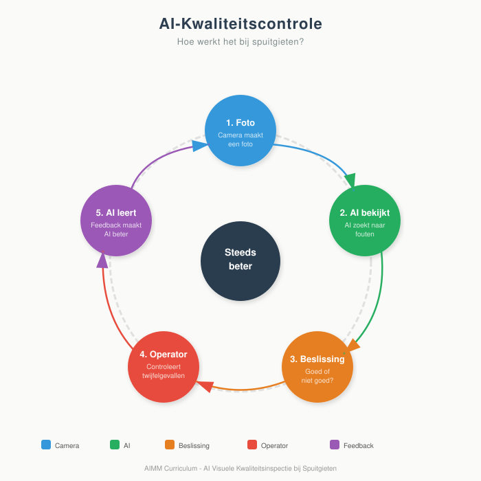

# Hoe werkt AI-kwaliteitscontrole en wat is jouw rol als operator?

Op de spuitgietlijn keur je producten met je ogen en handen. Steeds vaker doet een camera met AI dat ook. Het systeem ziet kleine fouten en werkt 24 uur door. Maar betekent dat dat jouw werk verdwijnt? Nee. Het betekent dat je werk verandert. In deze sessie zie je hoe.

## Wat leer je?

Je leert hoe AI-kwaliteitscontrole werkt op een spuitgietlijn. Je kunt na deze sessie minimaal drie stappen van het AI-inspectieproces benoemen en uitleggen welke rol jij daarbij houdt.

## De zes stappen van AI-kwaliteitscontrole

Een AI-inspectiesysteem werkt altijd in dezelfde volgorde. Zes stappen, korte cyclus, herhaalt zich constant.

### Stap 1: Foto maken

Een camera bij de uitworp maakt een scherpe foto van elk product. Altijd onder dezelfde belichting. Bij spuitgieten meestal binnen één seconde na de uitworp.

### Stap 2: Voorbewerken

De software snijdt onbelangrijke randen weg en past kleur of contrast aan. Zo ziet de AI altijd een vergelijkbaar beeld, ongeacht licht of stof.

### Stap 3: AI-analyse

De AI (kunstmatige intelligentie — een computerprogramma dat patronen herkent) vergelijkt de foto met duizenden voorbeelden die het eerder zag. Goede producten en afgekeurde. Binnen 0,1 seconde een oordeel.

### Stap 4: Defect benoemen

Bij een afkeur geeft het systeem aan welk soort defect het ziet: kras, braam, vlek, vorm. Soms ook waar precies op het product. Dat heet **segmentatie** (de AI markeert de plek).

### Stap 5: Beslissing en actie

Goed product gaat door. Afkeur gaat opzij of er komt een melding op je scherm. Bij twijfel kan het systeem vragen om jouw oordeel.

### Stap 6: Terugkoppeling

Jouw beslissingen — vooral bij twijfelgevallen — gaan terug naar het systeem. Zo leert het bij. Een fout die jij vandaag ziet, kent het systeem volgende maand zelf.

## Een werkvloer-voorbeeld

Stel: je werkt op een spuitgietlijn die deksels maakt. Camera, foto, AI-analyse — elke 8 seconden een product, dag en nacht. De AI is getraind op 12.000 foto's: 10.000 goede deksels en 2.000 met defecten.

Een nieuwe deksel komt langs. De AI ziet een vlek op de rand. Klep gaat opzij, jij krijgt een melding. Jij kijkt: vlek klopt. Klein bedankje aan het systeem.

Een uur later weer een melding. De AI noemt het "braam". Jij ziet: het is geen braam, het is een nieuwe vormafwijking door een versleten matrijs. Je markeert het als nieuw defect. Volgende maand herkent de AI het zelf.

## Wat kan de AI, wat kan jij?

| AI | Jij |
|---|---|
| 24 uur per dag dezelfde kwaliteit | Slimme uitzonderingen begrijpen |
| Snel — 0,1 seconde per product | Patronen door de hele dienst zien |
| Vermoeit niet, raakt niet afgeleid | Begrijpt oorzaak en context |
| Mist nieuwe fouttypes die het nooit zag | Signaleert wat nieuw is |

Jij blijft nodig voor twijfelgevallen, voor nieuwe foutsoorten, en voor het begrijpen van waarom een fout ontstaat. De AI haalt het routinematig kijkwerk weg.

## Waarom dit ertoe doet

AI-kwaliteitscontrole wordt al gebruikt in fabrieken in jouw regio. Het maakt jouw werk beter, niet overbodig. Een fabriek waar jij begrijpt hoe het systeem werkt, kan AI verstandig inzetten. Zonder operator die meekijkt, leert het systeem niet bij — en mist het op den duur de nieuwe fouten.

## Na deze sessie

Kijk deze week bij je eigen machine naar de kwaliteitscontrole. Schrijf op:

- Welke fouten komen het vaakst voor? Kras, braam, vorm, vlek?
- Hoe vaak per dienst zie je zo'n fout?
- Zou een camera die kunnen zien? Welke wel, welke niet?

Bespreek je bevindingen in de volgende sessie met de groep. Vraag een collega wat hij of zij denkt over AI bij kwaliteitscontrole. Hoor je twijfels of juist enthousiasme?

Eén kleine stap deze week: kies één product en let er twee diensten lang bewust op. Welke fouten zou een AI vandaag al kunnen overnemen?

---

## Werkbladen (Kolb-cyclus)

1. [`wb-01-ervaren.md`](./werkbladen/wb-01-ervaren.md) — Ervaren
2. [`wb-02-reflecteren.md`](./werkbladen/wb-02-reflecteren.md) — Reflecteren
3. [`wb-03-theoretiseren.md`](./werkbladen/wb-03-theoretiseren.md) — Theoretiseren
4. [`wb-04-experimenteren.md`](./werkbladen/wb-04-experimenteren.md) — Experimenteren

## Verder

- Onderliggend kennisobject: [`ko-smart-mfg-101`](../../kennisbank/smart_manufacturing/computer_vision_kwaliteit/ko-smart-mfg-101.md)
- Voor de begeleider: [`trainer.md`](./trainer.md) + [`draaiboek.md`](./draaiboek.md)
- Interactief: [`interactive/model.html`](./interactive/model.html)
