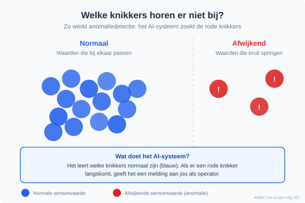

# AI die je machine in de gaten houdt

*Anomaliedetectie op CNC-machines — een praktijkcase*

**Duur:** 45 minuten | **Niveau:** MBO-3 | **Module 1: Gebruik**

---

> **Wat ga je leren?**
> Na deze sessie kun je in eigen woorden uitleggen hoe een AI-systeem afwijkingen op een CNC-machine herkent. En je weet wat jij als operator doet als je een melding krijgt.

---

## De case: CNH Industrial in Modena

*(Bron: Sesana et al. 2024, Artificial Intelligence in Manufacturing — CNH Industrial Modena, Heller 400 CNC-anomaliedetectie.)*

Bij CNH Industrial maken ze tractortransmissies. Hun CNC-machines draaien de hele dag. Maar af en toe valt een machine onverwacht uit. Dat kost tijd, geld en soms beschadigde werkstukken.

Ze hebben een AI-systeem geïnstalleerd dat 76 sensoren in de gaten houdt. Temperatuur, trillingen, energieverbruik, druk. Het systeem leert wat normaal is — en slaat alarm als er iets afwijkt.

---

## Hoe werkt het? De knikkermetafoor

Stel je voor: je hebt een bak met 1000 knikkers.

- **990 knikkers zijn blauw** — dat is normaal machinegedrag
- **10 knikkers zijn rood** — dat zijn afwijkingen

Het AI-systeem leert de blauwe knikkers te herkennen. Alles wat niet blauw is, krijgt een waarschuwing.

### Het systeem in 3 stappen

| Stap | Wat het systeem doet |
|------|---------------------|
| **1. Leren** | Het systeem bekijkt sensordata van weken normaal draaien. Het leert: dit is normaal. |
| **2. Vergelijken** | Bij elke nieuwe meting vergelijkt het systeem: past dit bij het normale patroon? |
| **3. Markeren** | Als iets afwijkt, krijg jij een melding. Het systeem zegt niet wat er mis is — het zegt: hier moet je kijken. |

> **Onthoud:** Het systeem heet Isolation Forest. Je hoeft niet te weten hoe het technisch werkt. Je moet weten wat het doet en wat jij doet met de melding.

---

## Waarom is dit belangrijk voor jou?

- Storingen eerder ontdekken (uren of zelfs dagen van tevoren)
- Minder ongeplande stilstand
- Minder beschadigde producten
- Gerichter onderhoud: je weet waar je moet kijken
- **Minder brandjes blussen, meer grip op je machine**

---

## De sessie: wat gaan we doen?

| Tijd | Wat | Hoe |
|------|-----|-----|
| 12 min | **Case 1: Trainer doet voor** | De trainer laat de CNC-case zien en legt hardop denkend voor hoe hij de anomalie herkent |
| 10 min | **Case 2: Groep samen** | Jullie analyseren samen een nieuwe melding |
| 8 min | **Reflectie** | Herken je dit van je eigen machine? |
| 7 min | **Uitleg** | Hoe het systeem werkt (knikkermetafoor) |
| 8 min | **Case 3: Duo zelfstandig** | Jullie analyseren in tweetallen een melding |

---

## Transferopdracht: voor op je werkvloer

**Deze week:**
1. Kijk bij je eigen machine naar de sensoren die je kent (temperatuur, trillingen, druk)
2. Schrijf op welke 3 sensoren jij het belangrijkst vindt om te bewaken
3. Neem dit mee naar de volgende bijeenkomst

**Doe ook:** Vraag aan de onderhoudsmonteur: "Welke storingen kwamen het afgelopen half jaar het vaakst voor op mijn machine?"

---

## Werkbladen (Kolb-cyclus)

1. [`wb-01-worked-example.md`](./werkbladen/wb-01-worked-example.md) — Worked example
2. [`wb-02-groepsanalyse.md`](./werkbladen/wb-02-groepsanalyse.md) — Groepsanalyse
3. [`wb-03-reflectie.md`](./werkbladen/wb-03-reflectie.md) — Reflectie
4. [`wb-04-duo-analyse.md`](./werkbladen/wb-04-duo-analyse.md) — Duo analyse

## Verder

- Onderliggend kennisobject: [`ko-smart-mfg-107`](../../kennisbank/smart_manufacturing/predictive_maintenance/ko-smart-mfg-107.md)
- Voor de begeleider: [`trainer.md`](./trainer.md) + [`draaiboek.md`](./draaiboek.md)
