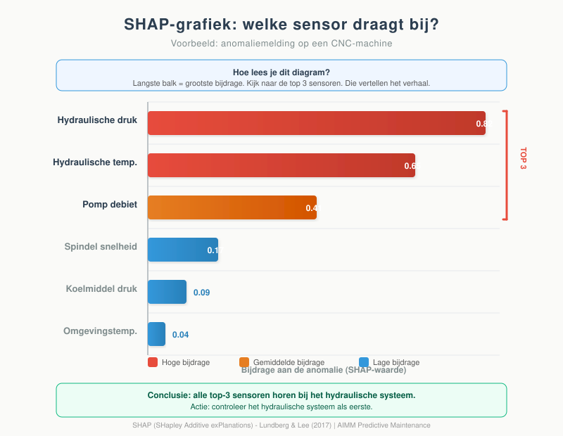

# Hoe lees je een SHAP-grafiek zodat je snel weet welke sensor het probleem veroorzaakt?

Op de werkvloer krijg je steeds vaker meldingen van een AI-systeem. "Er is iets mis met machine 3." Maar wát er mis is, zegt de melding niet. Dan sta je daar — bij een grote machine met tientallen sensoren — en mag je gaan zoeken. SHAP (een grafiek die laat zien welke sensor het meest bijdraagt aan een melding) lost dat op. In één blik weet je waar je moet kijken.

## Wat leer je?

Je leert een SHAP-grafiek lezen. Je kunt na deze sessie de drie sensoren met de grootste bijdrage aanwijzen en in eigen woorden uitleggen waarom die afwijken.

## Wat is een SHAP-grafiek?

Een SHAP-grafiek (SHapley Additive exPlanations — een uitlegmethode voor AI-beslissingen) laat per sensor zien hoeveel die bijdroeg aan de anomalie (afwijking). Het is een staafdiagram dat je vertelt: deze sensor zat het verst van normaal af.

De grafiek werkt met twee regels.

### Regel 1: Hoe groter de balk, hoe groter de bijdrage

Een sensor met een lange balk is dé verdachte. Een sensor met een korte balk is bijna normaal en niet je eerste actie.

### Regel 2: Kleur zegt of de waarde te hoog of te laag was

- **Rood** — de sensor mat een te hoge waarde.
- **Blauw** — de sensor mat een te lage waarde.

Zo weet je niet alleen welke sensor, maar ook welke richting. Te warm of juist te koud. Te veel druk of te weinig.

## Een SHAP-grafiek in drie stappen lezen

Volg deze drie stappen elke keer dat je een SHAP-grafiek voor je krijgt.

1. **Zoek de drie langste balken.** Dat zijn je top-3 verdachten.
2. **Kijk per balk naar de kleur.** Rood = waarde te hoog, blauw = te laag.
3. **Zeg hardop wat die sensor meet.** Bijvoorbeeld: "trilling-as-2, rood, te hoog." Dat is je eerste plek om te kijken.

## Een werkvloer-voorbeeld

Stel: je krijgt een melding op je dashboard. "Anomalie machine 7, om 14:32." Je opent de SHAP-grafiek. Je ziet vijf balken:

- Trilling lager 2: lange rode balk.
- Temperatuur motor: middelgrote rode balk.
- Stroomverbruik: kleine balk.
- Cyclustijd: kleine balk.
- Druk hydrauliek: korte blauwe balk.

Top-3: trilling te hoog, temperatuur motor te hoog, druk hydrauliek te laag. Je weet meteen: ga eerst kijken bij lager 2. Mogelijk is het versleten — daardoor stijgt de trilling, en als gevolg gaat de motor harder werken en wordt warm. De drukval kan een symptoom zijn.

Zonder SHAP had je waarschijnlijk eerst overal gekeken. Met SHAP heb je in 30 seconden een hypothese.

## Wat doet SHAP niet?

SHAP zegt welke sensor afwijkt. SHAP zegt niet waarom. Jij blijft nodig om:

- De fysieke oorzaak te vinden — versleten lager, vuile filter, koelvloeistof te laag.
- Te beoordelen of het urgent is.
- Te bepalen wat de juiste actie is — bijstellen, vervangen, stoppen.

## Waarom dit ertoe doet

Als een machine stopt, verlies je productietijd. Hoe langer je zoekt, hoe meer verlies. Met SHAP weet je in een halve minuut waar je moet beginnen. Je hoeft niet meer de hele machine te doorzoeken.

## Na deze sessie

Vraag deze week bij een storingsmelding aan je leidinggevende of er een SHAP-grafiek beschikbaar is. Bekijk de grafiek samen. Wijs de drie langste balken aan en zeg hardop wat die sensoren meten.

Maak een foto van de grafiek. Noteer welke sensor bovenaan stond en welke kleur die had. Schrijf één zin op over wat je vervolgens hebt gecontroleerd.

Bespreek in het volgende teamoverleg wat je hebt gezien. Vraag collega's of zij SHAP-grafieken op hun machines kennen. Vergelijk hoe jullie ze gebruiken.

Eén kleine stap deze week: vraag deze week één keer, bij één melding, om de SHAP-grafiek. Dat is genoeg om te beginnen.

---

## Werkbladen (Kolb-cyclus)

1. [`wb-01-ervaren.md`](./werkbladen/wb-01-ervaren.md) — Ervaren
2. [`wb-02-reflecteren.md`](./werkbladen/wb-02-reflecteren.md) — Reflecteren
3. [`wb-03-theoretiseren.md`](./werkbladen/wb-03-theoretiseren.md) — Theoretiseren
4. [`wb-04-experimenteren.md`](./werkbladen/wb-04-experimenteren.md) — Experimenteren

## Verder

- Onderliggend kennisobject: [`ko-smart-mfg-108`](../../kennisbank/smart_manufacturing/predictive_maintenance/ko-smart-mfg-108.md)
- Voor de begeleider: [`trainer.md`](./trainer.md) + [`draaiboek.md`](./draaiboek.md)
- Interactief: [`interactive/model.html`](./interactive/model.html)
