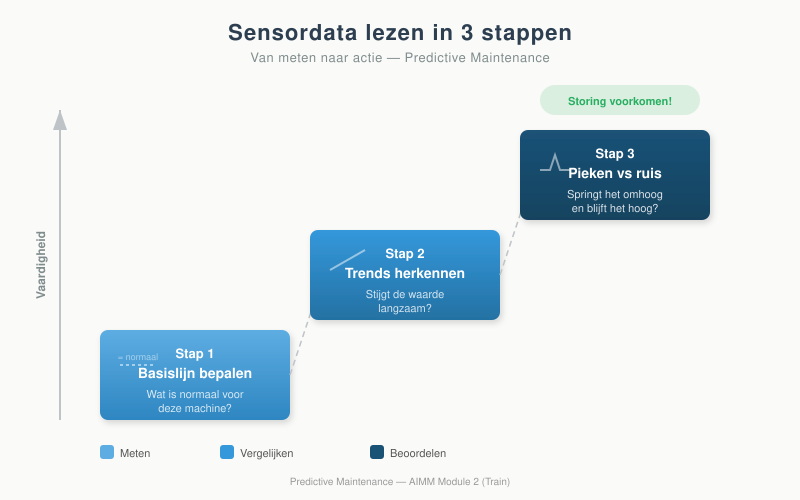

# Hoe lees je sensordata, en wanneer moet je actie ondernemen?

Op de werkvloer meten sensoren elke seconde temperatuur, druk en trillingen. Als je die data kunt lezen, zie je een storing aankomen voordat de machine stopt. Minder stilstand. Minder stress. Meer grip op jouw machine.

## Wat leer je?

Je leert sensordata van jouw machine aflezen. Je bepaalt zelf een basislijn (de "normale" waarde voor jouw machine). En je herkent of een afwijking een trend, een piek of gewoon ruis is.

## Sensordata lezen in drie stappen

Jouw machine heeft eigen normaalwaarden. Niet de fabriek, niet de leverancier — jij weet het beste hoe jouw lijn draait. Met deze drie stappen vertaal je ruwe getallen naar bruikbare informatie.

### Stap 1: Bepaal je basislijn

De basislijn is de gemiddelde waarde wanneer de machine goed draait. Je krijgt die niet cadeau. Je meet hem zelf.

- Doe minimaal 5 metingen per sensor.
- Spreid ze over 3 werkdagen.
- Meet op vaste tijden (bijvoorbeeld bij elke koffiepauze).
- Reken het gemiddelde uit per sensor: temperatuur, druk, trillingen.

Die drie getallen zijn jouw basislijn. Uniek voor jouw machine.

### Stap 2: Herken het type afwijking

Niet elke afwijking is een probleem. Er zijn drie soorten:

1. **Trend** — de waarde stijgt of daalt langzaam over dagen of weken. Dit wijst vaak op slijtage. Iets om in de gaten te houden.
2. **Piek** — een korte, scherpe uitschieter. Eén meting valt ver buiten de basislijn. Dit kan een echte storing zijn.
3. **Ruis** — kleine schommelingen rond de basislijn. Hoort erbij. Geen actie nodig.

### Stap 3: Kies de juiste actie

Per type afwijking hoort een andere reactie:

- **Trend** — noteer de waarde, vergelijk met vorige week, plan onderhoud in.
- **Piek** — check de machine direct, meld het bij onderhoud als de piek terugkomt.
- **Ruis** — niks doen. Laat de machine draaien.

Een vuistregel: als een waarde meer dan twee keer de normale spreiding afwijkt, kijk dan beter.

## Wat je zintuigen ook vertellen

Niet alles staat in een dashboard. Een sensor meet geen geur. Geen geluid. Geen trilling die je in je hand voelt. Vertrouw daarom ook op wat je hoort, ruikt en voelt.

Combineer drie bronnen:

- De getallen op het scherm.
- Wat de sensor niet meet (geluid, geur, vibratie).
- Wat de onderhoudstechnicus belangrijk vindt op jouw machine.

Samen krijg je een vollediger beeld dan elk stuk apart.

## Na deze sessie

Start deze week met jouw eigen basislijn-meting op één machine. Doe vijf metingen over drie werkdagen, op vaste tijden.

Reken het gemiddelde uit per sensor: temperatuur, druk en trillingen. Stuur die drie getallen naar de trainer of in de groepsapp.

Let deze week ook op niet-numerieke signalen. Geluid, geur, vibratie die je voelt. Noteer wat opvalt.

Vraag aan de onderhoudstechnicus welke sensorwaarden hij belangrijk vindt op jouw machine. Neem zijn antwoord mee naar de volgende sessie.

---

## Werkbladen (Kolb-cyclus)

1. [`wb-01-experimenteren.md`](./werkbladen/wb-01-experimenteren.md) — Experimenteren
2. [`wb-02-ervaren.md`](./werkbladen/wb-02-ervaren.md) — Ervaren
3. [`wb-03-reflecteren.md`](./werkbladen/wb-03-reflecteren.md) — Reflecteren
4. [`wb-04-theoretiseren.md`](./werkbladen/wb-04-theoretiseren.md) — Theoretiseren

## Verder

- Onderliggend kennisobject: [`ko-smart-mfg-201`](../../kennisbank/smart_manufacturing/predictive_maintenance/ko-smart-mfg-201.md)
- Voor de begeleider: [`trainer.md`](./trainer.md) + [`draaiboek.md`](./draaiboek.md)
- Interactief: [`interactive/model.html`](./interactive/model.html)
