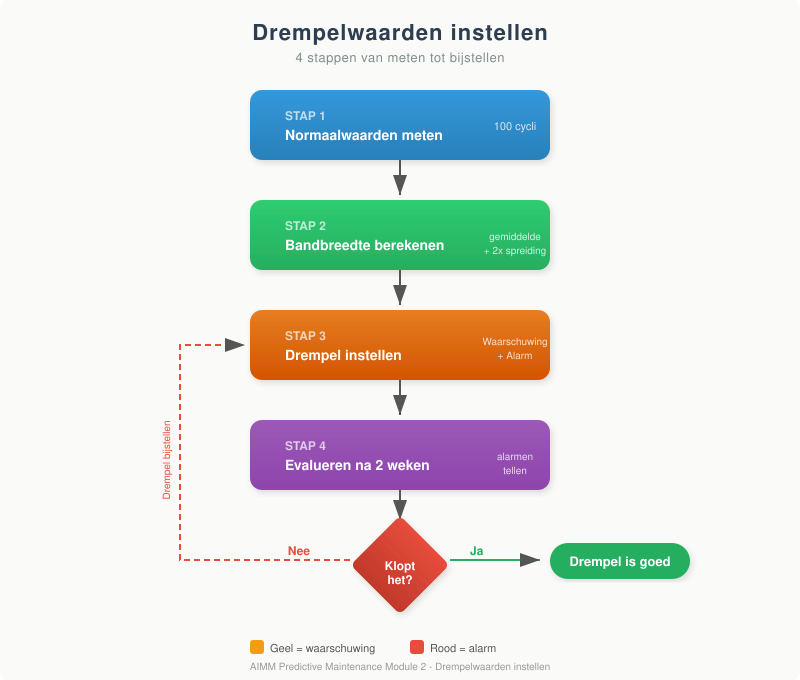

# Hoe bepaal je wanneer een sensorwaarde echt afwijkend is?

Op jouw productielijn meten sensoren continu door. Maar wanneer is een waarde "te hoog"? Als je drempelwaarden (de grens waarboven de machine waarschuwt) zelf kunt instellen, hoef je niet meer te wachten op de technische dienst. Je voorkomt onverwachte stilstand. En je krijgt minder vals alarm op vrijdagavond.

## Wat leer je?

Je kunt na deze sessie zelf drempelwaarden bepalen, instellen en bijstellen. Je gebruikt vier stappen: meten, berekenen, instellen, evalueren. Het doel: maximaal 1 vals alarm per week.

## Drempelwaarden bepalen in vier stappen

Een drempelwaarde is een grens. Boven die grens geeft het systeem een waarschuwing of alarm. Te laag ingesteld? Dan piept alles continu. Te hoog? Dan zie je problemen te laat. De juiste grens vind je met deze vier stappen.

### Stap 1: Meten

Verzamel data van minimaal 100 productiecycli. Niet één dag, maar een week of meer. Zo vang je ook de schommelingen tussen vroege dienst en late dienst.

- Kies één sensor om mee te beginnen.
- Noteer per cyclus de gemeten waarde.
- Sla de data op in een tabel of dashboard.

### Stap 2: Berekenen

Pak je 100 metingen. Reken twee dingen uit:

1. **Gemiddelde** — tel alle waarden op, deel door het aantal metingen.
2. **Spreiding** — hoeveel de waarden gemiddeld afwijken van het gemiddelde.

De vuistregel voor je drempelwaarde:

> drempel = gemiddelde + 2 x spreiding

Boven die grens is een waarde echt afwijkend, niet alleen ruis.

### Stap 3: Instellen

Stel twee niveaus in op het dashboard:

- **Waarschuwing** — het systeem geeft een seintje. Operator kijkt na.
- **Alarm** — het systeem stopt de machine of vraagt direct actie.

Het waarschuwingsniveau ligt iets lager dan het alarmniveau. Zo heb je tijd om in te grijpen voordat er echt iets stuk gaat.

### Stap 4: Evalueren

Plan een vast moment na twee weken. Check dan:

- Hoeveel waarschuwingen waren er?
- Hoeveel waren terecht?
- Hoeveel was vals alarm?

Bij meer dan 1 vals alarm per week: stel je drempel iets hoger. Bij gemiste storingen: stel hem iets lager. Je gaat door tot het klopt.

## Wat als je drempel niet klopt?

Beide kanten geven problemen:

- **Drempel te laag** — continu alarm, niemand reageert nog, je mist een echte storing.
- **Drempel te hoog** — stilte op het dashboard, maar de machine valt onverwacht stil.

Het zoeken naar de juiste grens is geen eenmalige klus. Je past hem aan zodra het seizoen verandert, of als je een nieuwe productiebatch draait.

## Na deze sessie

Kies één sensor op jouw machine. Meet 100 productiecycli. Bereken gemiddelde en spreiding.

Stel je twee drempelwaarden in: waarschuwing en alarm. Noteer ze in een tabel.

Plan een evaluatiemoment over twee weken. Bespreek dan met je teamleider hoeveel alarmen er waren.

Vraag een collega om hetzelfde te doen voor een andere sensor. Vergelijk jullie aanpak. Dat scheelt veel discussie achteraf.

---

## Werkbladen (Kolb-cyclus)

1. [`wb-01-ervaren.md`](./werkbladen/wb-01-ervaren.md) — Ervaren
2. [`wb-02-reflecteren.md`](./werkbladen/wb-02-reflecteren.md) — Reflecteren
3. [`wb-03-theoretiseren.md`](./werkbladen/wb-03-theoretiseren.md) — Theoretiseren
4. [`wb-04-experimenteren.md`](./werkbladen/wb-04-experimenteren.md) — Experimenteren

## Verder

- Onderliggend kennisobject: [`ko-smart-mfg-202`](../../kennisbank/smart_manufacturing/predictive_maintenance/ko-smart-mfg-202.md)
- Voor de begeleider: [`trainer.md`](./trainer.md) + [`draaiboek.md`](./draaiboek.md)
- Interactief: [`interactive/model.html`](./interactive/model.html)
