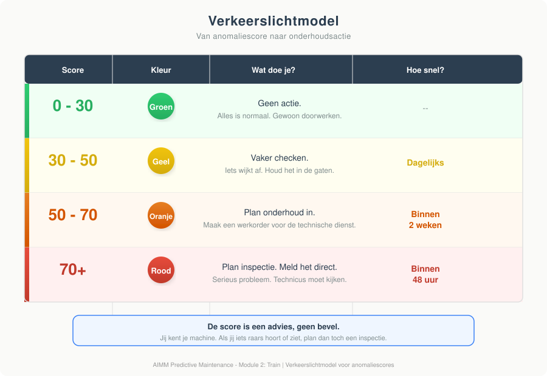

# Hoe weet je wanneer je moet ingrijpen op basis van een anomaliescore?

Op jouw dashboard staat een anomaliescore (een getal dat aangeeft hoe veel een machine afwijkt van normaal). Maar wat doe je met dat getal? Te laat ingrijpen kost uren stilstand. Te vroeg ingrijpen kost onnodig onderhoud. Het verkeerslichtmodel helpt je om op het juiste moment de juiste actie te kiezen.

## Wat leer je?

Je leert een anomaliescore vertalen naar een kleur (groen, oranje of rood). Bij elke kleur hoort een actie en een termijn. En je maakt een werkorder volgens een vast stappenplan.

## Het verkeerslichtmodel

Een dashboard geeft een score tussen 0 en 1. Hoe hoger het getal, hoe meer de machine afwijkt van normaal. Het verkeerslicht maakt dat overzichtelijk:

- **Groen (0,0 - 0,3)** — geen actie nodig. Machine draait binnen normale grenzen.
- **Oranje (0,3 - 0,7)** — extra opletten. Plan inspectie binnen 1 week.
- **Rood (0,7 - 1,0)** — direct kijken. Plan onderhoud binnen 24 uur.

De score is een advies, geen bevel. Je eigen ervaring telt mee.

## Meer dan één sensor lezen

Een machine heeft meestal meerdere sensoren. Soms ziet één sensor rood, terwijl de rest groen blijft. Dan is er nog geen reden voor paniek. Maar als drie sensoren samen oranje kleuren, is dat een sterker signaal dan één rode.

Vuistregels:

- Eén rode sensor + andere groen — check de rode sensor, mogelijk meetfout.
- Twee of meer oranje sensoren samen — plan inspectie, kijk naar het patroon.
- Eén rode + meerdere oranje — direct actie, het probleem is breder.

## Werkorder maken in vijf stappen

Als je beslist om in te grijpen, leg dat dan netjes vast. Een complete werkorder helpt onderhoud sneller op weg.

1. **Wat zie je?** — welke sensor, welke score, hoe lang al.
2. **Welke kleurzone?** — groen, oranje of rood, met datum en tijd.
3. **Welke actie?** — inspectie, onderdeel vervangen, verder meten.
4. **Wanneer?** — direct, binnen 24 uur, of binnen 1 week.
5. **Wie?** — operator zelf, onderhoud, of de leverancier.

## Wanneer vertrouw je de score, wanneer je gevoel?

Beide kunnen kloppen. De score kijkt naar duizenden eerdere patronen. Jouw gevoel kijkt naar wat je vandaag hoort, ruikt en voelt. Bij twijfel: bespreek het met een collega. Twee paar ogen zien meer dan één.

## Na deze sessie

Check morgen het dashboard van jouw machine. Bepaal per sensor de kleurzone.

Beslis of actie nodig is. Noteer waarom wel of niet. Schrijf je actie op het werkorder-formulier.

Bespreek je beslissing in het eerstvolgende werkoverleg met je teamleider.

Oefen één week lang elke ochtend hetzelfde rondje: dashboard checken, kleur bepalen, actie noteren. Na een week zie je patronen die je eerst miste.

---

## Werkbladen (Kolb-cyclus)

1. [`wb-01-ervaren.md`](./werkbladen/wb-01-ervaren.md) — Ervaren
2. [`wb-02-reflecteren.md`](./werkbladen/wb-02-reflecteren.md) — Reflecteren
3. [`wb-03-theoretiseren.md`](./werkbladen/wb-03-theoretiseren.md) — Theoretiseren
4. [`wb-04-experimenteren.md`](./werkbladen/wb-04-experimenteren.md) — Experimenteren

## Verder

- Onderliggend kennisobject: [`ko-smart-mfg-205`](../../kennisbank/smart_manufacturing/predictive_maintenance/ko-smart-mfg-205.md)
- Voor de begeleider: [`trainer.md`](./trainer.md) + [`draaiboek.md`](./draaiboek.md)
- Interactief: [`interactive/model.html`](./interactive/model.html)
