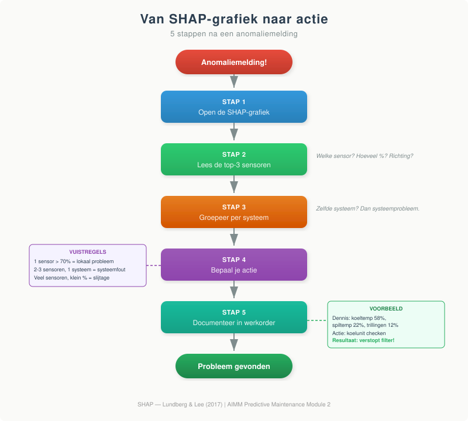

# Hoe lees je een SHAP-grafiek zodat je weet waar je moet beginnen met zoeken?

Na een storingsmelding op het dashboard wil je snel weten: waar zit het probleem? Een SHAP-grafiek (een staafdiagram dat per sensor laat zien hoeveel die bijdraagt aan de melding) vertelt je precies dat. Als je deze grafiek kunt lezen, hoef je niet alle sensoren te checken. Je bespaart tijd. Je voorkomt onnodige stilstand.

## Wat leer je?

Je leert een SHAP-grafiek lezen na een storingsmelding. Je benoemt de top-3 sensoren die het meest bijdragen. Je groepeert ze per systeem. En je kiest de eerste actie.

## Wat staat er in een SHAP-grafiek?

Een SHAP-grafiek is een lijst van sensoren met een staafje ernaast. Hoe langer het staafje, hoe meer die sensor bijdraagt aan de storingsmelding.

- **Lang staafje** — deze sensor is een belangrijke oorzaak.
- **Kort staafje** — deze sensor speelt een kleine rol.
- **Geen staafje** — deze sensor draagt niet bij.

De grafiek staat meestal op volgorde: de grootste bijdrager bovenaan.

## Van grafiek naar actie in vijf stappen

Met deze vijf stappen ga je van een storingsmelding naar een concrete eerste actie.

### Stap 1: Pak de top-3

Kijk naar de drie sensoren met de langste staafjes. Schrijf hun namen op. De rest negeer je eerst.

### Stap 2: Groepeer per systeem

Sensoren horen vaak bij een systeem: koeling, hydrauliek, aandrijving, persing. Als je top-3 allemaal bij hetzelfde systeem hoort, is dat een sterk signaal. Als ze verspreid zijn over drie systemen, is het probleem breder.

### Stap 3: Check de vuistregeltabel

Per systeem hoort een eerste actie. Een paar voorbeelden:

- Top-3 in **koeling** — check koelvloeistof en ventilator.
- Top-3 in **hydrauliek** — check druk en oliepeil.
- Top-3 in **aandrijving** — check lagers en riemen.
- Top-3 in **persing** — check matrijs en kracht.

### Stap 4: Kies één eerste actie

Niet alles tegelijk. Kies de actie die het snelste duidelijkheid geeft. Vaak is dat de visuele inspectie: gewoon kijken, ruiken, luisteren bij het meest verdachte onderdeel.

### Stap 5: Noteer in de werkorder

Schrijf in de werkorder welke top-3 je zag, welk systeem dat is en welke actie je hebt gedaan. Zo kan onderhoud later patronen herkennen.

## Wat als de top-3 verspreid is?

Niet elke storing is netjes. Soms ligt het probleem op de grens van twee systemen. Vraag dan een collega om mee te kijken. Of bel onderhoud voor een tweede inschatting. Bij twijfel: niet doorgaan, eerst overleggen.

## Na deze sessie

Gebruik het vijf-stappenplan bij de eerstvolgende storingsmelding op jouw machine.

Noteer je bevinding in de werkorder: top-3 sensoren, systeem, eerste actie.

Hang de vuistregeltabel bij je werkplek op. Dan heb je hem bij de hand als het nodig is.

Bespreek je ervaring in de volgende sessie van het Shared Learning Team (jouw leergroep). Wat ging goed? Wat was lastig?

---

## Werkbladen (Kolb-cyclus)

1. [`wb-01-ervaren.md`](./werkbladen/wb-01-ervaren.md) — Ervaren
2. [`wb-02-reflecteren.md`](./werkbladen/wb-02-reflecteren.md) — Reflecteren
3. [`wb-03-theoretiseren.md`](./werkbladen/wb-03-theoretiseren.md) — Theoretiseren
4. [`wb-04-experimenteren.md`](./werkbladen/wb-04-experimenteren.md) — Experimenteren

## Verder

- Onderliggend kennisobject: [`ko-smart-mfg-206`](../../kennisbank/smart_manufacturing/predictive_maintenance/ko-smart-mfg-206.md)
- Voor de begeleider: [`trainer.md`](./trainer.md) + [`draaiboek.md`](./draaiboek.md)
- Interactief: [`interactive/model.html`](./interactive/model.html)
