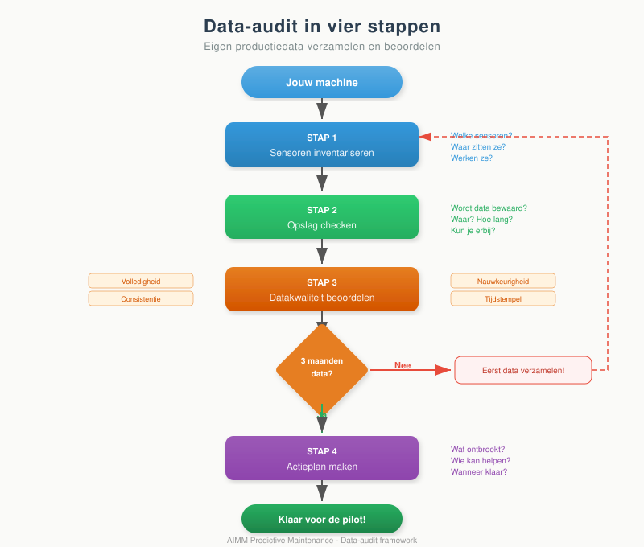

# Heb je genoeg goede data op je machine om een predictive maintenance pilot te starten?

In Module 2 heb je geoefend met voorbeelddata. Nu ga je het echt doen — op je eigen machine. Maar voordat je een model kunt trainen heb je goede data nodig. Zonder goede data geen goed model. Een data-audit laat zien of je klaar bent om te starten, of dat je eerst nog iets moet regelen.

## Wat leer je?

Je kunt een data-audit uitvoeren op je eigen machine: sensoren inventariseren, opslag controleren, en datakwaliteit beoordelen op vier criteria.

## Stap 1: Sensoren inventariseren

Voordat je iets met data kunt doen, moet je weten wat er is. Loop in gedachten langs je machine en vraag jezelf:

- **Welke sensoren zitten erop?** Temperatuur, druk, trilling, stroom, telleren?
- **Waar zitten ze?** Aan welke onderdelen, op welke positie?
- **Werken ze allemaal?** Of staat er één al maanden op storing?
- **Wie heeft ze geplaatst?** De fabrikant, of later toegevoegd?

Maak een lijst. Het hoeft niet compleet te zijn — alles wat je weet of vermoedt is een goed startpunt. Vergeet ook de PLC niet (de besturingscomputer van je machine): daar zitten vaak sensoren in die je nooit ziet.

## Stap 2: Opslag controleren

Een sensor die meet maar niets opslaat, is voor een AI-model waardeloos. Vraag per sensor:

- **Wordt de data opgeslagen?** Of vloeit die direct weg na gebruik?
- **Hoe vaak wordt er gemeten?** Elke seconde, elke minuut, één keer per ploeg?
- **Hoe lang wordt het bewaard?** Drie dagen? Drie maanden? Drie jaar?
- **Waar staat de data?** Op de PLC, in een database, in een Excel-bestand?

Vooral de laatste vraag is belangrijk. Data verdwijnt vaak in systemen waar niemand naar kijkt. De technische dienst heeft hier meestal het beste overzicht.

## Stap 3: Datakwaliteit beoordelen — vier criteria

Niet alle data is bruikbaar. Een goede dataset voor predictive maintenance scoort op vier punten:

### 1. Volledigheid

Zit er voldoende data om patronen uit te halen? Voor een eerste pilot wil je minstens **3 maanden historie** — anders mis je seizoens- en dienstwissel-patronen. Korter kan, maar levert minder zekere voorspellingen.

### 2. Consistentie

Zijn de metingen door de tijd heen vergelijkbaar? Een sensor die halverwege gekalibreerd is, of een meetinterval dat veranderde van 5 naar 1 minuut — dat verstoort het beeld. Check op breekpunten in je data.

### 3. Nauwkeurigheid

Klopt wat de sensor meet? Een trillingssensor die nooit boven 1,2 komt is verdacht — die meet waarschijnlijk niet meer wat je denkt. Vergelijk met je gevoel: hoor je de machine zwaarder draaien dan de sensor zegt?

### 4. Tijdstempel

Heeft elke meting een correcte tijdstempel? Zonder tijd kun je geen patronen zien. Ook belangrijk: zit er een tijdzone-fout in (bijvoorbeeld zomertijd-verschillen)?

## Een korte test

Pak één sensor van je machine. Beantwoord:

| Vraag | Score |
|---|---|
| Slaat hij data op? | ja / nee / weet niet |
| Hebben we 3+ maanden? | ja / nee / weet niet |
| Is de meetfrequentie constant? | ja / nee / weet niet |
| Klopt wat hij meet met wat je voelt? | ja / nee / twijfel |
| Heeft elke meting een tijd? | ja / nee / weet niet |

Veel "weet niet"-antwoorden? Dat is geen probleem — het betekent gewoon dat dit je eerste audit-vragen worden voor de technische dienst. Een audit beginnen met tien open vragen is een normale start.

## Wat dit oplevert

Aan het eind van een grondige data-audit weet je:

- **Welke sensoren** je hebt en welke nog ontbreken
- **Welke data bruikbaar** is voor een eerste pilot
- **Welke gaten** je nog moet vullen voor je begint
- **Wie je nodig hebt** (technische dienst, IT, leverancier)

Dat is de basis van een werkbaar pilotplan. Niet ambitie zonder fundament — wel realistisch zicht op wat haalbaar is.

## Na deze sessie

Ga deze week langs je machine. Check of je scoringsformulier klopt. Praat met de technische dienst: welke data wordt opgeslagen die je nog niet kent? Vul je actieplan aan met wat ontbreekt en wie je nodig hebt om het op te lossen. Vraag ook je teamleider of er een overzicht is van alle sensoren en data-aansluitingen op je afdeling. Vaak bestaat dat — alleen weet niemand het meer.

---

## Werkbladen (Kolb-cyclus)

1. [`wb-01-ervaren.md`](./werkbladen/wb-01-ervaren.md) — Ervaren
2. [`wb-02-reflecteren.md`](./werkbladen/wb-02-reflecteren.md) — Reflecteren
3. [`wb-03-theoretiseren.md`](./werkbladen/wb-03-theoretiseren.md) — Theoretiseren
4. [`wb-04-experimenteren.md`](./werkbladen/wb-04-experimenteren.md) — Experimenteren

## Verder

- Onderliggend kennisobject: [`ko-smart-mfg-502`](../../kennisbank/smart_manufacturing/predictive_maintenance/ko-smart-mfg-502.md)
- Voor de begeleider: [`trainer.md`](./trainer.md) + [`draaiboek.md`](./draaiboek.md)
- Interactief: [`interactive/model.html`](./interactive/model.html)
