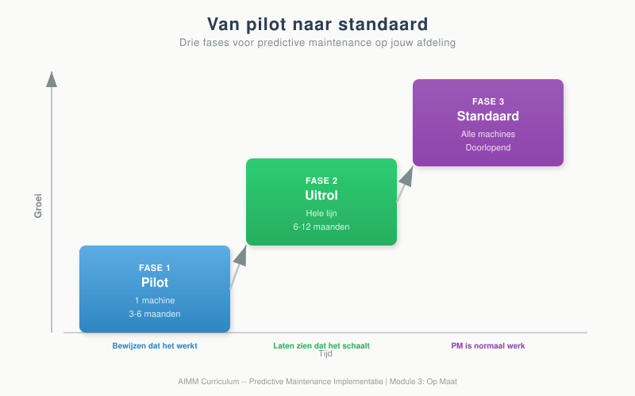

# Hoe maak je een plan om predictive maintenance op jouw afdeling te starten?

Je weet inmiddels wat predictive maintenance (PM) is en hoe het werkt. Nu komt het echte werk: het invoeren op jouw lijn. Een goed plan maakt het verschil tussen een geslaagde pilot en een duur experiment. Met de drie fases pilot, uitrol en standaard weet je waar je begint en waar je naartoe werkt.

## Wat leer je?

Je leert een implementatieplan voor jouw afdeling analyseren en beoordelen. Per fase benoem je minimaal twee risico's, twee betrokkenen en één succesmaat.

## De drie fases van implementatie

Predictive maintenance voer je niet in één keer in. Je doet het in drie stappen. Elke fase heeft een ander doel en andere mensen.

### Fase 1: Pilot

In de pilot test je het werkt op één machine, met één team. Klein beginnen, snel leren.

- **Doel** — bewijzen dat PM werkt in jouw situatie.
- **Wie** — één operator, één onderhoudstechnicus, één lijnverantwoordelijke.
- **Duur** — 4 tot 12 weken.
- **Succesmaat** — minimaal één voorspelde storing voorkomen.
- **Risico** — verkeerde machine gekozen, of niet genoeg storingen om te leren.

### Fase 2: Uitrol

De pilot werkt. Nu breid je uit naar meer machines en meer mensen.

- **Doel** — de aanpak werkend krijgen op 5 tot 10 machines.
- **Wie** — meerdere operators, onderhoud, IT, planning.
- **Duur** — 3 tot 6 maanden.
- **Succesmaat** — gemiddelde stilstandtijd op die machines daalt met 20 procent.
- **Risico** — collega's denken dat dit "iets van Jan" is, maar niet van het hele team.

### Fase 3: Standaard

PM is geen project meer, maar normaal werk. Iedereen werkt ermee.

- **Doel** — PM hoort bij de dagelijkse routine, op alle relevante machines.
- **Wie** — alle operators, alle ploegen, vast geïntegreerd in onderhoud en planning.
- **Duur** — doorlopend.
- **Succesmaat** — nieuwe operators krijgen PM mee in de introductie.
- **Risico** — kennis verdwijnt als mensen vertrekken, of het systeem raakt achterhaald.

## Wat hoort waar?

Per fase verschuift het accent:

| Wat | Pilot | Uitrol | Standaard |
|---|---|---|---|
| Aantal machines | 1 | 5-10 | Alle relevante |
| Aantal mensen | 3-4 | 10-20 | Iedereen |
| Belangrijkste vraag | Werkt het? | Schaalt het? | Houden we het draaiend? |
| Geld | Pilotbudget | Project-budget | Onderhoudsbudget |

## Een pilot voorbereiden

Voor jouw eigen pilot heb je vier dingen nodig:

1. **Machine** — kies er een met genoeg storingen om van te leren.
2. **Mensen** — minimaal een operator, een onderhoudstechnicus en een lijnverantwoordelijke.
3. **Risico's** — schrijf op wat fout kan gaan. Vaak zijn dat: te weinig data, weerstand van collega's, of een leverancier die afhaakt.
4. **Succesmaat** — een meetbaar doel. Bijvoorbeeld: "binnen 12 weken minimaal één voorspelde storing voorkomen".

Zonder deze vier ga je niet beginnen.

## Na deze sessie

Bespreek je pilot-voorstel deze week met je teamleider of leidinggevende. Vraag of zij meedoen.

Loop deze week ook langs de machine die je hebt gekozen. Kijk welke sensoren er al op zitten.

Noteer minstens twee risico's die je vooraf ziet. Bedenk per risico hoe je het kunt verkleinen.

In de volgende sessie presenteer je het voorstel aan de groep. Eén pagina is genoeg.

---

## Werkbladen (Kolb-cyclus)

1. [`wb-01-ervaren.md`](./werkbladen/wb-01-ervaren.md) — Ervaren
2. [`wb-02-reflecteren.md`](./werkbladen/wb-02-reflecteren.md) — Reflecteren
3. [`wb-03-theoretiseren.md`](./werkbladen/wb-03-theoretiseren.md) — Theoretiseren
4. [`wb-04-experimenteren.md`](./werkbladen/wb-04-experimenteren.md) — Experimenteren

## Verder

- Onderliggend kennisobject: [`ko-smart-mfg-504`](../../kennisbank/smart_manufacturing/predictive_maintenance/ko-smart-mfg-504.md)
- Voor de begeleider: [`trainer.md`](./trainer.md) + [`draaiboek.md`](./draaiboek.md)
- Interactief: [`interactive/model.html`](./interactive/model.html)
