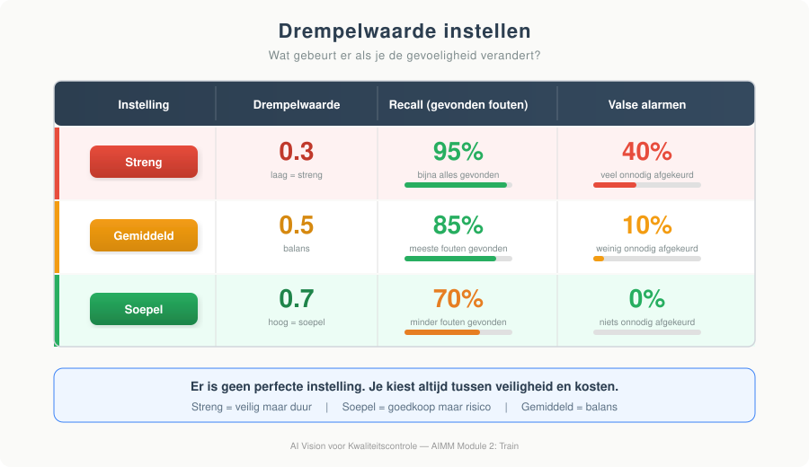

# Hoe stel je de gevoeligheid van een vision-model in voor jouw productielijn?

Een vision-model (een AI die foto's beoordeelt op fouten) heeft een drempelwaarde. Zet je hem laag, dan houdt het systeem veel tegen — ook goede producten. Zet je hem hoog, dan glipt er een fout product doorheen. Die instelling heeft direct effect op jouw lijn: meer stilstand, of meer klachten van de klant. Jij kunt dat beinvloeden.

## Wat leer je?

Je leert de drempelwaarde van een vision-model instellen en het effect uitleggen. Je onderbouwt je keuze met twee begrippen: recall (hoeveel echte fouten je vindt) en valse alarmen (hoeveel goede producten je weggooit).

## Wat doet een drempelwaarde?

Het vision-model geeft per product een score tussen 0 en 1. Hoe hoger de score, hoe zekerder het systeem dat het product fout is. De drempelwaarde is de grens waarboven het systeem het product afkeurt.

- **Drempel laag (bv. 0,3)** — het systeem keurt al snel af. Veel echte fouten gevonden, maar ook veel goede producten weg.
- **Drempel hoog (bv. 0,8)** — het systeem keurt pas laat af. Weinig vals alarm, maar je mist echte fouten.
- **Drempel midden (bv. 0,5)** — een tussenweg. Goede balans, maar voor elk product anders.

## Recall en valse alarmen

Twee begrippen helpen je bij de afweging.

### Recall

Recall vertelt je hoeveel echte fouten het systeem vindt. Een recall van 95 procent betekent: van elke 100 echte fouten vangt het systeem er 95 op. De andere 5 glippen erdoorheen.

Hoge recall is belangrijk als:

- Een fout product klanten kan schaden (denk aan medisch of voedsel).
- Eén klacht meer kost dan tien keer extra controleren.

### Valse alarmen

Een vals alarm is een goed product dat onterecht wordt afgekeurd. Een vals-alarm-percentage van 8 procent betekent: van elke 100 goede producten gooi je er 8 weg.

Laag percentage valse alarmen is belangrijk als:

- Materiaal duur is.
- Stilstand voor herinspectie te veel tijd kost.

## De afweging is altijd een keuze

Je kunt niet beide tegelijk maximaal hebben. Hoger recall geeft meer valse alarmen. Lager percentage valse alarmen geeft minder recall. De juiste keuze hangt af van jouw product en jouw klant.

Een vuistregel:

- **Veiligheidskritisch product** — recall hoger dan 95 procent, ook al kost dat 10 procent vals alarm.
- **Standaardproduct** — recall rond 85 procent, valse alarmen onder 5 procent.

## Hoe test je je keuze?

Gebruik een testset: 50 foto's waarvan je zeker weet welke goed en welke fout zijn. Laat het model alle 50 beoordelen bij verschillende drempelwaarden. Bereken voor elke drempel hoe vaak het klopt.

Zo zie je het effect van jouw keuze in echte getallen, niet in onderbuikgevoel.

## Na deze sessie

Bespreek met je leidinggevende welke drempelwaarde past bij jullie product. Praat over wat erger is: weggooien of doorlaten.

Maak een testset van 50 foto's: 25 goede en 25 foute producten. Vraag een collega om mee te kijken bij het beoordelen.

Test minimaal twee drempelwaarden op die set. Noteer per drempel hoeveel recall en hoeveel valse alarmen je krijgt.

In de volgende sessie bespreek je je testresultaten met de groep. Eén tabel is genoeg.

---

## Werkbladen (Kolb-cyclus)

1. [`wb-01-ervaren.md`](./werkbladen/wb-01-ervaren.md) — Ervaren
2. [`wb-02-reflecteren.md`](./werkbladen/wb-02-reflecteren.md) — Reflecteren
3. [`wb-03-theoretiseren.md`](./werkbladen/wb-03-theoretiseren.md) — Theoretiseren
4. [`wb-04-experimenteren.md`](./werkbladen/wb-04-experimenteren.md) — Experimenteren

## Verder

- Onderliggend kennisobject: [`ko-smart-mfg-512`](../../kennisbank/smart_manufacturing/computer_vision_kwaliteit/ko-smart-mfg-512.md)
- Voor de begeleider: [`trainer.md`](./trainer.md) + [`draaiboek.md`](./draaiboek.md)
- Interactief: [`interactive/model.html`](./interactive/model.html)
