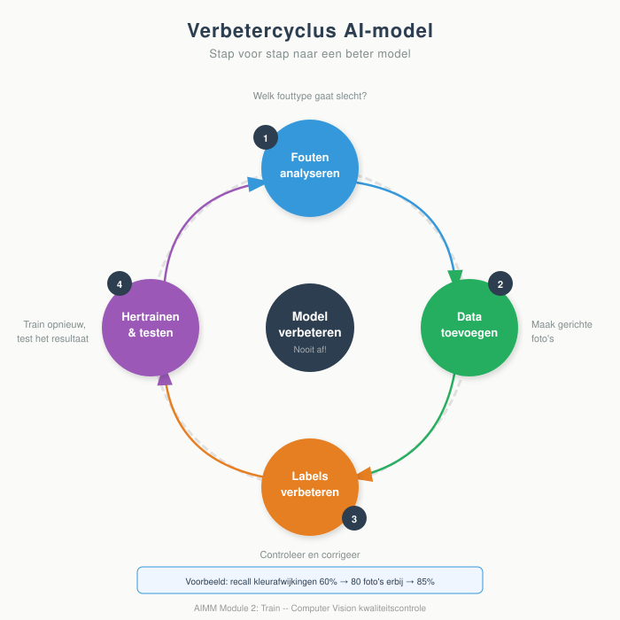

# Hoe maak je een vision-model dat al draait beter — zonder afhankelijk te zijn van anderen?



Een vision-model is niet "klaar" na de eerste training. Defecten veranderen, materialen wisselen, nieuwe storingstypen verschijnen. Wie zelf kan itereren bouwt een werkend systeem. Wie wacht op de leverancier verliest weken tot maanden.


## Wat leer je?

Je kunt de fouten van een vision-model analyseren en gericht trainingsdata + labels toevoegen om de modelprestatie te verbeteren.

## De iteratie-cyclus in vier stappen

Een vision-model verbeteren werkt cyclisch — je doorloopt steeds dezelfde vier stappen:

```
   1. Analyse        2. Data
   ┌────────┐       ┌────────┐
   │ fouten │  ──►  │ extra  │
   │ vinden │       │ foto's │
   └────────┘       └────────┘
        ▲                │
        │                ▼
   ┌────────┐       ┌────────┐
   │ test   │  ◄──  │ labels │
   │ opnieuw│       │ erbij  │
   └────────┘       └────────┘
   4. Hertest        3. Labels
```

Na elke ronde wordt je model iets beter. Niet meteen perfect — wel meetbaar verbeterd.

## Stap 1: Analyse — waar gaat het mis?

Pak je **confusion matrix** erbij. Dat is een tabel die laat zien welke voorspellingen klopten en welke niet. Wat zoek je?

- Categorieën met **lage recall** — het herkenningspercentage (model mist veel echte defecten)
- Categorieën met **lage precision** — de trefzekerheid (model meldt veel valse alarmen)

Een vuistregel: scoort een categorie onder **80% recall**, dan is daar werk te doen. Schrijf de zwakke categorieën op — meestal zijn het er twee tot drie.

## Stap 2: Data — extra foto's verzamelen

Voor elke zwakke categorie verzamel je **gericht** extra foto's. Niet zomaar meer foto's — alleen van die specifieke categorie.

| Aantal extra foto's | Verwacht effect |
|---|---|
| 30-50 | Kleine verbetering, vooral als data-tekort het probleem is |
| 80-150 | Substantiële verbetering, als categorie nu op 60-80% zit |
| 200+ | Grote verbetering of nieuwe categorie introduceren |

**Voorbeeld uit een lakdefect-pilot:** krassen scoorden 95% recall, kleurafwijkingen 60%. Door 80 extra foto's van kleurafwijkingen toe te voegen ging die naar 85%. Krassen bleven gelijk.

## Stap 3: Labels — consistent en gecheckt

Foto's labelen is gevoelig werk. Twee operators die "kras" anders interpreteren leveren ruis op die het model verwart. Drie regels om dat te voorkomen:

1. **Schrijf je labelcriteria op** — wat is "een defect", wanneer twijfel je?
2. **Laat een collega 5 labels checken** — dat heet **peer-check**. Stem niet eens? Dan is je criterium niet helder genoeg.
3. **Houd minder dan 1 op 10 inconsistent** — meer dan dat verstoort de training.

Labelen is kort werk per foto, maar de optelsom voor 100+ foto's is significant. Plan er tijd voor in.

## Stap 4: Hertest — meten of het werkt

Na de hertraining moet je meten of het beter is geworden. Vergelijk per categorie:

- Recall voor de iteratie versus na
- Precision voor de iteratie versus na

Niet alleen "het voelt beter" — concrete getallen. Geen verbetering? Dan zit het probleem dieper: misschien klopt de label-definitie niet, of mis je een hele klasse defecten die nieuw is.

## Wat het foutenpatroon je vertelt

Voordat je extra foto's gaat verzamelen, vraag je af **waarom** het model faalt. Drie typische oorzaken:

| Patroon | Oorzaak | Aanpak |
|---|---|---|
| Categorie heeft weinig voorbeelden | Data-tekort | Meer foto's van die categorie |
| Categorie wordt verward met andere | Label-fouten of onhelder criterium | Labels herzien, criteria scherpen |
| Nieuw type defect verschijnt | Drift (modelveroudering — de werkelijkheid verandert, het model niet) | Nieuwe klasse toevoegen of opnieuw labelen |

Het verschil zien is belangrijk. Bij data-tekort werken extra foto's. Bij label-verwarring werkt herzien van bestaande labels. Bij drift werkt geen van beide — dan moet je het model bijna opnieuw bouwen.

## Hoe vaak itereer je?

Een werkend vision-systeem itereert structureel. Realistische frequenties:

- **Eerste maanden:** wekelijks of tweewekelijks (veel ruimte voor verbetering)
- **Volwassen systeem:** maandelijks tot kwartaal (kleine bijstellingen)
- **Bij productverandering:** direct (anders gaat performance kelderen)

Maak het onderdeel van je werkafspraken. Iteratie die "we doen het wel als we tijd hebben" wordt nooit gedaan.

## Na deze sessie

Plan binnen 2 weken een tweede iteratie. Meet de prestatie voor en na — recall en precision per categorie. Bespreek de resultaten in het volgende kwaliteitsoverleg en maak iteratie-frequentie onderdeel van de werkafspraken. Vraag ook een collega van een naburige lijn om hetzelfde te doen op zijn vision-model. Vergelijk welke categorieën daar zwak zijn — vaak ontdek je patronen die je op je eigen lijn ook hebt.

---

## Werkbladen (Kolb-cyclus)

1. [`wb-01-ervaren.md`](./werkbladen/wb-01-ervaren.md) — Ervaren
2. [`wb-02-reflecteren.md`](./werkbladen/wb-02-reflecteren.md) — Reflecteren
3. [`wb-03-theoretiseren.md`](./werkbladen/wb-03-theoretiseren.md) — Theoretiseren
4. [`wb-04-experimenteren.md`](./werkbladen/wb-04-experimenteren.md) — Experimenteren

## Verder

- Onderliggend kennisobject: [`ko-smart-mfg-514`](../../kennisbank/smart_manufacturing/computer_vision_kwaliteit/ko-smart-mfg-514.md)
- Voor de begeleider: [`trainer.md`](./trainer.md) + [`draaiboek.md`](./draaiboek.md)
- Interactief: [`interactive/model.html`](./interactive/model.html)
