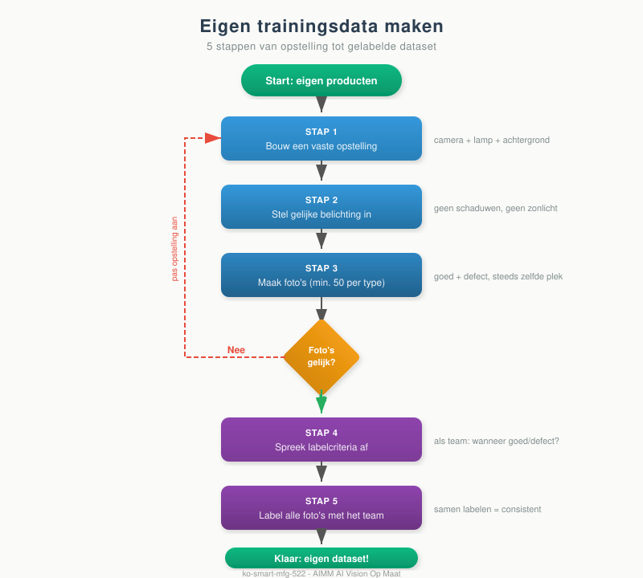

# Hoe maak je foto's van je eigen producten die geschikt zijn om een AI-model mee te trainen?

In Module 2 heb je gelabeld en een model ingesteld — met voorbeeldfoto's. Nu ga je het echt doen: foto's van jouw eigen producten. Jouw foto's worden de basis van het AI-model voor jouw lijn. Goede foto's en heldere afspraken maken het verschil tussen een model dat werkt en een model dat fouten maakt.

## Wat leer je?

Je kunt een camera-opstelling bouwen voor eigen producten, foto's maken met consistente belichting, en samen met je team labelcriteria afspreken en toepassen.

## De vijf vuistregels voor een goede foto-opstelling

### 1. Vast standpunt

De camera moet steeds op dezelfde plek staan. Als hij elke keer een paar centimeter verschoven is, ziet het AI-model bij elke foto een ander beeld — en kan geen patroon leren.

**Praktisch:** plak de camerapositie af met tape. Markeer de productpositie met tape op de werkbank.

### 2. Gelijke belichting

Geen direct zonlicht — dat verandert per uur. Geen flikkerende TL-buis. Zet een vaste lamp op een vaste plek. LED-paneel of bureaulamp werkt prima, mits de lamp niet meebeweegt.

**Praktisch:** maak twee foto's, één 's morgens en één 's middags. Zien ze er hetzelfde uit?

### 3. Schone achtergrond

Een witte of grijze vel papier achter het product. Geen rommel, geen verschillende achtergronden tussen de foto's. Het AI-model moet leren herkennen wat het product is — niet wat eromheen ligt.

**Praktisch:** een groot vel papier of een grijs doek volstaat.

### 4. Genoeg foto's

Voor een eerste werkbaar model: minstens **50 foto's per categorie**. Dus 50 goede producten én 50 defecte. Voor meer categorieën: 50 per categorie.

| Aantal foto's per categorie | Verwacht resultaat |
|---|---|
| 20-30 | Eerste verkenning, nog niet betrouwbaar |
| 50-100 | Werkbaar voor pilot |
| 150+ | Stabiel model, klaar voor productie |

### 5. Labelcriteria afspreken met het team

Vóór je begint te fotograferen, spreek met je team af: **wanneer is een product defect?** Drie collega's met drie definities = inconsistente labels = slecht model.

## Een voorbeeld dat werkte

Bij een ander bedrijf maakten 3 operators in 3 dagen 300 foto's. Wat anders ging:

- Ze spraken **vooraf** af: wanneer is een kras een defect, hoe groot moet hij zijn
- Ze legden de afspraken op één A4
- Bij twijfel overlegden ze altijd, niet apart

Resultaat: minder dan 1 op 10 labels werd bij latere check inconsistent gevonden. Genoeg om een werkend model op te trainen.

Bedrijven die dit niet vooraf afspreken besteden achteraf wéken aan herlabelen.

## Heldere labelcriteria — drie eisen

Een goed criterium is:

1. **Specifiek** — niet "een grote kras" maar "een kras langer dan 5 mm"
2. **Eenduidig** — twee mensen interpreteren het hetzelfde
3. **Toetsbaar** — een derde collega die er niet bij was begrijpt het ook

Drie typische criteria voor metalen onderdelen:

| Criterium | Specifiek | Eenduidig | Toetsbaar |
|---|---|---|---|
| "Defect" | ❌ | ❌ | ❌ |
| "Defect = oppervlakteafwijking" | ⚠️ | ❌ | ❌ |
| "Defect = kras langer dan 5 mm of deuk dieper dan 1 mm" | ✅ | ✅ | ✅ |

Specifiek wordt het door getallen of zichtbare grenzen toe te voegen.

## Het bouwproces — hoe je het uitvoert

Een aanpak die werkt voor de meeste werkvloeren:

1. **Spreek met je team de criteria af** — minstens drie heldere, specifieke regels
2. **Bouw één keer een goede opstelling** — vaste plek, vast licht, vaste achtergrond
3. **Maak in één sessie 50+ foto's per categorie** — niet over 10 dagen verspreid
4. **Label samen met een collega** — afwisselend, om consistentie te checken
5. **Test met een derde collega** — laat hem 10 foto's labelen met jullie criteria. Zelfde uitkomst? Dan zijn de criteria helder.

## Wat dit oplevert

Een dataset die werkt. En — minstens zo belangrijk — een team dat weet **waarom** het werkt. Je staat niet meer te kijken naar een vision-systeem dat de leverancier heeft gebouwd. Je hebt het zelf opgebouwd, samen met je collega's.

Dat verandert ook het gesprek. "Het model klopt niet" wordt: "we hebben categorie X niet goed afgesproken, laten we dat herzien."

## Na deze sessie

Voer jullie actieplan uit op de werkvloer. Maak in de komende week minstens 50 foto's met jullie opstelling. Gebruik jullie labelcriteria. Label elke foto samen met een collega. Neem de gelabelde dataset mee naar de volgende bijeenkomst — daar train je een AI-model met jullie eigen data en test je of het werkt op jullie eigen producten. Vraag ook een collega die niet bij de training was om 10 foto's te labelen met jullie criteria. Zijn de criteria helder genoeg?

---

## Werkbladen (Kolb-cyclus)

1. [`wb-01-ervaren.md`](./werkbladen/wb-01-ervaren.md) — Ervaren
2. [`wb-02-reflecteren.md`](./werkbladen/wb-02-reflecteren.md) — Reflecteren
3. [`wb-03-theoretiseren.md`](./werkbladen/wb-03-theoretiseren.md) — Theoretiseren
4. [`wb-04-experimenteren.md`](./werkbladen/wb-04-experimenteren.md) — Experimenteren

## Verder

- Onderliggend kennisobject: [`ko-smart-mfg-522`](../../kennisbank/smart_manufacturing/computer_vision_kwaliteit/ko-smart-mfg-522.md)
- Voor de begeleider: [`trainer.md`](./trainer.md) + [`draaiboek.md`](./draaiboek.md)
- Interactief: [`interactive/model.html`](./interactive/model.html)
