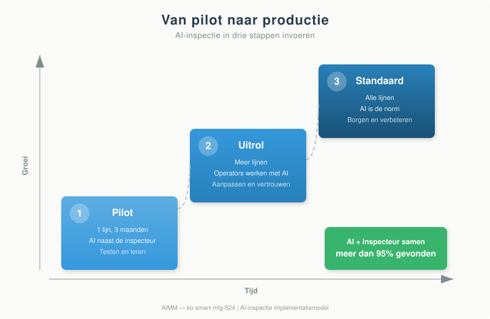

# Hoe voer je AI-inspectie in op jouw eigen productielijn?

AI-inspectie (een camera die met AI controleert of een product goed of fout is) kan de kwaliteit op jouw lijn flink verbeteren. Maar alleen als je het stap voor stap invoert. Te snel uitrollen geeft chaos. Te lang in de pilot blijven hangen geeft verspilling. Het drie-fasenmodel laat zien hoe je het rustig en stevig opbouwt.

## Wat leer je?

Je leert de drie implementatiefases van AI-inspectie benoemen en analyseren: pilot, uitrol en standaard. Je kiest welke fase past bij jouw werkplek. En je maakt een onderbouwd pilotplan voor je eigen lijn.

## Het drie-fasenmodel

Elke AI-inspectie groeit door drie fases. Je herkent ze aan het aantal machines, het aantal mensen en de soort vragen die spelen.

### Fase 1: Pilot

In de pilot test je op kleine schaal of het werkt.

- **Schaal** — één lijn, één productgroep.
- **Tijd** — 6 tot 12 weken.
- **Mensen** — operator, kwaliteitscontroleur, een externe expert.
- **Belangrijkste vraag** — werkt deze AI bij ons product?
- **Cijfer uit de praktijk** — ongeveer 30 procent van de pilots haalt fase 2 niet. Dat is normaal en geen mislukking.

### Fase 2: Uitrol

De pilot werkt. Je breidt uit naar meer lijnen.

- **Schaal** — drie tot zes lijnen, meerdere ploegen.
- **Tijd** — 3 tot 9 maanden.
- **Mensen** — alle operators op die lijnen, kwaliteit, onderhoud, planning.
- **Belangrijkste vraag** — schaalt het zonder dat de kwaliteit van inspectie daalt?
- **Cijfer uit de praktijk** — gemiddelde afkeur daalt met 15 tot 30 procent als de uitrol slaagt.

### Fase 3: Standaard

AI-inspectie is gewoon onderdeel van het werk geworden.

- **Schaal** — alle relevante lijnen.
- **Tijd** — doorlopend.
- **Mensen** — iedereen die op die lijnen werkt.
- **Belangrijkste vraag** — hoe houden we het systeem actueel als de productie verandert?
- **Cijfer uit de praktijk** — nieuwe operators leren AI-inspectie in de introductie.

## Hoe weet je in welke fase je zit?

Vier korte vragen helpen je dat vast te stellen:

1. Op hoeveel lijnen draait AI-inspectie?
2. Werkt iedere ploeg ermee, of slechts een?
3. Wie beslist over een aanpassing — een projectteam of de productiemanager?
4. Krijgt een nieuwe medewerker dit mee in de introductie?

Veel "ja" op vraag 3 en 4 wijst op fase 3. Een specifieke productgroep met een projectleider wijst op fase 1 of 2.

## Een pilotplan voor jouw lijn

Een pilotplan voor AI-inspectie heeft vier onderdelen:

- **Wat** — welke productgroep, welke lijn.
- **Waar** — welke machine of welk inspectiepunt.
- **Wanneer** — startdatum, eerste evaluatie na vier weken.
- **Met wie** — operator, kwaliteit, een buddy uit IT of bij de leverancier.

Een goed pilotplan past op een A4. Niet meer.

## Wat is dezelfde fout in alle drie fases?

Te weinig praten met collega's. AI-inspectie werkt alleen als het team mee is. Een mooi technisch systeem dat niemand vertrouwt, gebruikt niemand.

Praat dus vroeg en vaak met:

- De andere operators op je lijn.
- De kwaliteitscontroleur.
- De onderhoudstechnicus.
- Je teamleider.

## Na deze sessie

Bespreek je actieplan met je teamleider. Plan de eerste concrete stap binnen 2 weken.

Maak foto's van 10 goede en 10 foute producten op jouw lijn. Dat is het begin van je dataset.

Schrijf op welke fase jullie bedrijf nu zit. Welke kenmerken herken je? Welke ontbreken nog?

Plan over twee weken een review-moment met je teamleider. Wat heb je gedaan? Wat heb je geleerd?

---

## Werkbladen (Kolb-cyclus)

1. [`wb-01-ervaren.md`](./werkbladen/wb-01-ervaren.md) — Ervaren
2. [`wb-02-reflecteren.md`](./werkbladen/wb-02-reflecteren.md) — Reflecteren
3. [`wb-03-theoretiseren.md`](./werkbladen/wb-03-theoretiseren.md) — Theoretiseren
4. [`wb-04-experimenteren.md`](./werkbladen/wb-04-experimenteren.md) — Experimenteren

## Verder

- Onderliggend kennisobject: [`ko-smart-mfg-524`](../../kennisbank/smart_manufacturing/computer_vision_kwaliteit/ko-smart-mfg-524.md)
- Voor de begeleider: [`trainer.md`](./trainer.md) + [`draaiboek.md`](./draaiboek.md)
- Interactief: [`interactive/model.html`](./interactive/model.html)
