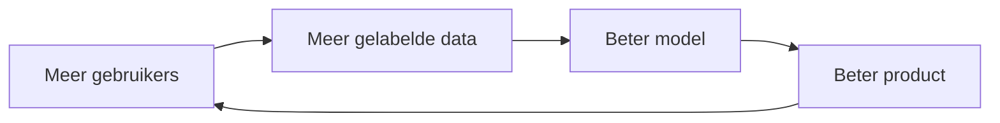

# Gelabelde data is de bottleneck

### Drie getallen voor het gesprek met je teamleider

  AI-Vision Module 1 (Gebruik) · MBO-4 variant · 40 min 
  AIMM Curriculum · BronzGreen

  Operators MBO-4 / aanstaande teamleiders · spuitgieten / CNC / verpakking

<!--
Welkom. De komende 40 minuten ontdek je waarom AI-vision systemen
bij veel bedrijven nog niet draaien.

Het probleem is niet het AI-model — dat is gratis.
Het probleem is jullie data.

Vandaag krijg je drie getallen om dat gesprek te voeren met je teamleider.

Trigger: "Wie heeft al eens 'we kopen een AI-camera' gehoord? Wat ging er door je hoofd?"
-->

---
layout: section
---

# Ervaren

## Zelf labelen — met de stopwatch erbij

<!--
Overgang naar blok 1.
"Geen theorie vooraf. Pak een fotoset, label, meet de tijd."
-->

---
layout: center
class: text-center
---

# Jullie opdracht

  10 foto's metalen beugels per duo 
  Label elke foto: kras / geen defect / scheurtje 
  Eén van jullie houdt de tijd per foto bij

  Welk getal noteer jij straks? Gemiddelde seconden per foto.

  6 min · in duo's · wb-01 + fotoset A

<!--
Werkblad wb-01 met handgeschreven extra kolom 'tijd per foto (sec)'.
Stopwatch via telefoon van één duo-lid.

Loop rond. Vragen:
- "Welke foto duurde het langst? Waarom?"
- "Waar twijfelden jullie?"
- "Bij 1000 zulke foto's — past dat in één werkdag?"

Geen jargon (YOLO, F1-score). Drie woorden vandaag.
-->

---
layout: section
---

# Reflecteren

## Jouw productielijn — de rekensom

<!--
Overgang naar blok 2.
"Nu de brug naar je werkvloer. Cijfers, niet alleen ervaring."
-->

---

# 15 uur versus 1222 uur

  
Eenmalige investering

  <ul class="text-sm space-y-2">
    <li>3 defecten × 150 foto's = 450 foto's</li>
    <li>2 min per foto</li>
    <li><strong>= 15 uur eenmalig</strong></li>
  </ul>

  
Jaarlijkse inspectietijd

  <ul class="text-sm space-y-2">
    <li>1000 prod/dag × 20 sec = 20000 sec/dag</li>
    <li>× 220 werkdagen</li>
    <li><strong>= ± 1222 uur per jaar</strong></li>
  </ul>

  Het contrast is de boodschap.

  12 min · plenair + duo · wb-02 + flipover

<!--
Plenaire rekensom op flipover.
Vraag de groep om eigen getallen — niet zelf invullen.

Daarna 3 min duo-overleg: "Hoeveel producten/dag op jullie lijn?
Hoeveel seconden/product?"

Plenaire deel-ronde 1.5 min: 1-2 deelnemers hun getallen.
-->

---
layout: section
---

# Theoretiseren

## Data flywheel + variatie-factor

<!--
Overgang naar blok 3.
"Twee concepten — niet meer. Maar het tweede verandert de rekensom."
-->

---

# Het data flywheel

  
Wat dit betekent

  
Data wordt strategisch voordeel — niet het model. Modellen zijn gratis. Data is jouw fabriek.

  
Google's reCAPTCHA

  
Miljoenen mensen leverden onbewust labels. Dat was Google's voorsprong — niet hun model.

<!--
Teken de cirkel of toon mermaid-graaf.
30 seconden, niet meer.

reCAPTCHA-anekdote als anker.
"Strategisch voordeel zit in de data."
-->

---

# Variatie-factor — de MBO-4 verdieping

  
🟢

  
Lage variatie

  
<strong>150</strong> foto's per klasse

  
Uniforme producten, weinig batches

  
🟡

  
Middel variatie

  
<strong>200-300</strong> per klasse

  
Gemiddelde productlijn

  
🔴

  
Hoge variatie

  
<strong>300-500</strong> per klasse

  
Veel kleuren, batches, lichtcondities

  Hoge variatie verdriedubbelt je labeltijd. Dat verandert de ROI.

<!--
Variatie-factor IS de MBO-4-toevoeging.
Niet skippen.

Anker: Philips Drachten — 3 producten, 3 modellen, elk apart getraind.
Geen "one model fits all".

Voeg toe: twee labelaars leveren niet dubbele data — consistentie schaalt slecht.
-->

---
layout: section
---

# Experimenteren

## Op jouw werkvloer — drie getallen

<!--
Overgang naar blok 4.
"Nu jij. Drie getallen. Eén KPI. Eén teamleider."
-->

---

# Vier delen voor je werkblad

  
📦

  
1. Jouw product

  
+ 3 defect-typen

  
🔢

  
2. Drie getallen

  
Labeltijd · jaarlijkse inspectie · ratio

  
📊

  
3. KPI

  
OEE · FPY · klachten · doorlooptijd

  
👤

  
4. Teamleider-naam

  
Voornaam — geen 'mijn manager'

  Orde-van-grootte. Niet derde decimaal.

  5 min individueel + 1.5 min plenair · wb-04-roi-afweging

<!--
Werkblad wb-04 (MBO-4 specifiek).

5 min individueel. Help met schattingen.
1.5 min plenair: 1-2 deelnemers hun cijfers.

Concreet maken is de competentie.
"Wie ga jij dit voorleggen? Naam."
-->

---

# Deze week — de teamleider-vraag

### Binnen 1 week

<v-clicks>

- Leg je drie getallen voor aan je teamleider
- Vraag: "Is deze afweging realistisch voor onze lijn?"
- Noteer welke getallen zij aanvullen of bijstellen
- Let op niet-getalsmatige factoren (contracten, budget, weerstand)

</v-clicks>

### Volgende sessie

<v-clicks>

- 5 min aan begin: plenaire correctie-bespreking
- Waar wijken schattingen het meest af van praktijk?
- Welke niet-getalsmatige factoren kwamen bovendrijven?

</v-clicks>

<!--
Sluit af met de transferopdracht.
Volgende sessie: bespreken correcties plenair.

Optioneel: zoek artikel "ROI AI quality inspection" — Engelse bron oké.
-->

---
layout: end
---

# Vragen?

  Volgende sessie: Correcties van de teamleiders + LO-006 visuele inspectie

  AIMM × BronzGreen · AI-Vision Module 1 (Gebruik) · MBO-4 variant

<!--
Bedank de groep.
Werkbladen innemen of foto's maken.
Foto van flipover — input voor correctie-bespreking.

Notitie:
- Wie had moeite met variatie-factor? (1-op-1 follow-up)
- Wie noteerde een KPI? Wie liet 'm leeg?
- Bron: RLC-Oost (2026); Ng (2021) Data-centric AI; Davenport & Ronanki (2018) HBR.
-->
