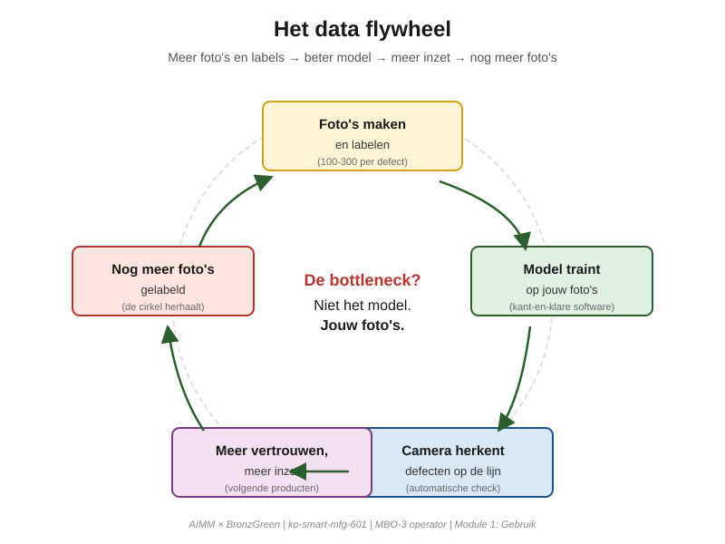

# Waarom werkt een AI-camerasysteem alleen zo goed als de foto's waarmee jij het traint?

Op steeds meer werkvloeren komen camera's met AI om kwaliteit te controleren. Leveranciers verkopen het als slimme techniek die "vanzelf leert". Dat klopt niet. Het systeem leert van foto's die JIJ moet labelen — en die foto's zijn het moeilijkste deel, niet het model.

## Wat leer je?

Je kunt aan een collega uitleggen waarom de gelabelde foto's de bottleneck zijn bij een camera-inspectiesysteem, met drie concrete argumenten: hoeveel foto's je nodig hebt, hoeveel tijd labelen kost, en waarom consistentie zo belangrijk is.

## Waarom de data het moeilijkste deel is

Een AI-camerasysteem leert herkennen wat een goed product is en wat een afkeur. Maar het leert dat niet uit zichzelf. Iemand moet het systeem vertellen: "deze foto is goed, deze foto is een kras, deze foto is een deuk." Dat heet **labelen**. Zonder gelabelde foto's kan het beste model niets.

### Hoeveel foto's heb je nodig?

Voor een werkbaar systeem heb je per soort defect ongeveer **100 tot 300 foto's** nodig. Dus:

- 1 soort defect (bijvoorbeeld krassen) -- 100 tot 300 foto's
- 3 soorten defecten (kras, deuk, doorbranding) -- 300 tot 900 foto's
- En altijd ook foto's van **goede** producten

Vaak kom je dus snel op 500 tot 1000 foto's voor één lijn.

### Hoeveel tijd kost dat?

Eén foto labelen lijkt snel. Maar als je het zorgvuldig doet — bekijken, beoordelen, soms tussen twee labels twijfelen, soms een streepje rond het defect tekenen — kost het **1 tot 3 minuten per foto**.

Reken even mee:

- 450 foto's × 2 minuten = **15 uur werk**
- Met strenge eisen aan precisie (bounding boxes, dubbele controles): **20 uur of meer**

Dat is een paar dagen werk voor één persoon. En die persoon moet **vakkennis** hebben. Anders weet hij niet wat een kras van een deuk is.

### Waarom consistentie zo belangrijk is

Stel: jij labelt op maandag honderd foto's. Je collega labelt op dinsdag honderd andere foto's. Als jullie verschillende woorden gebruiken — jij noemt iets een "kras", hij noemt het een "groef" — dan **leert het systeem twee dingen door elkaar**.

Het resultaat:

- Het systeem mist defecten omdat het ze niet herkent
- Of het slaat alarm bij goede producten omdat het te streng is
- Niemand vertrouwt het systeem nog

Eén persoon die slordig labelt op een vermoeide vrijdag kan een heel half jaar werk verpesten. Daarom is consistentie geen detail — het bepaalt of het systeem werkt.

De volgende keer dat een leverancier op de werkvloer komt met een AI-camerasysteem, kun je één vraag stellen: **"Welke foto's zijn gebruikt om dit systeem te trainen, en wie heeft die gelabeld?"** Als de leverancier dat niet weet, weet jij genoeg.

## Na deze sessie

Kies deze week één product op jouw eigen werkvloer waarbij een camera-inspectiesysteem interessant zou zijn. Schrijf op het actieplanblad: welk product, welke drie defecten je zelf kent, en hoeveel foto's je per defect nodig zou hebben (gebruik de regel: 100 tot 300 per soort). Vraag daarna aan één collega op je afdeling: "als ik foto's zou moeten maken van dit defect — waar moet ik op letten?" Schrijf zijn antwoord op in eigen woorden. Neem dit mee naar de volgende bijeenkomst.

---

## Werkbladen (Kolb-cyclus)

1. [`wb-01-storingsquiz.md`](./werkbladen/wb-01-storingsquiz.md) — Storingsquiz
2. [`wb-02-reflectie.md`](./werkbladen/wb-02-reflectie.md) — Reflectie
3. [`wb-03-theorie-handout.md`](./werkbladen/wb-03-theorie-handout.md) — Theorie handout
4. [`wb-04-actieplan.md`](./werkbladen/wb-04-actieplan.md) — Actieplan

## Verder

- Onderliggend kennisobject: [`ko-smart-mfg-601`](../../kennisbank/smart_manufacturing/computer_vision_kwaliteit/ko-smart-mfg-601.md)
- Voor de begeleider: [`trainer.md`](./trainer.md) + [`draaiboek.md`](./draaiboek.md)
