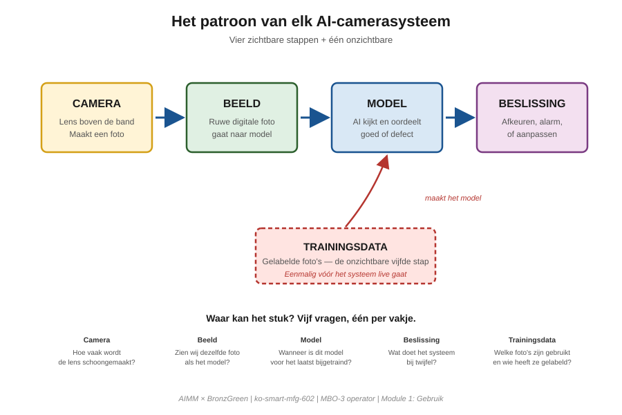

# Hoe bekijk je een AI-camerasysteem zodat je ziet waar het stuk kan — zonder technische achtergrond?

Op steeds meer werkvloeren staan camera's met AI om kwaliteit te controleren. Als operator ben jij vaak de eerste die merkt dat het systeem raar doet. Maar zonder model in je hoofd kun je alleen "het werkt niet" zeggen. Dit leerobject geeft je een eenvoudige tekening waarmee je precies kunt aanwijzen waar het probleem zit.

## Wat leer je?

Je kunt een AI-camerasysteem uitleggen in vier vakjes — camera, beeld, model, beslissing — en bij elk vakje één faalpunt benoemen. Daarmee weet je waar je moet kijken als het systeem vreemd doet.

## De vier vakjes (en het onzichtbare vijfde)

Elk AI-camerasysteem werkt volgens hetzelfde patroon. Vier zichtbare vakjes en één onzichtbaar vakje:

1. **Camera** -- maakt de foto van het product
2. **Beeld** -- de foto wordt klaargemaakt voor het systeem (uitsnijden, helderheid)
3. **Model** -- de AI bekijkt het beeld en geeft een score (bijvoorbeeld "85% zeker een goed product")
4. **Beslissing** -- de score wordt vergeleken met een drempel, en het systeem zegt "doorlaten" of "afkeuren"
5. **Trainingsdata** (onzichtbaar) -- de gelabelde foto's waarmee het model ooit heeft geleerd

Dit patroon verandert niet. De apparaten wel.

### Wat kan er per vakje stuk gaan?

Per vakje is er minstens één faalpunt dat je kunt herkennen op de werkvloer:

- **Camera** -- vuile lens, slechte belichting, camera staat scheef. Wordt vaak vergeten.
- **Beeld** -- de uitsnede klopt niet meer omdat het product net iets anders ligt
- **Model** -- het systeem is getraind op andere producten dan jullie nu maken
- **Beslissing** -- de drempel staat te streng of te soepel
- **Trainingsdata** -- de gebruikte foto's zijn oud, beperkt, of niet representatief voor jullie product

## Hoe gebruik je dit op de werkvloer?

Stel: vanmorgen keurt het systeem ineens drie keer zoveel goede producten af. Wat doe je?

Je loopt langs de vier vakjes, stelt per vakje één concrete vraag:

| Vakje | Vraag die je stelt |
|---|---|
| Camera | Is de lens schoon? Staat hij nog op zijn plek? |
| Beeld | Klopt de uitsnede met het product van vandaag? |
| Model | Is het model recent getraind op ons huidige product? |
| Beslissing | Is de drempel onlangs aangepast? |
| Trainingsdata | Wie heeft de foto's gelabeld, en wanneer? |

Kun je een vakje niet beantwoorden? Dan weet je meteen waar je moet kijken — of wie je moet vragen. Dat alleen al verandert je gesprek met onderhoud van "het doet raar" naar "ik denk dat het in vakje X zit".

### Welk vakje wordt het vaakst vergeten?

Op de werkvloer is het bijna altijd het camera-vakje. Vuile lens, een trillingenpiek, andere belichting in de winter — dingen die we niet meer zien omdat ze er altijd zijn. Begin daar.

## Na deze sessie

Loop deze week langs één AI-camerasysteem in jouw omgeving. Dat kan op de werkvloer zijn, of bij een bedrijf dat je bezoekt. Teken het vier-vakjes-patroon op een A4. Schrijf per vakje op: wat weet je er nu over, en wat niet. Stel daarna één vraag aan de beheerder of verantwoordelijke over een vakje waar je niets van weet. Neem je A4 mee naar de volgende bijeenkomst.

---

## Werkbladen (Kolb-cyclus)

1. [`wb-01-patroon-meetekenen.md`](./werkbladen/wb-01-patroon-meetekenen.md) — Patroon meetekenen
2. [`wb-02-case-diagnose.md`](./werkbladen/wb-02-case-diagnose.md) — Case diagnose
3. [`wb-03-reflectie-cases.md`](./werkbladen/wb-03-reflectie-cases.md) — Reflectie cases
4. [`wb-04-5-vragen-test.md`](./werkbladen/wb-04-5-vragen-test.md) — 5 vragen test

## Verder

- Onderliggend kennisobject: [`ko-smart-mfg-602`](../../kennisbank/smart_manufacturing/computer_vision_kwaliteit/ko-smart-mfg-602.md)
- Voor de begeleider: [`trainer.md`](./trainer.md) + [`draaiboek.md`](./draaiboek.md)
