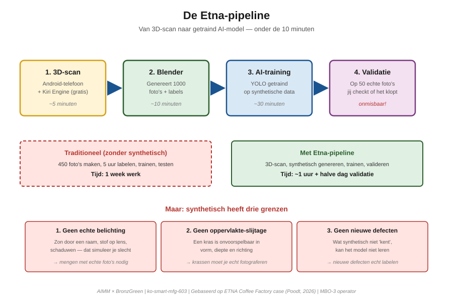

# Wanneer is synthetische data de juiste keuze, en wanneer niet?



In de vorige sessies heb je geleerd dat data labelen het zware werk is bij een AI-camerasysteem. 5 uur voor 450 foto's. En als de productie elke maand een nieuwe serie uitbrengt, moet je dat opnieuw doen. Voelt een beetje uitzichtloos. Maar er is een alternatief — en bedrijven gebruiken het al. Het heet synthetische data.


## Wat leer je?

Je kunt beslissen of synthetische data een geschikte aanpak is voor een gegeven AI-camerasysteem-situatie, en kunt die keuze uitleggen aan een teamleider.

## De Etna-truc

ETNA, een koffieapparatenfabrikant uit Etten-Leur, had een probleem. Voor hun nieuwe AI-inspectiesysteem hadden ze duizenden foto's nodig van PCB-onderdelen. Handmatig labelen zou maanden kosten. Wat deden ze?

In drie stappen:

1. **3D-scan** met een telefoon — één onderdeel, vijf minuten werk
2. **Blender** (een 3D-software) genereerde **1000 foto's met labels** vanuit dat 3D-model — automatisch
3. **YOLO** (een snel AI-herkenningsmodel) werd getraind in **10 minuten** op die 1000 foto's

Eindresultaat: **één week werk werd één uur werk.** En de inspectie werkte op de productielijn.

Dat is het belofte van synthetische data.

## Hoe het werkt

Een 3D-model van je product bestaat als digitaal bestand. Een softwarepakket zoals Blender kan dat 3D-model in elke gewenste hoek, belichting en oriëntatie laten zien — en daar foto's van maken. Met **labels** erbij, want het programma weet exact wat het toont.

```
1 onderdeel ──> 3D-scan ──> Blender ──> 1000 foto's
(echt)         (5 min)     (automatisch)  (gelabeld)
```

Het model krijgt zo voorbeelden van het onderdeel in honderden situaties — zonder dat iemand een foto hoeft te maken of te labelen.

## Maar — drie grenzen

Synthetische data is geen wondermiddel. Drie dingen waar het tekortschiet:

### 1. Belichting van de echte wereld

Een fluorescerende lamp op de werkvloer geeft een ander licht dan een gesimuleerde lamp in Blender. Een schaduw in de hal vrijdagmiddag bij ondergaande zon zit niet in je 3D-model. **Synthetische foto's lijken vaak iets te perfect.**

### 2. Oppervlakte-slijtage

Een nieuw onderdeel scannen is makkelijk. Maar krassen, deuken, kleurafwijkingen — die ontstaan door gebruik en zijn moeilijk te simuleren. **Voor cosmetische defecten werkt synthetisch slecht.**

### 3. Nieuwe defecten

Een 3D-model bevat alleen wat je hebt gescand. Verschijnt er een nieuw type defect dat de productieafdeling nooit eerder had? Het zit niet in je synthetische data — en het AI-model heeft het nooit gezien.

## Vier scenario's — past synthetisch hier?

| Scenario | Synthetisch? | Waarom |
|---|---|---|
| Nieuw koffieapparaat-model, 3 soorten connectoren herkennen | ✅ Ja | Voor de hand liggend — strakke 3D-vormen, nieuwe modellen |
| Inspectie op oppervlakte-krassen op metalen beugels | ❌ Nee | Krassen zijn onvoorspelbaar, slecht te simuleren |
| Nieuwe productielijn in opzet, nog geen product beschikbaar | ✅ Ja, mix | Synthetisch noodzakelijk; later aanvullen met echte foto's |
| Productserie die al 5 jaar loopt, veel historische foto's | ❌ Nee | Onnodig — gebruik bestaande echte data |

De laatste is verraderlijk. Synthetisch is **aantrekkelijk** omdat het snel en goedkoop is. Maar als je al echte data hebt, is het zonde om te kiezen voor een minder rijke synthetische set. Dan kies je voor gemak ten koste van kwaliteit.

## Validatie blijft nodig

Belangrijk: **een synthetisch getraind model moet altijd op echte foto's worden gevalideerd.** Anders weet je niet of het werkt op de werkvloer. ETNA testte hun model op een paar honderd echte foto's voordat ze het in productie zetten. Dat moet altijd.

Synthetisch versnelt de **opbouw** van je dataset. Maar je toetst altijd op echte foto's — anders weet je niet of het werkt op de werkvloer.

## Wat dit betekent voor jouw werkvloer

Twee vragen voor elke nieuwe AI-vraag in je bedrijf:

1. **Is dit 3D-scanbaar?** Strakke vorm, weinig variatie, geen oppervlakte-grilligheid → synthetisch kan
2. **Is er echte validatiedata beschikbaar?** Als nee, kun je nog niet eerlijk testen → eerst echte foto's verzamelen, ook als training synthetisch start

Wanneer je een AI-voorstel langs ziet komen waar de leverancier niet expliciet over synthetische data spreekt — dat is interessant. Vraag: *"Hebben jullie synthetische data overwogen voor de training? Waarom wel of niet?"* Het antwoord vertelt je hoeveel ze van de techniek weten.

## Het risico van te gretig kiezen

Bedrijven die te enthousiast op synthetisch springen lopen tegen hetzelfde probleem aan: het model werkt prachtig op de testfoto's en faalt op de productielijn. Reden: de testfoto's waren ook synthetisch. Pas in productie ontmoette het systeem echte belichting, echte slijtage, echte rotzooi op de werkvloer.

Dat verlies aan vertrouwen is moeilijk terug te winnen. **Liever twee weken extra in echte validatie investeren dan twee maanden uitleg achteraf.**

## Na deze sessie

Zoek binnen 2 weken één AI-kwaliteitscontrole-project in jouw eigen omgeving — bij jou, bij een bedrijf dat je kent, of in een nieuwsbericht. Stel deze vraag aan de verantwoordelijke: *"Hebben jullie overwogen om synthetische data te gebruiken? Waarom wel of niet?"* Schrijf het antwoord op in één alinea. Bekijk daarnaast een korte video over Blender (zoek op *"Blender in 5 minutes"* op YouTube). Je hoeft het niet te kunnen gebruiken — maar als je het hebt gezien, krijg je een concreter beeld bij wat "synthetische data maken" betekent.

---

## Werkbladen (Kolb-cyclus)

1. [`wb-01-etna-case-uitleg.md`](./werkbladen/wb-01-etna-case-uitleg.md) — Etna case uitleg
2. [`wb-02-beslis-scenarios.md`](./werkbladen/wb-02-beslis-scenarios.md) — Beslis scenarios
3. [`wb-03-actieplan-eigen-product.md`](./werkbladen/wb-03-actieplan-eigen-product.md) — Actieplan eigen product

## Verder

- Onderliggend kennisobject: [`ko-smart-mfg-603`](../../kennisbank/smart_manufacturing/computer_vision_kwaliteit/ko-smart-mfg-603.md)
- Voor de begeleider: [`trainer.md`](./trainer.md) + [`draaiboek.md`](./draaiboek.md)
