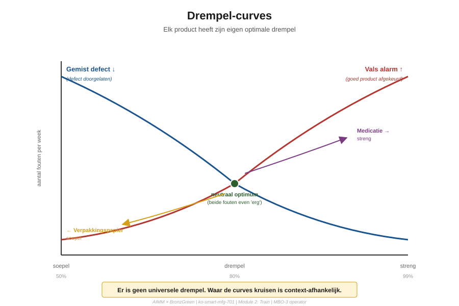

# Hoe kies je een drempel die klopt bij jullie product en jullie markt?

Elk AI-camerasysteem heeft een drempel. Onder de drempel keurt het systeem af, erboven laat het door. Meestal staat die drempel op de standaardwaarde van de leverancier — en niemand weet meer waarom. Na deze sessie kun jij dat veranderen.

## Wat leer je?

Je kunt een drempel kiezen voor een gegeven productsituatie en uitleggen welke gevolgen die keuze heeft voor het aantal vals alarm en het aantal gemist defect. Geen perfecte keuze — wel een doordachte.

## Het probleem met een vaste drempel

Het systeem geeft per foto een **confidence-score**: een getal tussen 0 en 100% dat zegt hoe zeker het is dat een product goed is. De drempel bepaalt waar je de grens trekt. Bijvoorbeeld: "alles onder 80% afkeuren".

Dat lijkt eenvoudig, maar er zit een ruil in. Hoe je de drempel zet, bepaalt twee soorten fouten:

1. **Vals alarm** -- het systeem keurt af, maar het product was eigenlijk goed. Je gooit goede producten weg.
2. **Gemist defect** -- het systeem laat door, maar het product was defect. Je levert kapotte producten aan de klant.

Streng zetten? Meer vals alarm, minder gemist defect. Soepel zetten? Andersom. **Er is geen drempel die beide oplost.**

### Een voorbeeld op een dataset van 50 producten

Stel je hebt 50 inspectieresultaten met confidence-scores. Je kiest een drempel van 80%:

- Het systeem keurt 12 producten af. Daarvan waren 4 eigenlijk goed → **4 vals alarm**.
- Het systeem laat 38 producten door. Daarvan waren 2 eigenlijk defect → **2 gemist defect**.

Zet je de drempel op 90% (strenger):

- Veel meer afkeuringen, dus meer vals alarm (zeg 9).
- Maar bijna geen defect glipt nog door (zeg 0).

Welke beter is? Dat hangt af van je product.

## De centrale vraag voor jouw product

Voor elke productlijn geldt dezelfde vraag. Wat is erger: een goed product weggooien, of een kapot product naar de klant sturen?

Het antwoord verschilt per product:

- **Medicijnverpakkingen** -- gemist defect kan iemand ziek maken. Strenge drempel.
- **Verpakkingspapier** -- gemist defect is hooguit een klacht. Soepele drempel mag.
- **Luxe artikelen** -- vals alarm kost geld (duur materiaal weggooien), gemist defect kost reputatie. Zoek de balans.

Je hoort zelf het beste op je werkvloer welke fout duurder is. Daar kies je je drempel op.

### De vuistregel

| Soort product | Drempel | Reden |
|---|---|---|
| Veiligheidskritisch (medisch, voeding, lucht- en ruimtevaart) | 90-95% | Gemist defect is duur of gevaarlijk |
| Standaard kwaliteitscontrole | 80-85% | Balans tussen klacht en weggooien |
| Massaproductie waar fouten goedkoop zijn | 70-75% | Liever doorlaten dan onnodig afkeuren |

Dit zijn richtlijnen, geen wetten. De juiste drempel voor jullie product hangt af van jullie kosten.

## Na deze sessie

Vraag deze week aan iemand in jullie organisatie — een teamleider, iemand van onderhoud of IT — wat de confidence-drempel is op jullie AI-inspectiesysteem. Vraag ook: **"Hoe is die waarde gekozen?"** Schrijf het antwoord op. Verwacht dat zeven van de tien zeggen "dat weet ik niet" of "die staat standaard". Dat is een waardevol antwoord — het laat zien waar jouw inbreng telt. Heeft jullie bedrijf geen AI-inspectie? Vraag het aan een collega uit een ander bedrijf, of zoek één case online. Neem je antwoord mee naar de volgende bijeenkomst.

---

## Werkbladen (Kolb-cyclus)

1. [`wb-01-drempel-simulatie.md`](./werkbladen/wb-01-drempel-simulatie.md) — Drempel simulatie
2. [`wb-02-drempel-curves.md`](./werkbladen/wb-02-drempel-curves.md) — Drempel curves

## Verder

- Onderliggend kennisobject: [`ko-smart-mfg-701`](../../kennisbank/smart_manufacturing/computer_vision_kwaliteit/ko-smart-mfg-701.md)
- Voor de begeleider: [`trainer.md`](./trainer.md) + [`draaiboek.md`](./draaiboek.md)
