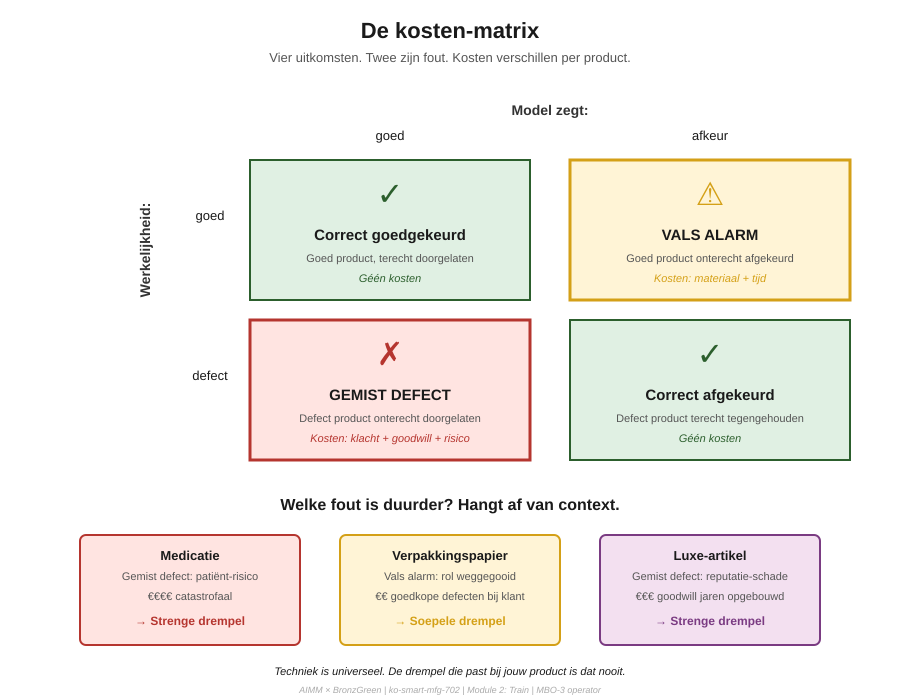

# Hoe vertaal je de drempelkeuze naar een concrete aanbeveling voor jouw werkvloer, met kosten erbij?

In de vorige sessie heb je geleerd hoe drempels werken op een geoefende dataset. Hier maak je het écht: jouw product, jouw cijfers, jouw aanbeveling. Als je straks naar je teamleider gaat met "voor ons product adviseer ik X% omdat fout type Y meer kost dan Z", dan ben je geen gebruiker meer van het systeem. Dan ben je gesprekspartner.

## Wat leer je?

Je kunt voor een product op je eigen werkvloer een kostenafweging maken tussen vals alarm en gemist defect, en op basis daarvan een onderbouwde drempel-aanbeveling formuleren voor je teamleider.

## De 2x2 matrix — vier mogelijke uitkomsten

Elk inspectieresultaat valt in één van vier vakjes:

| | **Werkelijkheid: goed** | **Werkelijkheid: defect** |
|---|---|---|
| **Model zegt: goed** | ✅ Terecht doorgelaten | ❌ Gemist defect |
| **Model zegt: afkeur** | ❌ Vals alarm | ✅ Terecht afgekeurd |

De twee vinkjes zijn waar je het systeem voor hebt. De twee kruisjes zijn de fouten waar het allemaal om draait. Daar zit het kostenverhaal.

## Wat kost een fout, écht?

Pak één voorbeeld: medicijnverpakkingen.

### Vals alarm (goed product, ten onrechte afgekeurd)

- Materiaalkosten -- weggegooid product
- Inspecteur-tijd -- handmatige hercontrole
- Ompak-kosten -- soms moet de hele charge opnieuw

Schatting: **5 tot 15 euro per vals alarm.**

### Gemist defect (defect product, ten onrechte doorgelaten)

- Recall-kosten -- soms moet de hele charge worden teruggehaald
- Klacht-afhandeling -- klantenservice, juridisch, vergoeding
- Reputatieschade -- moeilijk in geld uit te drukken, maar kan miljoenen kosten
- Bij medicatie: gezondheidsrisico voor de klant

Schatting: **honderden tot tienduizenden euro's per gemist defect, soms meer.**

Voor medicijnen is gemist defect dus minstens duizend keer zo duur als vals alarm. **Drempel moet streng.**

### Vergelijk dat eens met verpakkingspapier

- Vals alarm: paar cent papier weggooien
- Gemist defect: hooguit een klacht over een vlek

Hier zit factor 2 of 3 verschil — vals alarm en gemist defect kosten ongeveer hetzelfde. **Drempel mag soepel.**

## Een aanbeveling formuleren

Twee getallen heb je nodig: wat kost een vals alarm, en wat kost een gemist defect? Als je die weet, kun je dit schrijven:

> *"Voor ons product adviseer ik een drempel van X%, omdat een vals alarm ons ongeveer Y euro kost en een gemist defect ongeveer Z euro. Bij die verhouding past een drempel die liever afkeurt dan doorlaat / liever doorlaat dan afkeurt."*

Je hoeft de cijfers niet exact te weten. Een **schatting** is genoeg. Vergeleken met de standaardwaarde van de leverancier (die niets weet over jullie product) is jouw schatting altijd beter.

### Wat doe je als je de cijfers niet weet?

Vraag het. Een teamleider, iemand van finance, of iemand van klachten-afhandeling weet meestal grof:

- Hoeveel klachten per maand kosten gemiddeld hoeveel?
- Wat is de materiaalprijs per stuk?
- Hoeveel tijd kost een hercontrole?

Drie korte gesprekken op de werkvloer geven je een beter onderbouwde drempel dan welke leverancier dan ook kan leveren.

## Na deze sessie

Ga in de komende twee weken met je drempel-aanbeveling naar je teamleider. Het doel is **niet** om de aanbeveling meteen door te voeren. Het doel is een gesprek aangaan. Vraag: *"Wat vind je van deze schatting? Waar zit ik ernaast?"* Schrijf op welke aspecten je teamleider toevoegt of corrigeert. Lees deze week ook één case van een bedrijf in jullie sector dat AI-kwaliteitscontrole heeft ingevoerd. Kijk: noemen ze een drempel? Of verbergen ze die? Neem allebei mee naar de volgende bijeenkomst.

---

## Werkbladen (Kolb-cyclus)

1. [`wb-01-kosten-matrix.md`](./werkbladen/wb-01-kosten-matrix.md) — Kosten matrix
2. [`wb-02-eigen-product-matrix.md`](./werkbladen/wb-02-eigen-product-matrix.md) — Eigen product matrix

## Verder

- Onderliggend kennisobject: [`ko-smart-mfg-702`](../../kennisbank/smart_manufacturing/computer_vision_kwaliteit/ko-smart-mfg-702.md)
- Voor de begeleider: [`trainer.md`](./trainer.md) + [`draaiboek.md`](./draaiboek.md)
