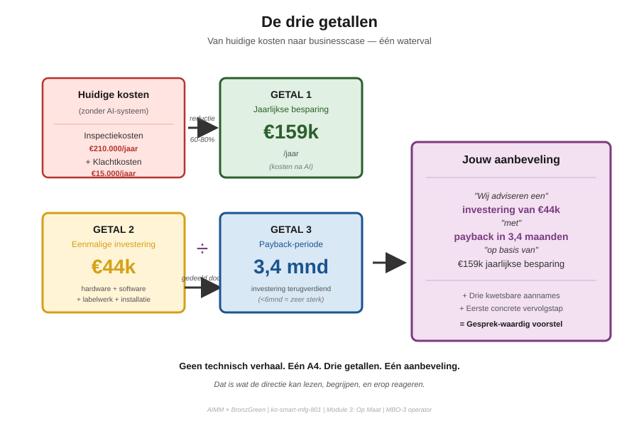

# Hoe vertaal je drie modules aan AI-kennis naar een businesscase voor jouw werkvloer?

In Module 2 heb je een drempel-aanbeveling gemaakt. Je teamleider kon daar iets mee. Maar een drempel alleen is geen businesscase. De directie wil getallen zien — investering, besparing, terugverdientijd. Hier wordt techniek beleid. En jij bent de persoon met de beste cijfers — niet de leverancier, niet de IT-afdeling. Jij.

## Wat leer je?

Je kunt een concrete businesscase voor AI-kwaliteitscontrole op je eigen werkvloer presenteren met drie kerngetallen — jaarlijkse besparing, eenmalige investering, terugverdientijd — en een realistische onzekerheidsmarge.

## De drie kerngetallen

Een businesscase die directie kan beoordelen heeft drie getallen. Niet meer, niet minder.

### 1. Jaarlijkse besparing

Wat levert het AI-systeem per jaar op? Tel alle voordelen op:

- Minder klachten -- aantal × gemiddelde kosten per klacht
- Minder afkeur -- minder materiaal en arbeid weggegooid
- Minder inspecteur-tijd -- handmatige controles vervallen of worden korter
- Minder stilstand -- problemen worden eerder gezien

Realistisch voor een productielijn in de maak- of voedselverwerkingsindustrie: **€50.000 tot €300.000 per jaar.** Zit je daarboven? Top, maar onderbouw extra goed. Zit je daaronder? Misschien is de case te klein om te dragen.

### 2. Eenmalige investering

Wat kost het systeem om op te zetten? Tel alle eenmalige kosten op:

- Hardware -- camera's, computers, kabels, schermen
- Software -- licenties, installatie, configuratie
- Foto's labelen -- 100 tot 300 foto's per defectsoort × 1 tot 3 minuten per foto × uurloon
- Opleiding -- jouw team moet het systeem leren gebruiken
- Pilotperiode -- waarschijnlijk een paar maanden testen voor je live gaat

Realistisch: **€20.000 tot €80.000.** Soms meer voor complexe lijnen.

### 3. Terugverdientijd (payback)

De simpele rekensom: investering gedeeld door jaarlijkse besparing.

Voorbeeld: €40.000 investering, €120.000 jaarlijkse besparing → payback = 4 maanden.

| Payback | Reactie van directie |
|---|---|
| Onder 12 maanden | "Waarom doen we dit nog niet?" |
| 12 tot 24 maanden | "Vertel me meer." |
| 2 tot 3 jaar | "Nuttig, maar overtuig me." |
| Boven 3 jaar | "Twee dingen kunnen waar zijn: óf de case is zwak, óf je rekent verkeerd." |

## Hoe je het opschrijft

Eén bladzijde, drie blokken. Hieronder een werkend voorbeeld voor een productielijn voor metalen onderdelen:

> **Kernaanbeveling:** Wij adviseren een investering van €45.000 in AI-kwaliteitscontrole, met een verwachte terugverdientijd van 7 maanden.
>
> **Onderbouwing:**
> - Jaarlijkse besparing: €78.000 (gebaseerd op 24 klachten per jaar à €2.500 + 8 uur per week aan handmatige inspectie à €45/uur)
> - Eenmalige investering: €45.000 (€25.000 hardware + €12.000 software + €8.000 labeling/training)
> - Payback: 7 maanden
>
> **Aannames die onder druk staan:**
> 1. We gaan ervan uit dat het AI-systeem 80% van de huidige klachten voorkomt — dat moet de pilot bevestigen.
> 2. We schatten het labelen op 100 uur — kan oplopen tot 200 als het defect-spectrum breder is dan we denken.
> 3. We rekenen niet met productiviteits-verlies tijdens pilotperiode — daar moet 1 tot 2 maanden lichte ruis voor worden gereserveerd.

Drie aannames waarvan je weet dat ze kwetsbaar zijn. Dit is geen zwakte — dit is wat directie van een goede case verwacht.

### Wat als je niet alle cijfers hebt?

Schat. Eerlijk. **"Op basis van mijn ervaring schat ik..."** is een sterkere zin dan een verzonnen exact getal. Eerlijk over onzekerheid is beter dan vals precies.

## Na deze sessie

Je kunt je businesscase de komende twee weken delen met je teamleider of afdelingshoofd. Het doel is **niet** dat hij/zij meteen ja zegt. Het doel is feedback. Schrijf op: welke getallen werden geaccepteerd, welke werden bijgesteld, welke werden afgewezen? Welke volgende stap stelt hij/zij voor? Als je directie ervoor openstaat: vraag of je 10 minuten in een management-overleg krijgt om de case kort te presenteren. Daar heb je je AIMM-modules voor gevolgd. Neem de feedback mee naar de volgende bijeenkomst.

---

## Werkbladen (Kolb-cyclus)

1. [`wb-01-businesscase-template.md`](./werkbladen/wb-01-businesscase-template.md) — Businesscase template
2. [`wb-02-directieblad.md`](./werkbladen/wb-02-directieblad.md) — Directieblad

## Verder

- Onderliggend kennisobject: [`ko-smart-mfg-801`](../../kennisbank/smart_manufacturing/computer_vision_kwaliteit/ko-smart-mfg-801.md)
- Voor de begeleider: [`trainer.md`](./trainer.md) + [`draaiboek.md`](./draaiboek.md)
