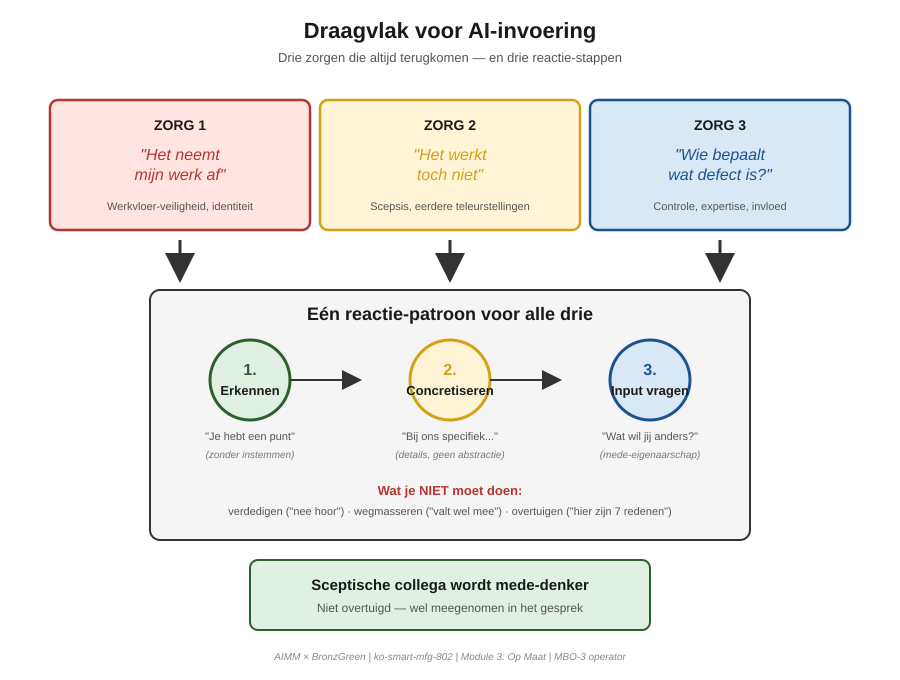

# Hoe maak je van jouw businesscase een gedragen voorstel?

Je businesscase is niets waard als niemand het steunt. Op elke werkvloer komen dezelfde drie zorgen terug als je over AI begint: "neemt het werk af", "werkt toch niet", "wie bepaalt wat defect is". Deze sessie leert je hoe je die zorgen herkent, erop reageert zonder in defensie te gaan, en mensen meekrijgt — niet door gelijk te krijgen, maar door ruimte te maken voor wat hen bezighoudt.

## Wat leer je?

Je kunt in een gesprek omgaan met de drie standaardzorgen rond AI op de werkvloer, zodanig dat de sceptische collega bereid is jouw voorstel mee te wegen. Geen overtuigen — wel ruimte maken.

## De drie zorgen die altijd terugkomen

In elk gesprek over AI op de werkvloer hoor je dezelfde drie zinnen:

### 1. "Het neemt ons werk af"

De zorg achter de woorden: baanzekerheid, identiteit, verlies van vakmanschap. Niet alleen het loon — ook het gevoel dat je iets kunt waar anderen je voor vragen.

**Wat niet werkt:** "Nee hoor, dat doet het niet" of "Dat zien we wel". Wegmasseren bevestigt de zorg.

**Wat wel werkt:**
- **Erken** -- "Dat snap ik. Ik heb daar zelf ook over nagedacht."
- **Concretiseer** -- "In onze case neemt de AI 8 uur handmatige inspectie per week over. Dat is bijna een halve werkdag. Wat ik me afvraag: wat zou er met die uren gebeuren?"
- **Vraag input** -- "Wat zou jij ermee willen doen?"

Je verandert het gesprek van "dreiging" naar "ruimte". Vaak komen er dan andere zorgen onderuit — meer tijd voor onderhoud, of voor begeleiden van nieuwe collega's.

### 2. "Het werkt toch niet"

De zorg achter de woorden: eerdere ervaringen met IT-projecten die mislukten. Vermoeidheid, cynisme, gebrek aan vertrouwen.

**Wat niet werkt:** Beloven dat dit anders is. De ander heeft je woord nog niet verdiend.

**Wat wel werkt:**
- **Erken** -- "Ik snap waar dat vandaan komt. We hebben hier eerder dingen gehad die niet werkten."
- **Concretiseer** -- "Wat ik anders wil doen is een pilot van twee maanden voordat we live gaan. Als de pilot mislukt, gaat het niet door."
- **Vraag input** -- "Wat zou voor jou een teken zijn dat de pilot wél werkt?"

Je laat zien dat jij ook twijfelt — en dat de twijfel ingebouwd is in het plan. Dat is iets anders dan een verkooppraatje.

### 3. "Wie bepaalt wat defect is?"

De zorg achter de woorden: vakmanschap. De kennis over wat een goed product is zit in de hoofden van ervaren collega's. Een AI-systeem dat dat overneemt voelt alsof iemand jouw oordeel afpakt.

**Wat niet werkt:** "De AI leert het wel". Dat ontkent dat het oordeel ergens vandaan komt.

**Wat wel werkt:**
- **Erken** -- "Dat is precies de goede vraag. Iemand bepaalt het, ja."
- **Concretiseer** -- "In onze case bepaalt het labelteam wat defect is. Dat is geen abstract systeem — dat zijn collega's met 15 jaar ervaring die 200 foto's gaan beoordelen."
- **Vraag input** -- "Wie zou jij willen dat in dat labelteam zit?"

Je maakt zichtbaar dat het vakmanschap niet verdwijnt. Het krijgt een andere vorm.

## Het patroon achter de drie reacties

Alle drie reacties hebben dezelfde structuur:

1. **Erken** -- laat zien dat je de zorg snapt en geen weerstand op zet
2. **Concretiseer** -- vervang de abstracte angst door een specifiek getal of voorbeeld
3. **Vraag input** -- maak van de criticus een mede-ontwerper

Dit is geen trucje. Het werkt alleen als je het meent. Sceptici voelen onoprechtheid binnen drie seconden.

### Wat als iemand alle drie tegelijk inbrengt?

Pak er één per keer. Vraag: "Welke van die drie zit jou het meest dwars?" Begin daar.

## Na deze sessie

Voer in de komende drie weken minimaal één gesprek met een sceptische collega in jullie team — iemand die twijfels heeft geuit over AI-invoering. Probeer de drie-zorgen-aanpak in praktijk: erken, concretiseer, vraag input. Schrijf na het gesprek op: wat werkte? Wat niet? Welke zorg zat er onder? Heb je geen sceptische collega in je directe team? Zoek in je netwerk iemand die eerder een AI-project heeft meegemaakt dat mislukte. Vraag: wat was de **sociale** oorzaak, los van de techniek? Neem je notities mee — ze zijn input voor de eindtoets van Module 3.

---

## Werkbladen (Kolb-cyclus)

1. [`wb-01-drie-zorgen.md`](./werkbladen/wb-01-drie-zorgen.md) — Drie zorgen
2. [`wb-02-rollenspel-notities.md`](./werkbladen/wb-02-rollenspel-notities.md) — Rollenspel notities
3. [`wb-03-drie-stappen.md`](./werkbladen/wb-03-drie-stappen.md) — Drie stappen

## Verder

- Onderliggend kennisobject: [`ko-smart-mfg-802`](../../kennisbank/smart_manufacturing/computer_vision_kwaliteit/ko-smart-mfg-802.md)
- Voor de begeleider: [`trainer.md`](./trainer.md) + [`draaiboek.md`](./draaiboek.md)
